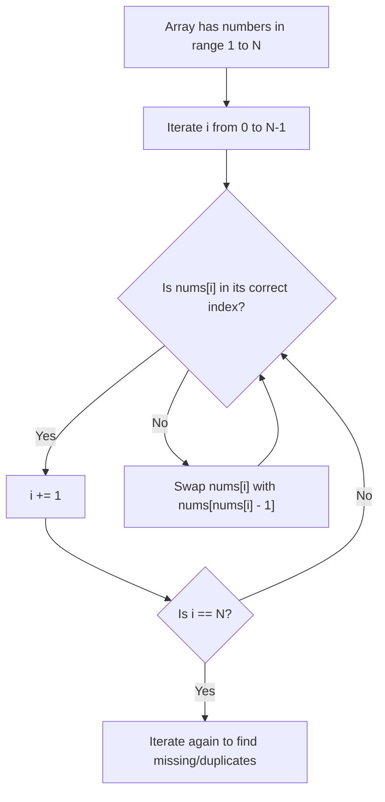
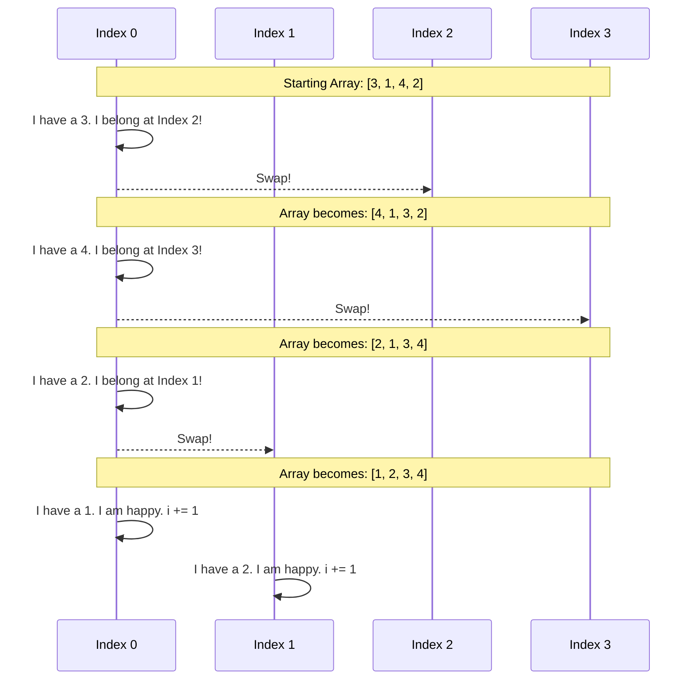

# Pattern 06: Cyclic Sort

## 👶 Explain Like I'm 5
Imagine you are a teacher and you have 5 students. Their ID numbers are exactly 
1, 2, 3, 4, and 5. 
They are sitting in 5 chairs, but they are all jumbled up! 
Student #4 is sitting in Chair #1, Student #2 is in Chair #5, etc.
You want them sorted. You COULD make them all stand up, compare heights or IDs 
(which takes a long time, like regular sorting).
OR, you can use a magic trick:
You walk up to Chair #1 and see Student #4 sitting there. You say, "Hey! You 
belong in Chair #4!" 
You make Student #4 swap seats with whoever is currently in Chair #4.
You keep doing this until the person in Chair #1 is actually Student #1. Then 
you move to Chair #2 and do the same thing!
Because every single swap puts at least ONE student in their forever-correct seat, 
you only ever have to do exactly 5 swaps! It's incredibly fast.

---

## 🧩 Core Idea & Pattern Detection

The **Cyclic Sort** pattern is the absolute best way to solve problems involving arrays containing numbers in a given range (e.g., `1` to `N` or `0` to `N`).

### When to use it:
- The problem explicitly mentions an array of numbers in the range `1` to `N` (or `0` to `N`).
- You are asked to find missing, duplicate, or smallest numbers in an array.
- You are required to solve the problem in **O(N)** time and **O(1)** space. (This is the biggest giveaway!)

---

## 🔧 Algorithmic Anatomy

### Recipe: Standard Cyclic Sort
1. Iterate through the array with a `while` loop and an index pointer `i = 0`.
2. Determine the "correct" index for the current number. 
   - If numbers are `1` to `N`, the correct index is `j = nums[i] - 1`.
   - If numbers are `0` to `N`, the correct index is `j = nums[i]`.
3. If `nums[i]` is within the valid bounds AND `nums[i] != nums[j]`:
   - **Swap** `nums[i]` and `nums[j]`.
   - Do **NOT** increment `i`. We need to re-evaluate the new number that just landed at index `i`!
4. If it IS at the correct index (or it's an out-of-bounds number we don't care about):
   - Increment `i += 1`.
5. After the array is sorted, do a **second pass** (a simple `for` loop). Any index `i` where `nums[i] != i + 1` points to the missing/duplicate number!

---

## 🛑 Per-Variant DOs and DON'Ts

| Variant | DO | DON'T |
|---------|----|-------|
| **Base Pattern** | **DO** use a `while i < len(nums)` loop. You only increment `i` when the current index holds the correct number. | **DON'T** use a `for` loop to sort. A `for` loop forces `i` to increment on every step, even if the newly swapped number is in the wrong spot! |
| **Out-of-bounds numbers** | **DO** add a check `if 0 < nums[i] <= len(nums)` before swapping. Ignore numbers that don't belong in the range. | **DON'T** let Python throw an `IndexError`. Always validate `j`. |
| **Duplicates** | **DO** realize that if you try to swap `nums[i]` to `j`, but `nums[j]` ALREADY equals `nums[i]`, you've found a duplicate! | **DON'T** get stuck in an infinite swapping loop of identical numbers. The swap condition must be `nums[i] != nums[j]`. |

---

## ⏱️ Complexity Analysis

| Aspect | Complexity | Why |
|--------|-----------|-----|
| **Time** | **O(N)** | Although there is a `while` loop that doesn't always increment `i`, every single swap places at least one number in its correct, final position. Thus, at most `N-1` swaps occur across the entire traversal. |
| **Space** | **O(1)** | All sorting and swapping is done completely in-place. |

---

## ⚠️ Common Pitfalls

1. **Infinite Swapping Loop:** If your swap condition is just `nums[i] != i + 1`, and the array contains duplicates (e.g., `[1, 1]`), you will try to swap the `1` at index 0 with the `1` at index 0 forever. The condition MUST compare values: `nums[i] != nums[nums[i] - 1]`.
2. **0-indexed vs 1-indexed:** Be extremely careful about whether the problem guarantees numbers from `0 to N` or `1 to N`.
   - If `1 to N`: `j = nums[i] - 1`. The second pass checks `nums[i] != i + 1`.
   - If `0 to N`: `j = nums[i]`. The second pass checks `nums[i] != i`.

---

## ✅ Problems in This Pattern

| # | Problem | Difficulty | Key Twist |
|---|---------|------------|-----------|
| 1 | Cyclic Sort | Easy | The foundational algorithm |
| 2 | Find the Missing Number | Easy | Array is `0` to `N`, find the one missing |
| 3 | Find all Missing Numbers | Easy | Array has duplicates, find all missing indices |
| 4 | Find the Duplicate Number | Easy | Array is `1` to `N`, find the duplicate without extra space |
| 5 | Find all Duplicate Numbers | Easy | Similar to 3, but collect the numbers that are in the wrong spots |
| 6 | Find the Corrupt Pair | Easy | Find one missing AND one duplicate simultaneously |
| 7 | Smallest Missing Positive Number | Medium | Array has negatives and >N. Ignore them and sort `1` to `N` |
| 8 | First K Missing Positive Numbers | Hard | Maintain tracking array/set for numbers outside bounds |
