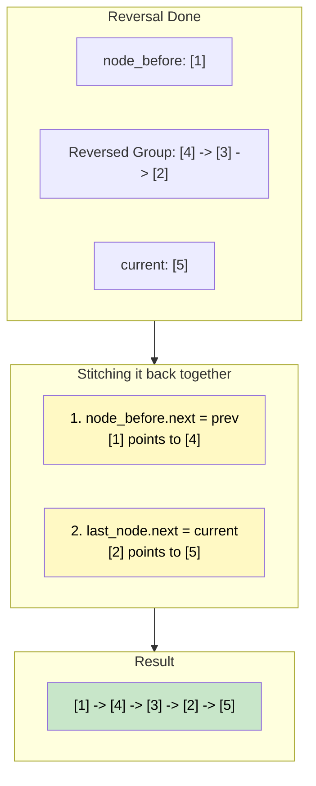

# 🚶‍♂️ Walkthrough: Reverse a Sub-list

## 👶 Explain Like I'm 5
You have a line of friends holding hands. This time, you don't want everyone to turn around. You only want the friends from position $P$ to position $Q$ to turn around!

If the line is: **Alice $\rightarrow$ Bob $\rightarrow$ Charlie $\rightarrow$ Dave $\rightarrow$ Eve**
And you want to reverse from position 2 (Bob) to position 4 (Dave):
First, you walk up to Alice. Alice is the "friend right before the flip".
You ask Alice to wait for a second and let go of Bob.
Then, you take the group (Bob, Charlie, Dave) and use the standard reversal trick we learned to flip them around: **Dave $\rightarrow$ Charlie $\rightarrow$ Bob**.
Now, you have a flipped group, but they are detached from the main line!
You just need to reconnect them:
1. Alice needs to hold the hand of the new front of the group (Dave).
2. The new back of the group (Bob) needs to reach out and hold Eve's hand.
Boom! The line is back together, with just the middle part reversed!

## 🎯 Core Strategy
This builds perfectly upon the standard In-place Reversal pattern. We just need to carefully keep track of the boundaries so we can stitch the list back together.

1. **Skip**: Fast-forward your `current` and `prev` pointers by skipping exactly `p - 1` nodes. 
   - After skipping, `prev` will sit right before the sublist (`node_before_sublist`).
   - `current` will sit on the very first node of the sublist. Once reversed, this specific node will end up at the very back of the group! So we also memorize it as `last_node_of_sublist`.
2. **Reverse**: We want to reverse exactly from $P$ to $Q$, which means we perform exactly `q - p + 1` reversals. We run our standard 4-step reversal loop exactly that many times.
3. **Reconnect**: 
   - **Front Edge**: If `node_before_sublist` exists (which means $P > 1$), we point its `.next` to `prev` (because `prev` is now the new head of the reversed group). If it does NOT exist (because $P = 1$), the reversal happened at the very beginning of the list, so `prev` becomes the new global `head`!
   - **Back Edge**: The `last_node_of_sublist` reaches out and sets its `.next` to `current` (who is patiently waiting as the first un-reversed node after $Q$).
4. Return the global `head`.

## 🏃‍♂️ Step-by-Step Execution (Dry Run)
**Example Input**: `1 -> 2 -> 3 -> 4 -> 5`, $P = 2$, $Q = 4$.

### Phase 1: Skip
We loop `p - 1` (1) times.
- `prev = 1`, `current = 2`.
- `node_before_sublist = 1`.
- `last_node_of_sublist = 2`.

### Phase 2: Reverse Sublist
We loop `q - p + 1` (3) times.

| Loop | `current` | Save `next_node` | Reverse (`current.next = prev`) | Advance `prev` | Advance `current` |
|------|-----------|------------------|---------------------------------|----------------|-------------------|
| 1 | `2` | `3` | `2.next = 1` | `prev = 2` | `current = 3` |
| 2 | `3` | `4` | `3.next = 2` | `prev = 3` | `current = 4` |
| 3 | `4` | `5` | `4.next = 3` | `prev = 4` | `current = 5` |

After loop: `prev = 4` (new front of group). `current = 5` (waiting after group).

### Phase 3: Reconnect
- **Front Edge**: `node_before_sublist (1).next = prev (4)`. (1 now points to 4).
- **Back Edge**: `last_node_of_sublist (2).next = current (5)`. (2 now points to 5).

Result: `1 -> 4 -> 3 -> 2 -> 5`.

## 📊 Visual Diagram
Here is a visualization of the reconnection phase:

## 🛑 Edge Cases & Complexity

### Complexity
- **Time Complexity:** $O(N)$. We skip nodes until we reach $P$, then reverse nodes until we reach $Q$. We visit nodes at most once, running strictly in $O(N)$ time.
- **Space Complexity:** $O(1)$. All sorting is done in-place using just a few pointers.

### Edge Cases Handled Safely
- **$P = 1$:** `node_before_sublist` will be `None`. The `if node_before_sublist is not None:` check will fail, and it will execute the `else: head = prev` branch, correctly updating the global head of the linked list.
- **$P = Q$:** The initial check `if p == q:` instantly returns `head`, doing 0 work.
