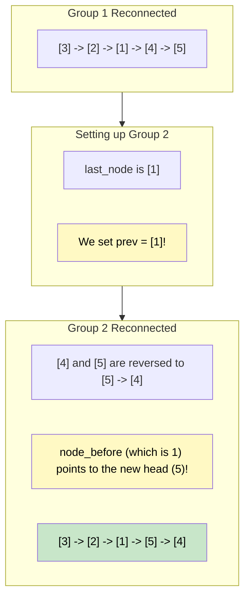

# 🚶‍♂️ Walkthrough: Reverse every K-element Sub-list

## 👶 Explain Like I'm 5
You still have a line of friends holding hands. This time, you want them to turn around in groups of $K$. 
If $K=3$, you count 1, 2, 3 friends, and ask those 3 to flip around.
Then you step over to the next group, count 1, 2, 3 friends, and ask *them* to flip around.
You keep doing this until you reach the end of the line.

If you get to the very end of the line and there are only 2 friends left (which is less than $K$), you just flip those last 2 friends anyway.
We can solve this by taking our "Reverse a Sub-list" magic trick and simply putting it inside a giant loop that keeps running until everyone in the line is done!

## 🎯 Core Strategy
This is an iterative application of the "Reverse a Sub-list" logic. Instead of jumping to position $P$ and stopping after position $Q$, we just start at the head and run the reversal block $K$ times, repeatedly, until `current is None`.

1. Initialize `current = head`, `prev = None`.
2. Loop `while current is not None`:
   - **Memorize Borders**: 
     - `node_before_sublist = prev` (The node sitting right before this current $K$-group).
     - `last_node_of_sublist = current` (The node we are currently on, which will end up at the back of this group after it gets reversed).
   - **Reverse**: Run the standard 4-step reversal logic inside an inner `while` loop that stops when it hits $K$ iterations, or when `current` runs out early.
   - **Reconnect Borders**:
     - Front edge: `node_before_sublist.next = prev` (or update the global `head` to `prev` if this was the very first group).
     - Back edge: `last_node_of_sublist.next = current`.
   - **Prepare for Next Group**: 
     - Set `prev = last_node_of_sublist`. **This is the most crucial step!** The tail of the group we just reversed will act exactly as the "node before" for the *next* group!
3. Return `head`.

## 🏃‍♂️ Step-by-Step Execution (Dry Run)
**Example Input**: `1 -> 2 -> 3 -> 4 -> 5`, $K = 3$.
Initialization: `current = 1`, `prev = null`.

### Group 1 (Nodes 1, 2, 3)
- Memorize: `node_before = null`, `last_node = 1`.
- Reverse 3 nodes. `current` moves to `4`, `prev` moves to `3`.
- Reconnect:
  - `node_before` is `null`, so `head = prev` (`head = 3`).
  - `last_node (1).next = current (4)`.
- List is now `3 -> 2 -> 1 -> 4 -> 5`.
- Prepare next: `prev = last_node` (`prev = 1`).

### Group 2 (Nodes 4, 5)
- Memorize: `node_before = 1`, `last_node = 4`.
- Reverse remaining 2 nodes. `current` runs out (`null`), `prev` moves to `5`.
- Reconnect:
  - `node_before (1).next = prev (5)`. (1 now points to 5).
  - `last_node (4).next = current (null)`. (4 points to null).
- List is now `3 -> 2 -> 1 -> 5 -> 4 -> null`.
- Prepare next: `prev = 4`.

Outer loop terminates because `current` is `null`.

Result: `3 -> 2 -> 1 -> 5 -> 4 -> null`.

## 📊 Visual Diagram
Here is how `prev` dynamically shifts to become the new anchor between groups:

## 🛑 Edge Cases & Complexity

### Complexity
- **Time Complexity:** $O(N)$. We visit and reverse every node exactly once.
- **Space Complexity:** $O(1)$. All reversal and stitching is done in-place with a few pointers.

### Edge Cases Handled Safely
- **Leftover elements < $K$:** Handled perfectly. The inner loop `while current is not None and i < k:` will gracefully stop early when `current` hits `None`. It reverses what it can and reconnects it normally.
- **$K = 1$:** Handled as a fast-path at the very beginning: `if k <= 1 or not head: return head`. Reversing groups of 1 means doing nothing at all.
