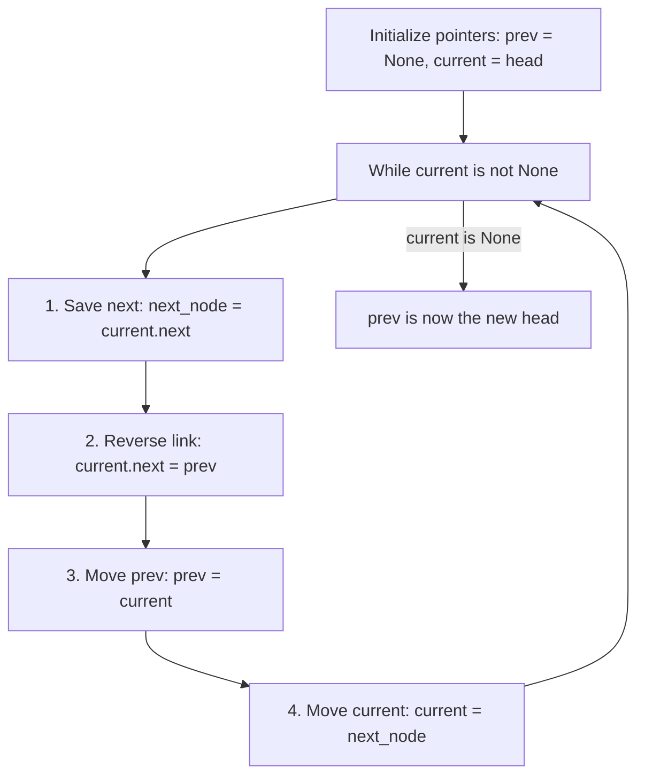
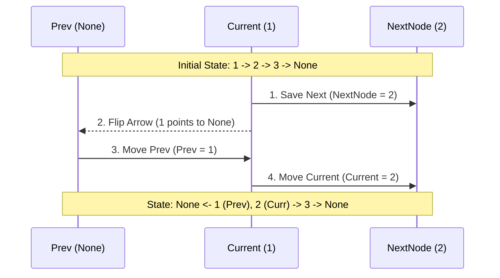

# Pattern 07: In-place Reversal of a LinkedList

## 👶 Explain Like I'm 5
Imagine you have a line of friends holding hands, all facing the same direction. 
Friend 1 is holding Friend 2's hand, Friend 2 is holding Friend 3's hand, etc.
You want them to turn around so Friend 3 holds Friend 2's hand, and Friend 2 holds 
Friend 1's hand!
But here's the catch: You can't ask them to let go of everyone all at once, or 
they will get lost and wander away. You can only tell ONE friend to change hands 
at a time.
To do this safely, you need three pieces of information at any given moment:
1. Who did I just finish talking to? (`previous`)
2. Who am I talking to right now? (`current`)
3. Who is next in line? (`next`)

You tell `current`: "Let go of `next` and grab `previous` instead!"
Then you step sideways. The person you just talked to becomes the new `previous`, 
and the `next` person in line becomes your new `current`. You do this until 
everyone is facing backward!

---

## 🧩 Core Idea & Pattern Detection

The **In-place Reversal** pattern describes an efficient way to reverse the links between nodes of a LinkedList without using any extra memory (like putting them in an array and building a new list).

### When to use it:
- You need to reverse a LinkedList, or a sub-portion of it.
- You need to rotate a LinkedList.
- You need to reverse segments of a LinkedList (like reversing every K elements).
- The problem explicitly asks for **O(1)** extra space.

---

## 🔧 Algorithmic Anatomy

### Recipe: Standard Reversal
The standard reversal uses exactly three pointers inside a loop.

1. `prev = None` (The new tail will point to None)
2. `current = head` (The starting node)
3. `while current is not None:`
   - `next_node = current.next` (Temporarily save the rest of the list so we don't lose it)
   - `current.next = prev` (Flip the arrow to point backward)
   - `prev = current` (Move the `prev` pointer one step forward)
   - `current = next_node` (Move the `current` pointer one step forward)
4. Return `prev` (Because `current` is `None`, `prev` is sitting on the very last node, which is now the new head!)

---

## 🛑 Per-Variant DOs and DON'Ts

| Variant | DO | DON'T |
|---------|----|-------|
| **Standard Reversal** | **DO** memorize the 4-step variable swapping block exactly. It is the foundation of all other variants. | **DON'T** try to do it with only two variables. If you don't save `next_node` before breaking the link, you lose the rest of the list forever! |
| **Sub-list Reversal** | **DO** save pointers to the nodes *immediately before* and *immediately after* the reversed sub-list, so you can reconnect them when finished. | **DON'T** forget that the head of the reversed portion becomes the tail, and the tail becomes the head! |
| **K-Group Reversal** | **DO** write a helper function for reversing a specific portion to keep your main logic clean. | **DON'T** reverse a chunk if there are less than `K` nodes left, UNLESS the problem explicitly asks you to (pay close attention to the instructions!). |

---

## ⏱️ Complexity Analysis

| Aspect | Complexity | Why |
|--------|-----------|-----|
| **Time** | **O(N)** | We traverse the list exactly once (or twice in sub-list problems to find the starting node). |
| **Space** | **O(1)** | We only ever use a handful of pointer variables (`prev`, `current`, `next_node`), regardless of how massive the LinkedList is. |

---

## ⚠️ Common Pitfalls

1. **Losing the Head:** When reconnecting a reversed sub-list, what if the sub-list started at the very first node? You won't have a `node_before_sublist` to reconnect to! You must update the global `head` instead.
2. **Infinite Loops (Cycles):** If you don't correctly set the tail's `.next` to `None` (or to the rest of the list), you can accidentally create a cycle where nodes point to each other in a circle.
3. **Off-by-One Errors:** Counting steps to reach the `p`-th node is tricky. If you start at 1, you do a `for` loop `p-1` times to reach the `p`-th node. Test this manually!

---

## ✅ Problems in This Pattern

| # | Problem | Difficulty | Key Twist |
|---|---------|------------|-----------|
| 1 | Reverse a LinkedList | Easy | The foundational 4-step algorithm |
| 2 | Reverse a Sub-list | Medium | Reconnect the severed edges (`p-1` to `q`, and `p` to `q+1`) |
| 3 | Reverse every K-element Sub-list | Medium | Loop the sub-list logic in chunks of `K` |
| 4 | Reverse alternating K-elements | Medium | Reverse a chunk, then SKIP a chunk |
| 5 | Rotate a LinkedList | Medium | Connect tail to head, then sever the ring at `N - rotations` |
| 6 | Reverse Nodes in k-Group | Hard | **Advanced**: Must count remaining nodes to ensure exactly `k` exist before reversing. |
