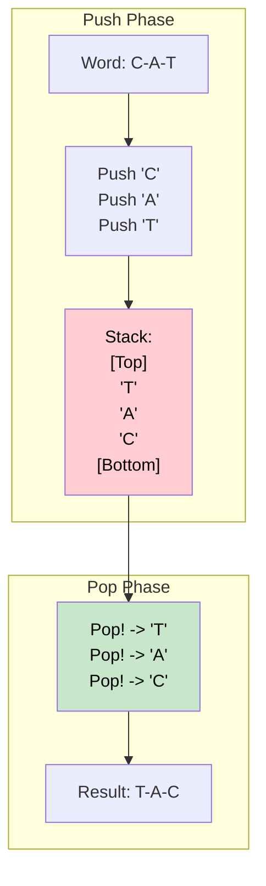

# 🚶‍♂️ Walkthrough: Reverse a String using a Stack

## 👶 Explain Like I'm 5
Imagine you have a stack of blocks with letters on them.
You have the word "CAT".
First, you put 'C' on the table.
Then, you put 'A' on top of 'C'.
Then, you put 'T' on top of 'A'.
Now you have a tower of blocks: 'T' is on top, 'A' is in the middle, 'C' is at the bottom.

To take them down, you have to take the top block first.
You take off 'T' and write it down.
You take off 'A' and write it down.
You take off 'C' and write it down.
What did you write? "TAC"! 
You just reversed the word just by using the natural rules of a Stack.

## 🎯 Core Strategy
A **Stack** naturally follows the **Last-In, First-Out (LIFO)** principle. By pushing all elements into a stack and then immediately popping them out, the elements naturally come out in the exact reverse order. 

1. Initialize an empty stack (Python list).
2. Loop through every character in the string, **pushing** it onto the stack.
3. Initialize an empty list for the result (building strings via lists is faster in Python).
4. While the stack is not empty, **pop** the top character and append it to the result list.
5. Return the joined result string.

*(Note: In real-world Python code, you would simply use string slicing `s[::-1]` which is highly optimized in C. However, this problem tests fundamental understanding of the Stack data structure, which is widely applicable across languages).*

## 🏃‍♂️ Step-by-Step Execution (Dry Run)
**Example Input**: `"CAT"`

### Phase 1: Push
- Char 'C' $\rightarrow$ Stack: `['C']`
- Char 'A' $\rightarrow$ Stack: `['C', 'A']`
- Char 'T' $\rightarrow$ Stack: `['C', 'A', 'T']`

### Phase 2: Pop
- Pop! Returns 'T'. Result = `['T']`
- Pop! Returns 'A'. Result = `['T', 'A']`
- Pop! Returns 'C'. Result = `['T', 'A', 'C']`

Final Result: `"TAC"`

## 📊 Visual Diagram
Here is how LIFO (Last-In, First-Out) naturally flips data:

## 🛑 Edge Cases & Complexity

### Complexity
- **Time Complexity:** $O(N)$. Pushing $N$ characters onto a stack takes $O(N)$ time. Popping $N$ characters off the stack takes $O(N)$ time.
- **Space Complexity:** $O(N)$. The stack stores exactly $N$ characters.

### Edge Cases Handled Safely
- **Empty string:** `""`. The first `for` loop skips. Stack is empty. The `while` loop skips. Returns `"".join([])` which is `""`. Perfectly handled.
- **Single character:** `"a"`. Pushes `"a"`. Pops `"a"`. Returns `"a"`. Perfectly handled.
