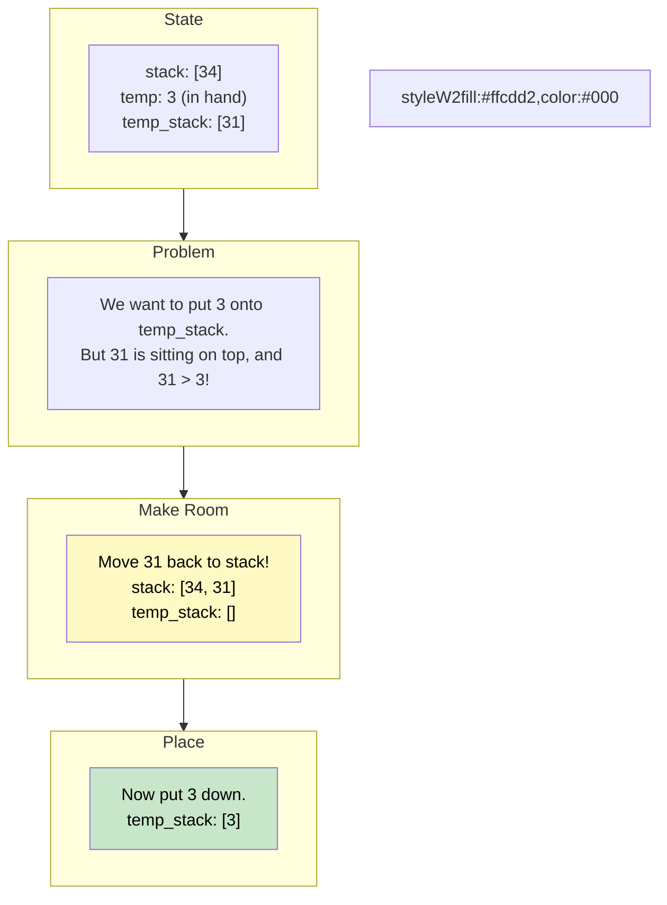

# 🚶‍♂️ Walkthrough: Sort a Stack

## 👶 Explain Like I'm 5
You have a stack of heavy boxes with numbers on them, and they are all out of order.
You want to sort them so the **smallest number is at the top**, and the **biggest number is at the bottom**.
But you only have ONE empty space next to you (a temporary stack) to help you sort.

Here is the trick:
1. You take the top box off the main stack and hold it in your hands.
2. You look at the temporary stack. Is the top box there BIGGER than the one in your hands?
   If it is, you can't put your box down! You have to move the bigger box back to the main stack for a second, to make room.
3. You keep moving boxes back until you find the perfect spot in the temporary stack.
4. Then you put your box down on the temporary stack.
5. You repeat this until the main stack is empty. 

Now the temporary stack has all the boxes sorted (with the biggest at the top). 
Wait, if we want the smallest at the top, we just pour the temporary stack back into the main stack!

## 🎯 Core Strategy
This algorithm is a variation of **Insertion Sort**, adapted perfectly for Stack constraints.

1. Initialize `temp_stack = []`.
2. Loop while `stack` is not empty:
   - **Pop** the top element from `stack` and store it in `temp` (this is the box in your hands).
   - **Make Room**: While `temp_stack` is not empty AND `temp_stack[-1] > temp`:
     - Pop from `temp_stack` and push it back to `stack`.
   - **Place**: Now it's safe to push `temp` onto `temp_stack`.
3. After the loop, `temp_stack` is completely sorted, but the largest element is at the top.
4. To return a stack with the **smallest** element at the top, we simply pop everything from `temp_stack` and push it back into `stack`.

## 🏃‍♂️ Step-by-Step Execution (Dry Run)
**Example Input**: `stack = [34, 3, 31]` (Top is `31`)

### Phase 1: Sort into Temp Stack
| `stack` | `temp` (In Hand) | `temp_stack` | Action |
|---------|----------------|--------------|--------|
| `[34, 3]` | `31` | `[]` | `temp_stack` is empty. Push 31. |
| `[34]` | `3` | `[31]` | `31 > 3`. Move 31 back to `stack`. Push 3 to `temp_stack`. |
| `[34, 31]` | - | `[3]` | (Intermediate state after moving 31) |
| `[34]` | `31` | `[3]` | `3 < 31`. Push 31. |
| `[]` | `34` | `[3, 31]` | `31 < 34`. Push 34. |

`temp_stack` is now `[3, 31, 34]` (Top is `34`).

### Phase 2: Pour Back
- Pop `34` from `temp_stack`, push to `stack`. `stack = [34]`.
- Pop `31` from `temp_stack`, push to `stack`. `stack = [34, 31]`.
- Pop `3` from `temp_stack`, push to `stack`. `stack = [34, 31, 3]`.

Result: `[34, 31, 3]` (Top is `3`, which is the smallest element!).

## 📊 Visual Diagram
Here is a visualization of the "Make Room" logic:

## 🛑 Edge Cases & Complexity

### Complexity
- **Time Complexity:** $O(N^2)$. In the worst case (where the input stack is sorted in reverse), every single element has to move back and forth between the two stacks. This acts identically to the $O(N^2)$ time of Insertion Sort.
- **Space Complexity:** $O(N)$. We use one additional temporary stack that eventually holds all $N$ elements.

### Edge Cases Handled Safely
- **Already Sorted:** `[34, 31, 3]` (Top is `3`). The inner `while temp_stack[-1] > temp:` loop will never trigger! It just pops from `stack` and immediately pushes to `temp_stack`. Runs in $O(N)$ time.
- **Empty Stack:** Handled flawlessly. The outer `while stack:` loop never triggers. Returns `[]`.
