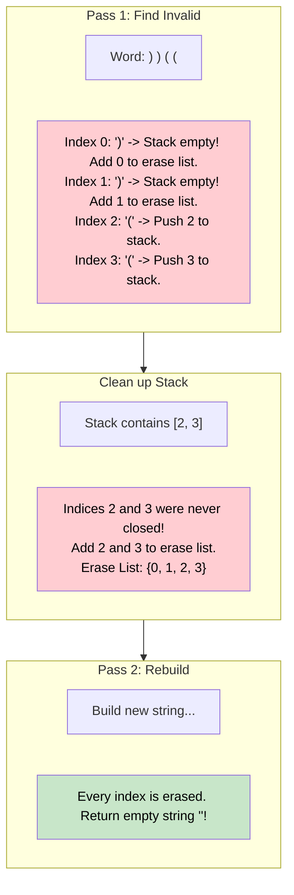

# 🚶‍♂️ Walkthrough: Minimum Remove to Make Valid Parentheses

## 👶 Explain Like I'm 5
You have a sentence that has some parentheses in it, like `a)b(c)d`.
But oh no! The parentheses are messed up. There is a closing parenthesis `)` right after `a` that never had an opening parenthesis before it.
We want to fix the sentence by erasing the MINIMUM number of parentheses possible. We never erase the letters.

If we use our Stack trick, it's really easy to find the bad parentheses!
Every time we see an opening `(`, we put its **index** (its location in the word) onto our Stack.
When we see a closing `)`, we try to pop from the Stack. 
If the Stack is empty, it means this `)` is an extra, invalid parenthesis! We write down its index on our "erase list".
If we finish reading the whole sentence, and there are still numbers left in our Stack, that means we had some `(` that we never closed! Those are invalid too, so we add them to our "erase list".

Finally, we just rewrite the sentence, skipping any index that is on our erase list!

## 🎯 Core Strategy
This takes the standard "Balanced Parentheses" logic and modifies it to track indices instead of just validating correctness.

1. Initialize an empty `stack` to keep track of unmatched `(` indices.
2. Initialize an `invalid_indices` set to hold the indices of brackets we need to erase.
3. **First Pass (Identify Invalid Indices)**:
   - Loop through the string `s` using `enumerate` to get the `index` and `char`.
   - If `char == '('`: Push `index` to the stack.
   - If `char == ')'`:
     - If stack is empty, this `)` is unmatched. Add `index` to `invalid_indices`.
     - Else, pop from stack (we successfully matched the `)` with a `(`).
4. **Clean up Stack**: After the loop, any indices left in the `stack` belong to `(` characters that were never closed. Add all of them to `invalid_indices`.
5. **Second Pass (Build Result)**:
   - Create a result list.
   - Loop through `s` again with `enumerate`.
   - If the current `index` is NOT in `invalid_indices`, append the `char` to the result list.
6. Join and return the result string.

## 🏃‍♂️ Step-by-Step Execution (Dry Run)
**Example Input**: `"a)b(c)d"`

### Phase 1: Identify Invalid Indices
| Index | Char | Action | Stack | `invalid_indices` |
|-------|------|--------|-------|-------------------|
| 0 | `'a'` | Ignore | `[]` | `set()` |
| 1 | `')'` | Stack empty! Invalid. | `[]` | `{1}` |
| 2 | `'b'` | Ignore | `[]` | `{1}` |
| 3 | `'('` | Push index 3. | `[3]` | `{1}` |
| 4 | `'c'` | Ignore | `[3]` | `{1}` |
| 5 | `')'` | Pop index 3. Matched! | `[]` | `{1}` |
| 6 | `'d'` | Ignore | `[]` | `{1}` |

Stack is empty. No left-over opening brackets.
`invalid_indices = {1}`.

### Phase 2: Build String
Walk through the string `"a)b(c)d"` again.
Skip any character at index `1`.
- Index 0: `"a"`
- Index 1: Skip!
- Index 2: `"b"`
- Index 3: `"("`
- Index 4: `"c"`
- Index 5: `")"`
- Index 6: `"d"`

Result list: `["a", "b", "(", "c", ")", "d"]`.
Joined: `"ab(c)d"`.

## 📊 Visual Diagram
Here is how the indices help us pinpoint exactly what to erase:

## 🛑 Edge Cases & Complexity

### Complexity
- **Time Complexity:** $O(N)$. We iterate through the string of length $N$ exactly twice. Set lookups in Python are $O(1)$. Total time is $O(N)$.
- **Space Complexity:** $O(N)$. The stack can store up to $N$ indices. The set can store up to $N$ indices. The result array stores up to $N$ characters. Total space is $O(N)$.

### Edge Cases Handled Safely
- **No Parentheses:** e.g., `"hello"`. Stack is empty, set is empty. Second pass copies the string exactly. Returns `"hello"`.
- **Nested valid with extra closing:** e.g., `"(a(b)c)d)"`. Finds the final `)` at the very end is invalid. Returns `"(a(b)c)d"`. Perfect!
