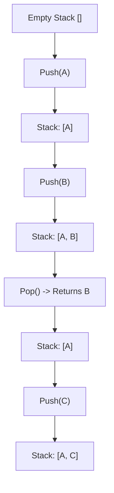
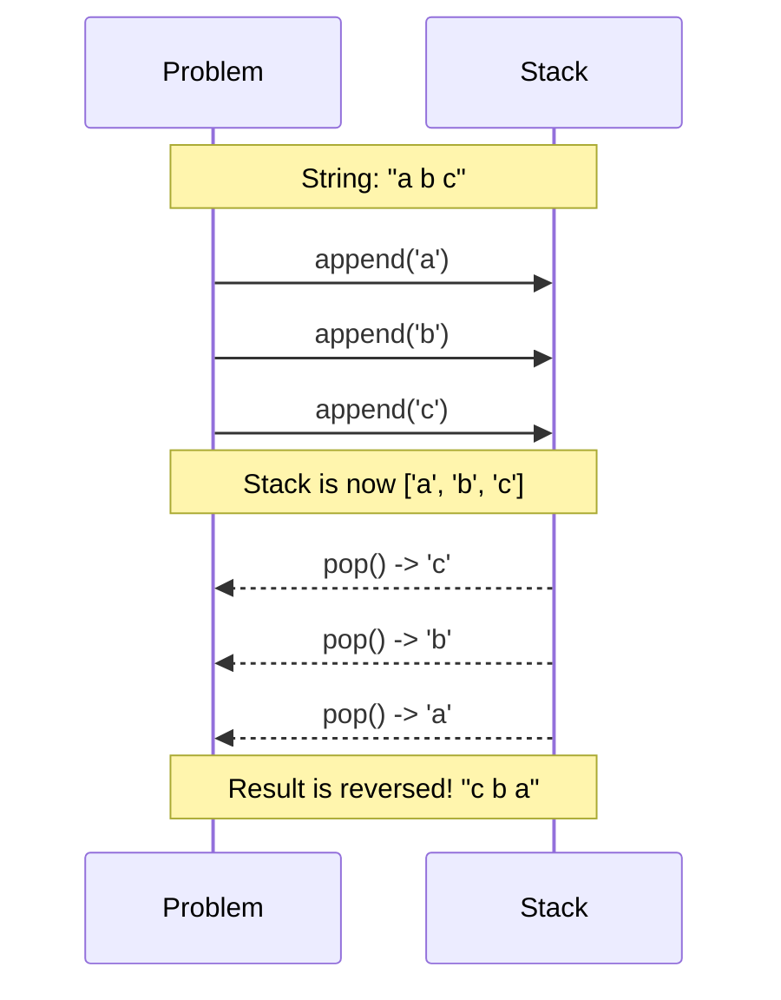

# Pattern 08: Stacks

## 👶 Explain Like I'm 5
Imagine you have a spring-loaded plate dispenser at a buffet.
When you wash a clean plate, you push it down onto the top of the stack.
When a customer comes along, they always grab the plate that is on the VERY TOP.
They can't easily grab the plate at the bottom without taking all the other plates 
off first!
This is called **LIFO** (Last-In, First-Out). The LAST plate you put on the stack 
is the FIRST plate that gets taken off.
In coding, a Stack helps us remember things in the exact reverse order that they 
happened. If we are walking through a maze and keep pushing every turn we make onto 
a Stack, when we hit a dead-end, we can just "pop" the Stack to take back our 
most recent step!

---

## 🧩 Core Idea & Pattern Detection

The **Stack** is a fundamental data structure perfectly suited for problems involving matching, reversing, or remembering a strict history of events where you only care about the *most recent* event.

### When to use it:
- You need to reverse the order of items.
- You need to track matching pairs (like parentheses, HTML tags, or brackets).
- You are parsing strings, evaluating mathematical expressions, or simplifying directory paths.
- The problem involves backtracking or undoing recent actions.

---

## 🔧 Algorithmic Anatomy

### Recipe: Standard Stack Operations
In Python, we use a standard `list` to represent a Stack because it is highly optimized for adding and removing from the end (the "top").

1. **Initialization**: `stack = []`
2. **Push**: `stack.append(item)` — Adds an item to the top. `O(1)` time.
3. **Pop**: `item = stack.pop()` — Removes and returns the top item. `O(1)` time.
4. **Peek**: `item = stack[-1]` — Looks at the top item without removing it. `O(1)` time.
5. **IsEmpty**: `len(stack) == 0` (or just `if not stack:`).

---

## 🛑 Per-Variant DOs and DON'Ts

| Variant | DO | DON'T |
|---------|----|-------|
| **Parentheses/Matching** | **DO** push opening brackets `( { [` onto the stack, and when you see a closing bracket, `pop()` to ensure it matches the correct type. | **DON'T** just count `+1` for opening and `-1` for closing if there are MULTIPLE types of brackets. `([)]` is invalid, but counting would say it's valid! |
| **String Reversal** | **DO** realize that `append` all then `pop` all naturally reverses data. | **DON'T** use a Stack for string reversal in real Python production code (just use `s[::-1]`), but use it to demonstrate understanding in an interview! |
| **Path Simplification** | **DO** split the path by `/`, ignore `.` and empty strings, and `pop()` when you see `..`. | **DON'T** `pop()` without checking if the stack is empty first. You can't go up from the root directory! |

---

## ⏱️ Complexity Analysis

| Aspect | Complexity | Why |
|--------|-----------|-----|
| **Time** | **O(N)** | We typically iterate over the input exactly once, doing `O(1)` pushes or pops. |
| **Space** | **O(N)** | The Stack can grow to store every single element in the worst case (e.g., all opening brackets, or a string). |

---

## ⚠️ Common Pitfalls

1. **Popping an Empty Stack:** Calling `.pop()` or `[-1]` on an empty list in Python throws an `IndexError`. **Always** check `if stack:` before popping or peeking.
2. **Forgetting to check if Stack is empty at the end:** In parentheses matching, if the string is `"((()"`, you will finish the loop without errors, but the stack won't be empty! You must check `len(stack) == 0` at the very end.

---

## ✅ Problems in This Pattern

| # | Problem | Difficulty | Key Twist |
|---|---------|------------|-----------|
| 1 | Balanced Parentheses | Easy | Push openings, pop on closings. Ensure matching pairs. |
| 2 | Reverse a String | Easy | Push characters, pop characters. |
| 3 | Decimal to Binary | Easy | Divide by 2, push remainders, pop to read backwards. |
| 4 | Sort a Stack | Medium | Use a temporary stack to shuffle elements until sorted. |
| 5 | Simplify Path | Medium | Push directories, pop on `..`, ignore `.`. |
| 6 | Min Remove for Valid Parens | Medium | **Advanced**: Track indices of invalid brackets to delete later. |
