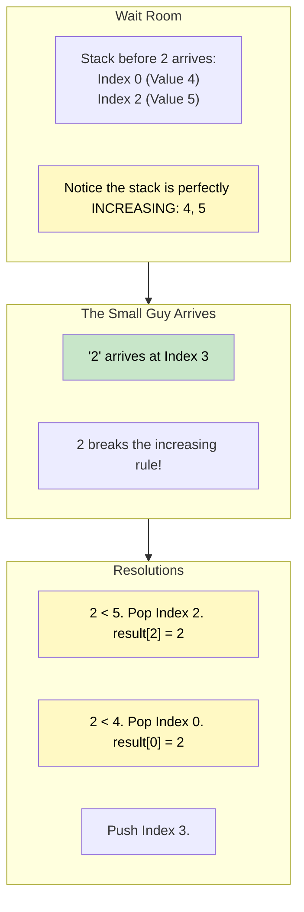

# 🚶‍♂️ Walkthrough: Next Smaller Element

## 👶 Explain Like I'm 5
This is exactly the same as the "Next Greater Element" problem, but reversed!
Instead of a very TALL person walking in and telling all the shorter people they can leave the waiting room...
A very SHORT person walks in! 
If you are height 10, and a person of height 3 stands behind you, you can't see anyone shorter than 3 ever again. That short person blocks the view of anything shorter down the line.

So, when a SHORT person enters the waiting room, EVERYONE in the room who is TALLER than them says "Aha! That's my Next Smaller Element!" 
They write down the short person's height and leave the room.

## 🎯 Core Strategy
This uses a **monotonically increasing stack**. We only allow the stack to contain values that are strictly getting larger. If a small number arrives, the rule is broken, and we pop the large numbers!

1. Initialize an array `result` of the same length as the input, filled with `-1`.
2. Initialize an empty `stack`. The stack will store the **indices** of the elements waiting to find a smaller element.
3. Loop `for i, num in enumerate(arr)`:
   - **Pop & Resolve**: While the stack is not empty AND `num` is SMALLER than the element currently at the top of the stack (`arr[stack[-1]]`):
     - The rule of our monotonically increasing stack is broken by `num`!
     - Pop the index from the stack: `popped_index = stack.pop()`.
     - Update the result for that person: `result[popped_index] = num`.
   - **Push**: Push the current person's index into the waiting room: `stack.append(i)`.
4. Return `result`.

## 🏃‍♂️ Step-by-Step Execution (Dry Run)
**Example Input**: `arr = [4, 8, 5, 2, 25]`
Initialization: `result = [-1, -1, -1, -1, -1]`, `stack = []`.

| `i` | `num` | Action | `stack` (Indices) | `result` |
|-----|-------|--------|-------------------|----------|
| 0 | `4` | Stack empty. Push 0. | `[0]` | `[-1, -1, -1, -1, -1]` |
| 1 | `8` | `8 > 4`. The increasing rule is perfectly fine! Push 1. | `[0, 1]` | `[-1, -1, -1, -1, -1]` |
| 2 | `5` | `5 < arr[1]` (8). Pop 1. `result[1] = 5`. `5 > arr[0]` (4). Push 2. | `[0, 2]` | `[-1, 5, -1, -1, -1]` |
| 3 | `2` | `2 < arr[2]` (5). Pop 2. `result[2] = 2`. `2 < arr[0]` (4). Pop 0. `result[0] = 2`. Push 3. | `[3]` | `[2, 5, 2, -1, -1]` |
| 4 | `25`| `25 > arr[3]` (2). The rule is fine! Push 4. | `[3, 4]` | `[2, 5, 2, -1, -1]` |

Loop ends.
Final `result`: `[2, 5, 2, -1, -1]`.

## 📊 Visual Diagram
Here is how the '2' clears out the waiting room:

## 🛑 Edge Cases & Complexity

### Complexity
- **Time Complexity:** $O(N)$. We loop through the array of length $N$ exactly once. Every index is pushed and popped at most once.
- **Space Complexity:** $O(N)$. In the worst-case scenario (an array sorted in ascending order), nobody ever finds a smaller element, and the stack grows to hold all $N$ indices.

### Edge Cases Handled Safely
- **Ascending Array:** `[1, 2, 3, 4, 5]`. The `while stack and num < arr[stack[-1]]` loop literally never executes. The stack just fills up completely. Result remains identically `[-1, -1, -1, -1, -1]`. Perfect!
- **Descending Array:** `[5, 4, 3, 2, 1]`. Every single number pops the previous one immediately. Result is `[4, 3, 2, 1, -1]`. Perfect!
