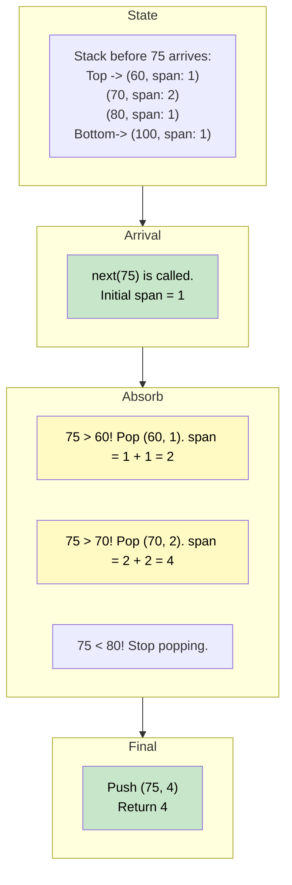

# 🚶‍♂️ Walkthrough: Online Stock Spanner

## 👶 Explain Like I'm 5
You are tracking the stock price of your favorite toy company every day.
When you check the price today, you want to know: "How many days in a row (looking backward from today) was the price lower than or equal to today's price?"

If the prices were: `[10, 20, 30]`
- On day 1 (price 10), it's the first day, so the streak is 1.
- On day 2 (price 20), 20 is bigger than 10. So the streak is today (1) + yesterday's streak (1) = 2.
- On day 3 (price 30), 30 is bigger than 20. So the streak is today (1) + yesterday's streak (2) = 3.

We can use a Stack to remember previous days! But instead of just remembering the price, we remember a combo meal: `(price, streak)`.
When a big price comes in, it "eats" all the smaller prices in the stack and absorbs their streaks!

## 🎯 Core Strategy
We use a **monotonically decreasing stack** to store tuples of `(price, span)`.
Because it's a decreasing stack, every element below the top element is guaranteed to be strictly larger than the top element.

1. Initialize `self.stack = []`.
2. When `next(price)` is called:
   - Initialize the `span` for today as `1` (because today always counts).
   - **Pop & Absorb**: While the stack is not empty AND the price at the top of the stack is `<= price`:
     - This older price is smaller or equal, so it gets absorbed!
     - `popped_price, popped_span = self.stack.pop()`
     - Add its span to our current span: `span += popped_span`.
   - **Push**: Push our new combo `(price, span)` onto the stack.
   - Return the `span`.

## 🏃‍♂️ Step-by-Step Execution (Dry Run)
**Example Input Prices**: `[100, 80, 60, 70, 60, 75, 85]`

| Method Call | `price` | Action (Pop & Absorb) | Stack State After | Return `span` |
|-------------|---------|-----------------------|-------------------|---------------|
| `next(100)` | 100 | Stack empty. Push (100, 1). | `[(100, 1)]` | 1 |
| `next(80)` | 80 | 80 < 100. Push (80, 1). | `[(100, 1), (80, 1)]` | 1 |
| `next(60)` | 60 | 60 < 80. Push (60, 1). | `[(100, 1), (80, 1), (60, 1)]` | 1 |
| `next(70)` | 70 | 70 > 60. Absorb (60, 1). Span = 1+1=2. 70 < 80. Push (70, 2). | `[(100, 1), (80, 1), (70, 2)]` | 2 |
| `next(60)` | 60 | 60 < 70. Push (60, 1). | `[(100, 1), (80, 1), (70, 2), (60, 1)]` | 1 |
| `next(75)` | 75 | 75 > 60. Absorb (60, 1). Span = 1+1=2. 75 > 70. Absorb (70, 2). Span = 2+2=4. 75 < 80. Push (75, 4). | `[(100, 1), (80, 1), (75, 4)]` | 4 |
| `next(85)` | 85 | 85 > 75. Absorb (75, 4). Span = 1+4=5. 85 > 80. Absorb (80, 1). Span = 5+1=6. 85 < 100. Push (85, 6). | `[(100, 1), (85, 6)]` | 6 |

## 📊 Visual Diagram
Here is how `75` absorbs the previous days:

## 🛑 Edge Cases & Complexity

### Complexity
- **Time Complexity:** Amortized $O(1)$ per call to `next`. Each element is pushed onto the stack exactly once and popped off at most once. Over $N$ calls, the total time spent in the `while` loop is $O(N)$, meaning the *average* time per call is $O(1)$.
- **Space Complexity:** $O(N)$. The stack can grow to size $N$ if the prices strictly decrease every day (e.g., `100, 90, 80...`), as nothing ever gets popped.

### Edge Cases Handled Safely
- **Prices strictly decrease:** `[50, 40, 30]`. The `while` loop never triggers. Span is always 1. Stack grows smoothly.
- **Prices are identical:** `[50, 50, 50]`. The condition `self.stack[-1][0] <= price` properly catches the equal prices and absorbs them, yielding spans of `1, 2, 3`. Perfect!
