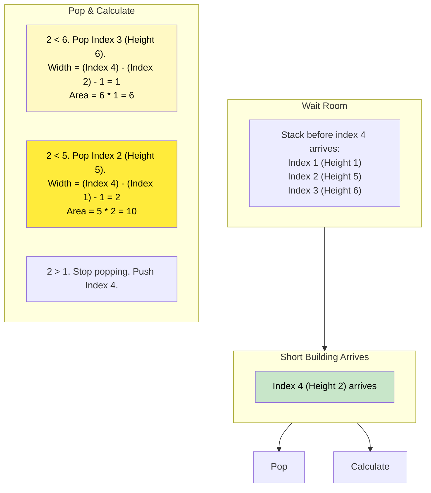

# 🚶‍♂️ Walkthrough: Largest Rectangle in Histogram

## 👶 Explain Like I'm 5
Imagine you built a city skyline using LEGO blocks, all lined up in a row.
You want to paint the absolute largest solid rectangle possible across these buildings.

If you pick a short building, you can paint a very wide rectangle across all the taller buildings next to it! But it will be short.
If you pick a very tall building, the rectangle will be tall, but probably very skinny, because the next building might be shorter and block it.

How do we find the biggest one?
We use a **Monotonic INCREASING Stack**! 
We push buildings onto our stack as long as they keep getting taller.
But the moment a SHORT building appears, it ruins the streak! 
It tells the tall buildings on the stack: "You can't stretch any further to the right!"
So, we pop the tall buildings one by one, and for each one, we calculate:
"Okay, how tall are you? And how far to the LEFT did you stretch before you hit another short building?" (The answer is whatever is underneath it on the stack!).
We multiply Height $\times$ Width, and keep track of the biggest rectangle we find.

## 🎯 Core Strategy
This is the classic, hard-level application of the **Monotonic Stack**. We maintain a strictly increasing stack of indices.

1. Initialize `max_area = 0`.
2. Initialize an empty `stack` to store indices of the buildings.
3. **The Janitor Trick**: Append a `0` height building to the very end of the array. This acts as a tiny "janitor" building that forces the stack to pop and calculate the area for ALL remaining buildings at the very end of the loop, saving us from writing duplicate code outside the loop.
4. Loop through `for i, h in enumerate(heights)`:
   - **Calculate Trapped Areas**: While the stack is not empty AND the current building `h` is SHORTER than the building at the top of the stack (`heights[stack[-1]]`):
     - The top building is trapped! It cannot expand to the right anymore.
     - Pop it: `height = heights[stack.pop()]`.
     - Calculate width:
       - If the stack is empty after popping, this building was the shortest so far, so it stretches all the way to the left: `width = i`.
       - If the stack is not empty, it stretches to the left down to the new top of the stack (exclusive): `width = i - stack[-1] - 1`.
     - Update area: `max_area = max(max_area, height * width)`.
   - **Push**: Push the current index `i` onto the stack.
5. (Optional but good practice) Remove the dummy `0` from the end of the array.
6. Return `max_area`.

## 🏃‍♂️ Step-by-Step Execution (Dry Run)
**Example Input**: `heights = [2, 1, 5, 6, 2, 3]`
Append `0`: `[2, 1, 5, 6, 2, 3, 0]`

| `i` | `h` | Action | `stack` (Indices) | `max_area` |
|-----|-----|--------|-------------------|------------|
| 0 | 2 | Stack empty. Push 0. | `[0]` | 0 |
| 1 | 1 | 1 < 2. **Pop 0**. `height`=2. Stack empty, `width`=1. Area=2.  Push 1. | `[1]` | 2 |
| 2 | 5 | 5 > 1. Push 2. | `[1, 2]` | 2 |
| 3 | 6 | 6 > 5. Push 3. | `[1, 2, 3]` | 2 |
| 4 | 2 | 2 < 6. **Pop 3**. `height`=6. `width`=4-2-1=1. Area=6. 2 < 5. **Pop 2**. `height`=5. `width`=4-1-1=2. Area=10. 2 > 1. Push 4. | `[1, 4]` | **10** |
| 5 | 3 | 3 > 2. Push 5. | `[1, 4, 5]` | 10 |
| 6 | 0 | 0 < 3. **Pop 5**. `height`=3. `width`=6-4-1=1. Area=3. 0 < 2. **Pop 4**. `height`=2. `width`=6-1-1=4. Area=8. 0 < 1. **Pop 1**. `height`=1. Stack empty, `width`=6. Area=6. | `[]` | 10 |

Final `max_area`: **10** (created by the 5 and 6 height blocks).

## 📊 Visual Diagram
Here is how the arrival of height 2 at index 4 traps the taller buildings:

## 🛑 Edge Cases & Complexity

### Complexity
- **Time Complexity:** $O(N)$. We loop through the array of length $N+1$ exactly once. Every building index is pushed onto the stack exactly once, and popped off exactly once. The total number of operations inside the `while` loop across the entire execution is strictly bounded by $N$.
- **Space Complexity:** $O(N)$. The stack can store up to $N$ indices if the histogram is strictly increasing (e.g., `[1, 2, 3, 4, 5]`).

### Edge Cases Handled Safely
- **Flat Histogram:** `[2, 2, 2, 2]`. Stack holds `[0, 1, 2, 3]`. The `0` at the end pops them one by one. The final pop (Index 0, height 2) sees an empty stack and calculates width = 4. Area = $2 \times 4 = 8$. Perfect!
- **Ascending Histogram:** `[1, 2, 3, 4, 5]`. Nothing gets popped until the dummy `0` at the very end forces everything to pop. The max area (3x3 = 9) is correctly found during the flush.
- **Empty Array:** Handled by the `if not heights: return 0` check.
