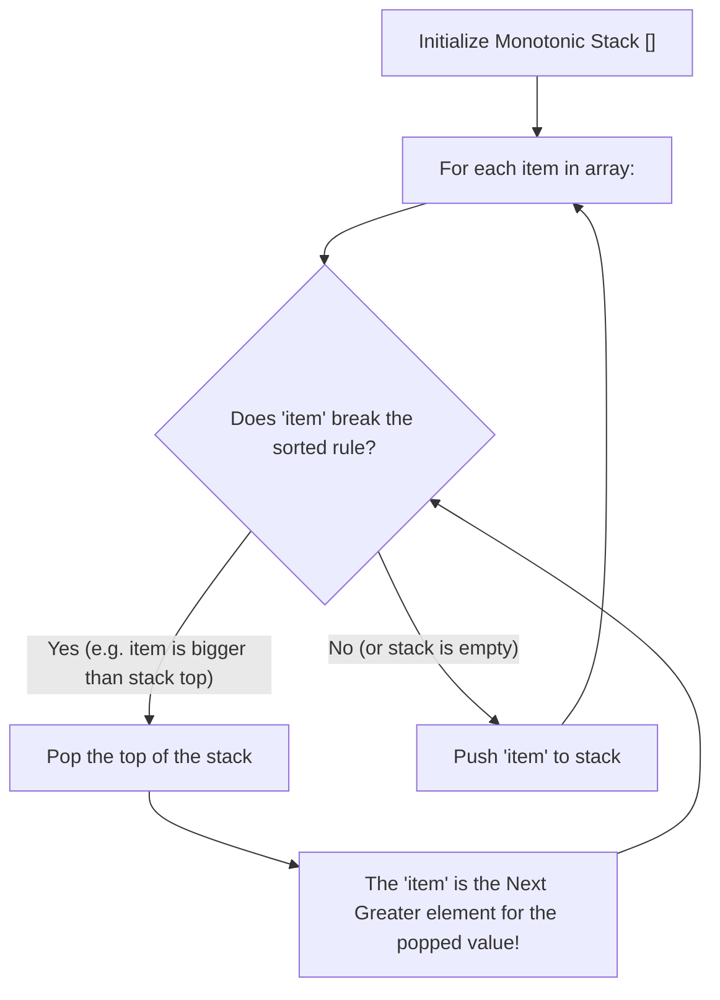
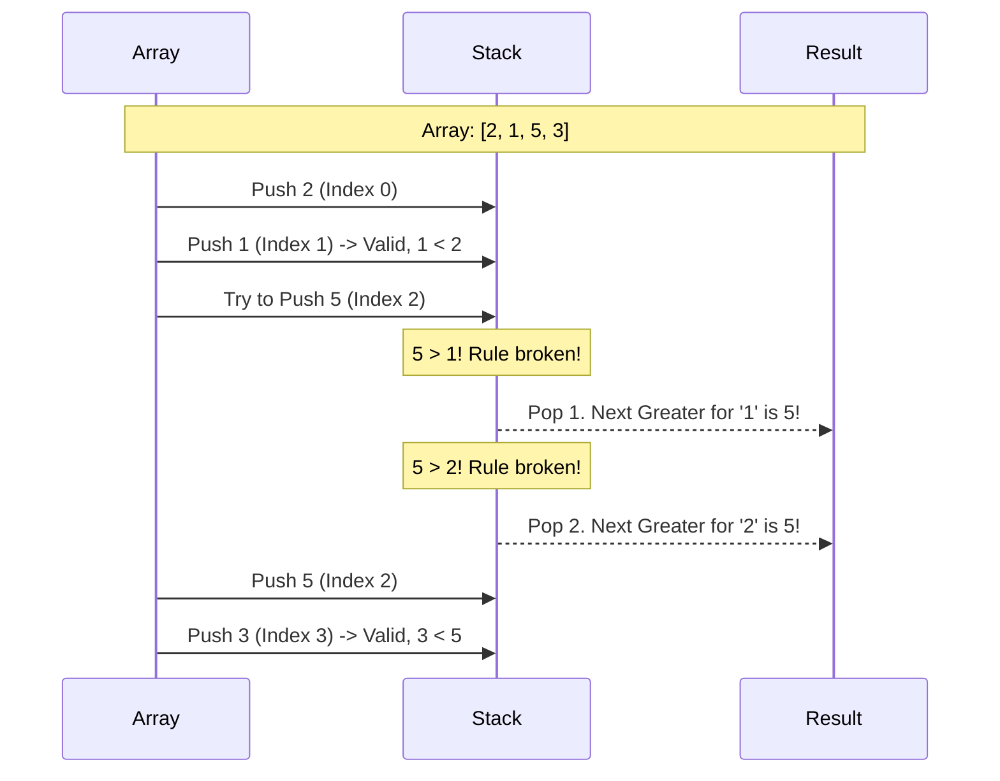

# Pattern 09: Monotonic Stack

## 👶 Explain Like I'm 5
Imagine you have a line of people standing in front of a giant movie screen.
You are walking down the line, trying to figure out who can see the screen and who 
is blocked.
If you (height 5) stand behind a very tall person (height 10), you can't see anything 
past them! That tall person basically "blocks" you forever from seeing anything 
further down the line.
A **Monotonic Stack** is like keeping a list of people who are still useful. 
If a new, super-tall person walks into the line, they instantly block everyone shorter 
than them who was standing behind them. So, we tell all those shorter people to 
leave the line (we `pop` them off the stack!).
By doing this, the stack only ever contains people standing in perfectly increasing 
(or perfectly decreasing) height order. "Monotonic" is just a fancy math word for 
"always going in one direction without turning back."

---

## 🧩 Core Idea & Pattern Detection

A Monotonic Stack is a regular stack with one strict rule: **Elements inside the stack must always remain sorted (either strictly increasing or strictly decreasing).**
Whenever we try to push a new element that breaks the rule, we fiercely `pop` elements off the top until the rule is satisfied again.

### When to use it:
- The problem asks you to find the **"Next Greater"** or **"Next Smaller"** element for every item in an array.
- The problem asks you to find how many days you have to wait until it gets warmer (Daily Temperatures).
- The problem asks you to maximize a rectangle area in a histogram.
- A brute force solution takes O(N²) because of nested loops looking ahead, but you need an O(N) solution.

---

## 🔧 Algorithmic Anatomy

### Recipe: Next Greater Element (Monotonic Decreasing Stack)
If we want to find the NEXT GREATER element, we want our stack to be strictly decreasing. That way, if a BIG number comes along, it breaks the rule, and we pop the small numbers.

1. `stack = []`
2. `result = [-1] * len(arr)`
3. `for i, num in enumerate(arr):`
   - `while stack and num > stack[-1].value:` (The rule is broken!)
     - `popped_node = stack.pop()`
     - `result[popped_node.index] = num` (We just found the next greater element for the popped node!)
   - `stack.append(Node(i, num))`
4. Any elements left in the stack at the end never found a greater element, so they remain `-1`.

---

## 🛑 Per-Variant DOs and DON'Ts

| Variant | DO | DON'T |
|---------|----|-------|
| **Next Greater Element** | **DO** use a Monotonic DECREASING stack. Big numbers trigger the pops. | **DON'T** forget to store the original `index` of the elements in the stack, so you know exactly where to put the answer in the result array! |
| **Next Smaller Element** | **DO** use a Monotonic INCREASING stack. Small numbers trigger the pops. | **DON'T** just store the values. Indices are almost always required to calculate distances (like in Daily Temperatures). |
| **Circular Arrays** | **DO** loop through the array twice `list * 2` (or use `i % n`) so elements at the end can wrap around and find greater elements at the start. | **DON'T** let the loop run infinitely. Exactly `2*N` steps are enough. |

---

## ⏱️ Complexity Analysis

| Aspect | Complexity | Why |
|--------|-----------|-----|
| **Time** | **O(N)** | Even though there is a `while` loop inside a `for` loop, every element is pushed exactly ONCE and popped exactly ONCE. `2N` operations total = `O(N)`. |
| **Space** | **O(N)** | The stack can grow to size N if the array is already perfectly sorted and no pops occur. |

---

## ⚠️ Common Pitfalls

1. **Storing Values vs Indices:** In almost all Monotonic Stack problems, it is infinitely better to push the **INDEX** to the stack, not just the value. You can always look up `arr[index]` to get the value, but you can't easily find the index if you only stored the value.
2. **Strictly vs Non-Strictly Monotonic:** Does `>=` break the rule, or only `>`? 
   - If you want the *Next Strictly Greater* element, pop when `num > arr[stack[-1]]`. 
   - If duplicates matter, read the prompt carefully.

---

## ✅ Problems in This Pattern

| # | Problem | Difficulty | Key Twist |
|---|---------|------------|-----------|
| 1 | Next Greater Element | Easy | The foundational Monotonic Stack. |
| 2 | Next Smaller Element | Easy | The inverted foundation (Monotonic Increasing). |
| 3 | Daily Temperatures | Medium | Find the *distance* (difference in indices) instead of just the value. |
| 4 | Online Stock Spanner | Medium | Process a stream of numbers, keeping a running total of popped weights. |
| 5 | Remove K Digits | Medium | **Advanced**: Greedy stack. Pop if next digit is smaller to make the smallest number. |
| 6 | Largest Rectangle in Hist | Hard | **Advanced**: Calculate area `height * width` every time an element is popped. |
