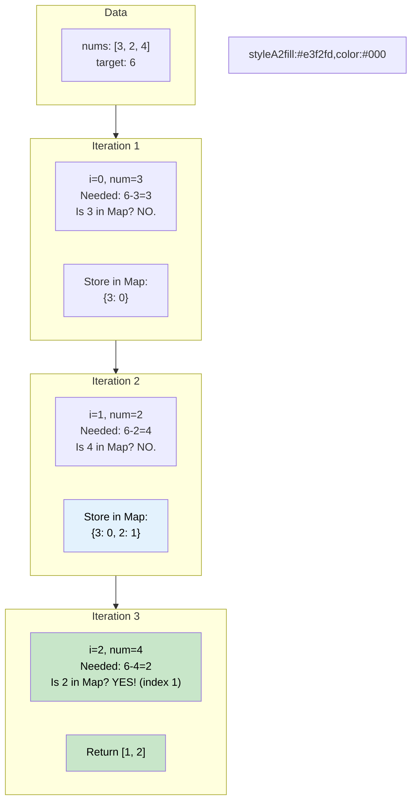

# 🚶‍♂️ Walkthrough: Two Sum

## 👶 Explain Like I'm 5
You have a bunch of numbers: `[2, 7, 11, 15]` and a target number: `9`.
You need to find exactly two numbers that add up to `9`, and give their indices.

You COULD look at `2`, and then ask every single other number: "Hey, are you `7`?"
But if the list is a million numbers long, that takes forever!
Instead, as you walk down the line, you use a magical notebook (Hash Map).
When you look at `2`, you write down: "I saw a `2` at index `0`."
When you get to `7`, you think: "I need a `2` to make `9`. Let me check my notebook!"
You look in the notebook, see that you found a `2` earlier at index `0`, and boom! 
You instantly know the answer is index `0` and index `1`.

## 🎯 Core Strategy
This is the foundational **Hash Map** problem. It teaches you how to trade space for time, bringing an $O(N^2)$ brute-force approach down to an elegant $O(N)$ solution.

1. Initialize an empty dictionary `seen_map = {}`. This will store `number -> index` mappings.
2. Loop through the array using `enumerate` to get both `i` (index) and `num`.
3. For the current `num`, calculate what number you would NEED to reach the target: `needed = target - num`.
4. **O(1) Lookup**: Check if `needed` is already a key in your `seen_map`.
   - If it is, you found your pair! Return `[seen_map[needed], i]`.
5. If it's not, store the current number and its index in the map for future numbers to look up: `seen_map[num] = i`.
6. (Optional) Return an empty list if the loop finishes without finding a pair.

## 🏃‍♂️ Step-by-Step Execution (Dry Run)
**Example Input**: `nums = [2, 7, 11, 15]`, `target = 9`

| `i` | `num` | `needed` ($9 - num$) | Is `needed` in `seen_map`? | Action | `seen_map` |
|-----|-------|--------------------|----------------------------|--------|------------|
| 0 | 2 | $9 - 2 = 7$ | No | Store 2 | `{2: 0}` |
| 1 | 7 | $9 - 7 = 2$ | **Yes!** (Index 0) | Return `[0, 1]` | `{2: 0}` |

**Example Input 2**: `nums = [3, 2, 4]`, `target = 6`

| `i` | `num` | `needed` ($6 - num$) | Is `needed` in `seen_map`? | Action | `seen_map` |
|-----|-------|--------------------|----------------------------|--------|------------|
| 0 | 3 | $6 - 3 = 3$ | No | Store 3 | `{3: 0}` |
| 1 | 2 | $6 - 2 = 4$ | No | Store 2 | `{3: 0, 2: 1}` |
| 2 | 4 | $6 - 4 = 2$ | **Yes!** (Index 1) | Return `[1, 2]` | `{3: 0, 2: 1}` |

## 📊 Visual Diagram
Here is how the dictionary (Hash Map) acts as a high-speed memory bank:

## 🛑 Edge Cases & Complexity

### Complexity
- **Time Complexity:** $O(N)$. We loop through the array of length $N$ exactly once. Hash Map lookups (`needed in seen_map`) take amortized $O(1)$ time in Python.
- **Space Complexity:** $O(N)$. In the worst-case scenario (the pair is at the very end of the array, or doesn't exist), we will store $N$ elements in the dictionary.

### Edge Cases Handled Safely
- **Same numbers forming the target:** `nums = [3, 3], target = 6`. When processing the first `3`, we put `{3: 0}` in the map. When processing the second `3` at index 1, `needed = 6 - 3 = 3`. We check the map, see that `3` exists at index 0, and return `[0, 1]`. By adding to the map *after* checking, we prevent a number from matching with itself!
- **Negative numbers:** `nums = [-1, -2, -3], target = -5`. The math `target - num` perfectly handles negatives: `-5 - (-2) = -3`. It correctly searches for `-3`.
