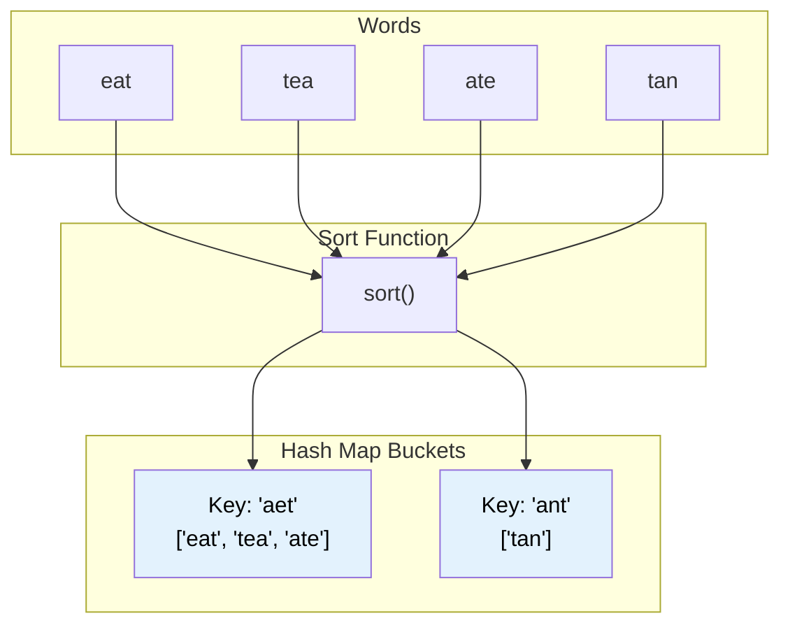

# 🚶‍♂️ Walkthrough: Group Anagrams

## 👶 Explain Like I'm 5
You have a bucket of words: `["eat", "tea", "tan", "ate", "nat", "bat"]`.
An anagram is a word made by mixing up the letters of another word. "eat", "tea", and "ate" all have exactly one 'e', one 'a', and one 't'.
You want to group all the mixed-up words together!

How do you know if two words are anagrams of each other?
If you put their letters in alphabetical order, they will look EXACTLY the same!
- `"eat"` sorted is `"aet"`.
- `"tea"` sorted is `"aet"`.
- `"ate"` sorted is `"aet"`.

We can use a Hash Map where the "Key" is the sorted word (`"aet"`), and the "Value" is a list of all the original words that sort to that key: `["eat", "tea", "ate"]`.

## 🎯 Core Strategy
This is a grouping problem, which perfectly fits a **Hash Map mapping to Lists** (`dict[str, list[str]]`). The main trick is finding a "canonical" key that all anagrams share. Sorting the string provides this canonical key.

1. Initialize an empty dictionary `groups = {}`.
2. Loop through every `word` in the input list.
3. **Generate Key**: Sort the characters in the word and join them back into a single string to form the key.
   - `sorted_word = "".join(sorted(word))`
4. **Group**: Check if `sorted_word` is already a key in `groups`. 
   - If not, initialize it with an empty list.
   - Append the original `word` to the list at `groups[sorted_word]`.
5. Finally, return all the values from the dictionary as a list of lists.
   - `return list(groups.values())`

## 🏃‍♂️ Step-by-Step Execution (Dry Run)
**Example Input**: `["eat", "tea", "tan", "ate", "nat", "bat"]`

| `word` | Sorted Key | Action | `groups` Dictionary |
|--------|------------|--------|---------------------|
| `"eat"` | `"aet"` | Create key `"aet"`. Append. | `{"aet": ["eat"]}` |
| `"tea"` | `"aet"` | Key exists. Append. | `{"aet": ["eat", "tea"]}` |
| `"tan"` | `"ant"` | Create key `"ant"`. Append. | `{"aet": ["eat", "tea"], "ant": ["tan"]}` |
| `"ate"` | `"aet"` | Key exists. Append. | `{"aet": ["eat", "tea", "ate"], "ant": ["tan"]}` |
| `"nat"` | `"ant"` | Key exists. Append. | `{"aet": ["eat", "tea", "ate"], "ant": ["tan", "nat"]}` |
| `"bat"` | `"abt"` | Create key `"abt"`. Append. | `{"aet": ["eat", "tea", "ate"], "ant": ["tan", "nat"], "abt": ["bat"]}` |

Loop finishes!
Extract `.values()`: `[["eat", "tea", "ate"], ["tan", "nat"], ["bat"]]`.

## 📊 Visual Diagram
Here is how sorting forces anagrams to collide into the same Hash Map bucket:

## 🛑 Edge Cases & Complexity

### Complexity
- **Time Complexity:** $O(N \cdot K \log K)$. Where $N$ is the number of words, and $K$ is the maximum length of a word. We iterate through $N$ strings, and for each string, we sort it, which takes $K \log K$ time.
- **Space Complexity:** $O(N \cdot K)$. The Hash Map stores all $N$ strings of length $K$.

*(Note: An alternative $O(N \cdot K)$ time approach involves using a frequency array of size 26 as a tuple key instead of sorting. This is faster for very long strings but more verbose to code).*

### Edge Cases Handled Safely
- **Empty string:** `[""]`. Sorting `""` yields `""`. It is placed in the dictionary at key `""`. Returns `[[""]]`. Correct!
- **Single character:** `["a"]`. Returns `[["a"]]`. Correct!
- **Words with identical characters but different frequencies:** `["aab", "abb"]`. 
  - `"aab"` sorts to `"aab"`.
  - `"abb"` sorts to `"abb"`.
  - They correctly map to different keys. Returns `[["aab"], ["abb"]]`. Correct!
