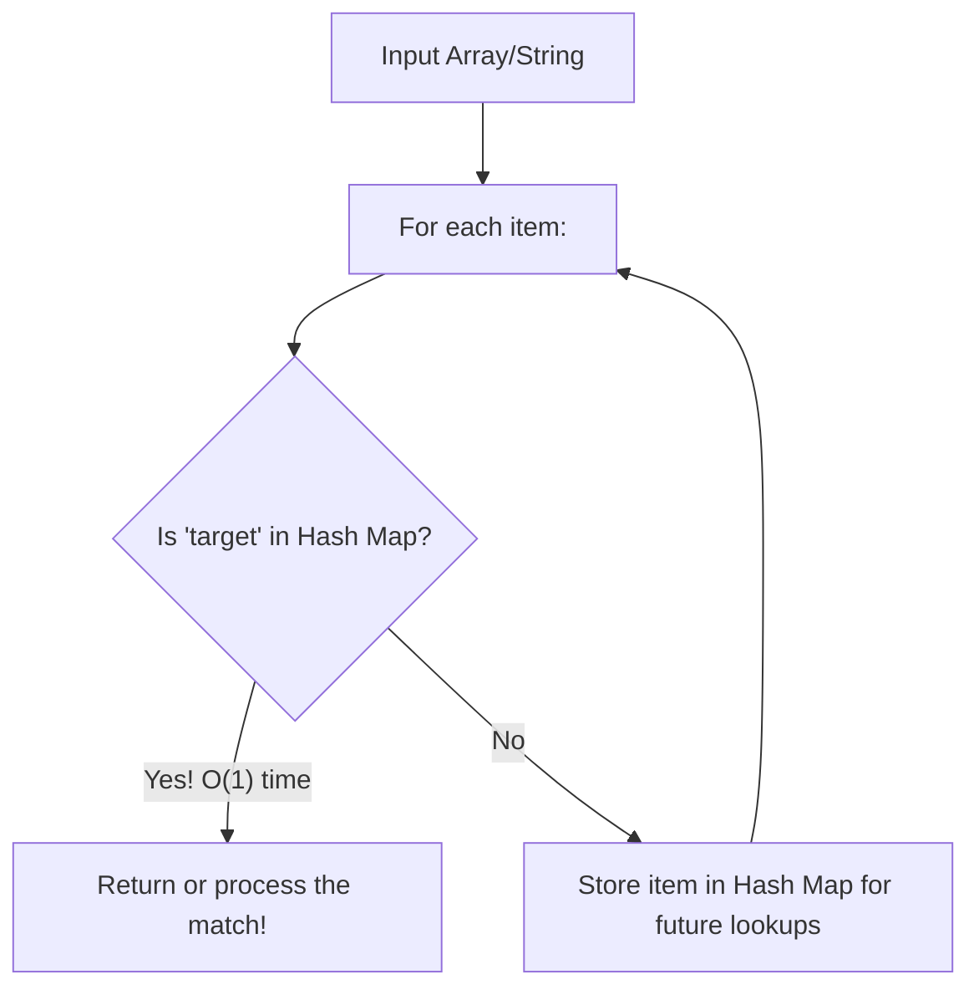
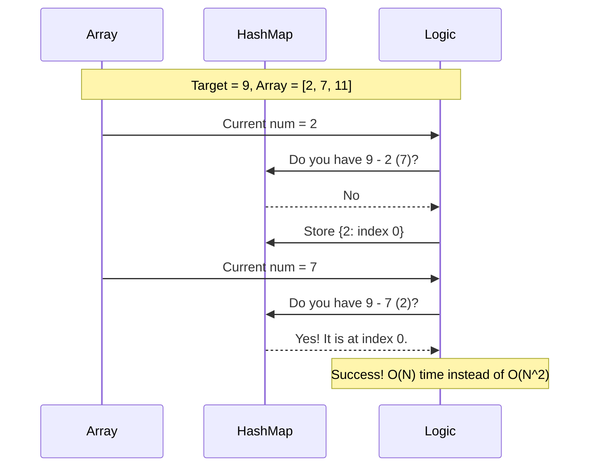

# Pattern 10: Hash Maps

## 👶 Explain Like I'm 5
Imagine you have a giant library with a million books. 
If someone asks you, "Do you have the book 'Harry Potter'?", it would take you 
hours to check every single bookshelf one by one.
But what if you had a magical notebook? In this notebook, every time you buy a 
book, you write down its name and exactly which shelf it's on.
Now, when someone asks for 'Harry Potter', you just flip the notebook exactly to 
the 'H' page, look for 'Harry Potter', and instantly know the answer!
A **Hash Map** (or a Dictionary in Python) is exactly this magical notebook. 
It lets you store a `Key` (the book's name) and a `Value` (the shelf number), 
and it lets you look them up instantly, in `O(1)` time!

---

## 🧩 Core Idea & Pattern Detection

Hash Maps are the most commonly used data structure in coding interviews. They trade a little bit of **Space** (to store the dictionary) for a massive amount of **Time** savings (turning O(N) or O(N²) lookups into O(1)).

### When to use it:
- The problem requires you to count the **frequency** of items.
- You need to check if something **exists** very quickly without looping.
- You are trying to find pairs or sums (like `Two Sum`).
- You want to group items by a common property (like Anagrams).
- You are repeatedly looking backward to see if you've seen a specific value before.

---

## 🔧 Algorithmic Anatomy

### Recipe 1: Frequency Counters
If you want to count how many times characters or words appear:
1. `freq_map = {}`
2. `for item in array:`
   - `freq_map[item] = freq_map.get(item, 0) + 1`

### Recipe 2: The "Look-Back" Pattern (Two Sum)
Instead of looking forward in nested loops, look backward at what you've already seen:
1. `seen_map = {}`
2. `for i, num in enumerate(nums):`
   - `needed = target - num`
   - `if needed in seen_map: return [seen_map[needed], i]`
   - `seen_map[num] = i`

---

## 🛑 Per-Variant DOs and DON'Ts

| Variant | DO | DON'T |
|---------|----|-------|
| **Two Sum / Look-Back** | **DO** store values in the map AS you iterate. This prevents using the same element twice. | **DON'T** put everything in the map first and then loop again, unless the problem strictly allows re-using elements or has edge cases. |
| **Anagram Grouping** | **DO** use a sorted string (or a tuple of character counts) as the Key. | **DON'T** use a `list` or a `set` as a Key! Dictionary keys must be immutable (hashable). |
| **Prefix Sums** | **DO** use a Hash Map to store `(prefix_sum -> count)`. Initialize the map with `{0: 1}` to catch sub-arrays starting from index 0. | **DON'T** forget that negative numbers exist. Sliding Window won't work for arrays with negatives; you MUST use Prefix Sum + Hash Map. |

---

## ⏱️ Complexity Analysis

| Aspect | Complexity | Why |
|--------|-----------|-----|
| **Time** | **O(1) average** | Looking up a key in a Hash Map is generally instant. Overall time complexity for a loop drops from O(N²) to O(N). |
| **Space** | **O(N)** | We have to store up to N items in our Hash Map. |

---

## ⚠️ Common Pitfalls

1. **Mutable Keys:** You cannot use a list `[1, 2, 3]` as a key in a Python dictionary. You must convert it to a tuple `(1, 2, 3)`.
2. **KeyError:** Trying to read `my_dict["apple"]` if "apple" doesn't exist will crash your program. Use `my_dict.get("apple", default_value)` or check `if "apple" in my_dict:` first.
3. **Hash Collisions:** In theoretical computer science, if many keys hash to the same spot, O(1) can degrade to O(N). Python handles this automatically, but it's good to know for interviews!

---

## ✅ Problems in This Pattern

| # | Problem | Difficulty | Key Twist |
|---|---------|------------|-----------|
| 1 | Two Sum | Easy | The classic Look-Back pattern. |
| 2 | First Non-repeating Char | Easy | Two passes: One to count frequencies, one to find the first '1'. |
| 3 | Ransom Note | Easy | Can you build string A from string B's frequency map? |
| 4 | Group Anagrams | Medium | Use a sorted string as a dictionary key to group lists of words. |
| 5 | Subarray Sum Equals K | Medium | **Advanced**: Map Prefix Sums to find subarrays in O(N) time. |
| 6 | Longest Consecutive Seq | Medium | **Advanced**: Convert list to a Set (Hash Map) for O(1) lookups to build sequences. |
