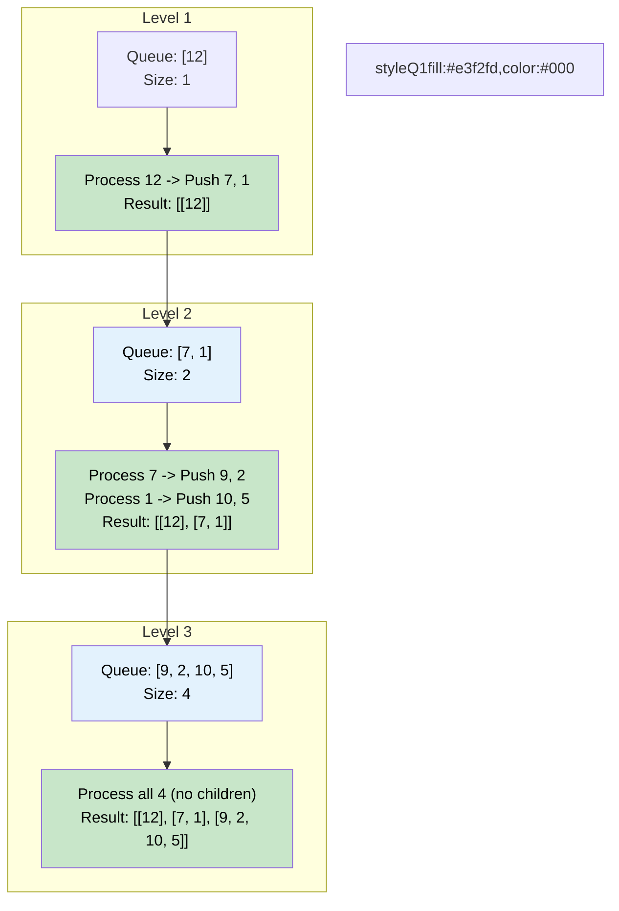

# 🚶‍♂️ Walkthrough: Binary Tree Level Order Traversal

## 👶 Explain Like I'm 5
You have a family tree. You want to take a picture of every generation separately.
- First, a picture of the Great-Grandparents.
- Then, a picture of the Grandparents.
- Then, a picture of the Parents.

We can do this easily using a Queue (like a line for a rollercoaster).
First, the Great-Grandparents get in line.
You look at the line and say, "Okay, there is 1 person in line right now. Let's take a picture of just them."
While they are getting their picture taken, they tell all their kids (the Grandparents) to get in the back of the line!
Once the first picture is done, you look at the line again. Now there are 2 people in line (the Grandparents). You say, "Okay, I will take a picture of the next 2 people!"
They get their picture taken, and tell THEIR kids to get in line.
By strictly counting how many people are in line *before* you start taking pictures for that round, you perfectly separate every generation!

## 🎯 Core Strategy
This is the foundational **Tree Breadth First Search (BFS)** pattern. We use a Queue data structure (FIFO - First In, First Out) to process nodes level by level.

1. **Initialization**: If the `root` is None, return an empty list `[]`. Otherwise, initialize a `queue` using `collections.deque` and add the `root` to it. Initialize an empty `result` list.
2. **Level Loop**: Loop `while queue is not empty`:
   - **Snapshot the Level**: Get the number of nodes currently in the queue: `level_size = len(queue)`. This is the most crucial step! It tells us exactly how many nodes belong to the *current* level.
   - Initialize `current_level = []` to hold the values for this level.
   - **Node Loop**: Loop exactly `level_size` times:
     - Pop the front node: `node = queue.popleft()`.
     - Add its value to `current_level`.
     - If `node.left` exists, add it to the back of the queue.
     - If `node.right` exists, add it to the back of the queue.
   - After the inner loop finishes, append the populated `current_level` list to `result`.
3. Return `result`.

## 🏃‍♂️ Step-by-Step Execution (Dry Run)
**Example Input Tree**:
```text
      12
     /  \
    7    1
   / \  / \
  9  2 10  5
```
Initialization: `queue = [12]`, `result = []`.

### Level 1
- `level_size` = 1.
- `current_level` = `[]`
- Node `12`: Pop. Add 12. Add children `7` and `1` to queue.
- `current_level` is `[12]`. Append to `result`.
- Queue is now `[7, 1]`.

### Level 2
- `level_size` = 2.
- `current_level` = `[]`
- Node `7`: Pop. Add 7. Add children `9` and `2`. Queue: `[1, 9, 2]`.
- Node `1`: Pop. Add 1. Add children `10` and `5`. Queue: `[9, 2, 10, 5]`.
- `current_level` is `[7, 1]`. Append to `result`.

### Level 3
- `level_size` = 4.
- `current_level` = `[]`
- Node `9`: Pop. Add 9. No children.
- Node `2`: Pop. Add 2. No children.
- Node `10`: Pop. Add 10. No children.
- Node `5`: Pop. Add 5. No children.
- `current_level` is `[9, 2, 10, 5]`. Append to `result`.
- Queue is empty!

Final `result`: `[[12], [7, 1], [9, 2, 10, 5]]`.

## 📊 Visual Diagram
Here is how the queue manages the flow of nodes level by level:



## 🛑 Edge Cases & Complexity

### Complexity
- **Time Complexity:** $O(N)$. We traverse each node in the tree exactly once. The operations inside the loop (queue push/pop) take $O(1)$ time.
- **Space Complexity:** $O(N)$. We need to store nodes in the queue. In the worst case (a perfectly balanced tree), the bottom level contains roughly $N/2$ nodes, meaning the queue will hold $O(N)$ elements at once. We also need $O(N)$ space to store the final result array.

### Edge Cases Handled Safely
- **Empty Tree:** `if not root: return []` catches a `None` input immediately and safely returns an empty list.
- **Single Node Tree:** Works perfectly. Queue has size 1, processes the root, finds no children, and returns `[[root.value]]`.
