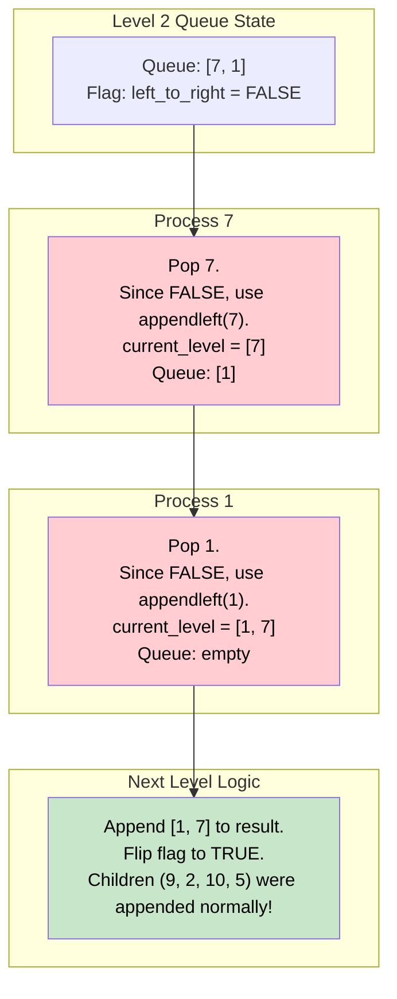

# 🚶‍♂️ Walkthrough: Zigzag Traversal

## 👶 Explain Like I'm 5
You are taking pictures of the family tree again, but this time you want to be fancy.
- For the Grandparents (Level 1), you take the picture from **Left to Right**.
- For the Parents (Level 2), you take the picture from **Right to Left**!
- For the Kids (Level 3), you go back to **Left to Right**.

It's a Zigzag!
To do this, we DO NOT change how people wait in line. They still wait in the exact same Queue (from left to right).
The ONLY thing that changes is how we put them into the photo album.
If it's a "Left to Right" round, we just append them normally to the end of the page.
If it's a "Right to Left" round, we push them into the FRONT of the page (using `appendleft()`), so the first person we took a picture of ends up at the very back!
After every round, we just flip a switch to change directions for the next round.

## 🎯 Core Strategy
This builds perfectly upon the standard **Tree Breadth First Search (BFS)** pattern. We maintain the exact same queue logic for traversing the tree. We just change how we format the *output* for each level based on a toggle flag.

1. **Initialization**: If the `root` is None, return `[]`. Initialize `queue = deque([root])`, `result = []`.
2. **The Toggle**: Initialize a boolean `left_to_right = True`. This acts as our directional switch.
3. **Level Loop**: Loop `while queue is not empty`:
   - `level_size = len(queue)`
   - `current_level = deque()`  <-- Notice we use a `deque` for the current level! This is critical for $O(1)$ front insertions.
   - **Node Loop**: Loop `level_size` times:
     - Pop `node` from queue.
     - **The Magic**: 
       - IF `left_to_right`: `current_level.append(node.value)` (normal order)
       - ELSE: `current_level.appendleft(node.value)` (reverse order)
     - Append children to the queue (always Left then Right, regardless of the zigzag direction).
   - Append `list(current_level)` to `result`.
   - **Flip the Switch**: `left_to_right = not left_to_right`.
4. Return `result`.

## 🏃‍♂️ Step-by-Step Execution (Dry Run)
**Example Input Tree**:
```text
      12
     /  \
    7    1
   / \  / \
  9  2 10  5
```
Initialization: `queue = [12]`, `result = []`, `left_to_right = True`.

### Level 1 (Top Level)
- `left_to_right = True`
- Pop `12`. `current_level.append(12)`. Queue: `[7, 1]`.
- `current_level`: `[12]`. Append to `result`.
- Flip switch: `left_to_right = False`.

### Level 2 (Middle Level)
- `left_to_right = False`
- Pop `7`. `current_level.appendleft(7)`. `current_level` is `[7]`. Queue: `[1, 9, 2]`.
- Pop `1`. `current_level.appendleft(1)`. `current_level` is `[1, 7]`. Queue: `[9, 2, 10, 5]`.
- `current_level`: `[1, 7]`. Append to `result`.
- Flip switch: `left_to_right = True`.

### Level 3 (Bottom Level)
- `left_to_right = True`
- Pop `9`. `append(9)`. `current_level` is `[9]`.
- Pop `2`. `append(2)`. `current_level` is `[9, 2]`.
- Pop `10`. `append(10)`. `current_level` is `[9, 2, 10]`.
- Pop `5`. `append(5)`. `current_level` is `[9, 2, 10, 5]`.
- `current_level`: `[9, 2, 10, 5]`. Append to `result`.
- Flip switch: `left_to_right = False`.

Queue empty! Return `result`: `[[12], [1, 7], [9, 2, 10, 5]]`.

## 📊 Visual Diagram
Here is how the boolean flag controls the output construction without messing up the underlying traversal queue:



## 🛑 Edge Cases & Complexity

### Complexity
- **Time Complexity:** $O(N)$. Every node is visited exactly once. Checking the boolean flag and pushing to either end of a `deque` takes $O(1)$ time. 
- **Space Complexity:** $O(N)$. The primary queue holds at most $N/2$ nodes. The `current_level` deque holds at most $N/2$ values. The `result` list stores all $N$ values.

### Edge Cases Handled Safely
- **Empty Tree:** Safely handled by the initial `if not root:` check. Returns `[]`.
- **Tree with missing children:** As with all BFS patterns, it only adds children if they exist `if node.left: queue.append(node.left)`. It doesn't break if a node only has one child.
