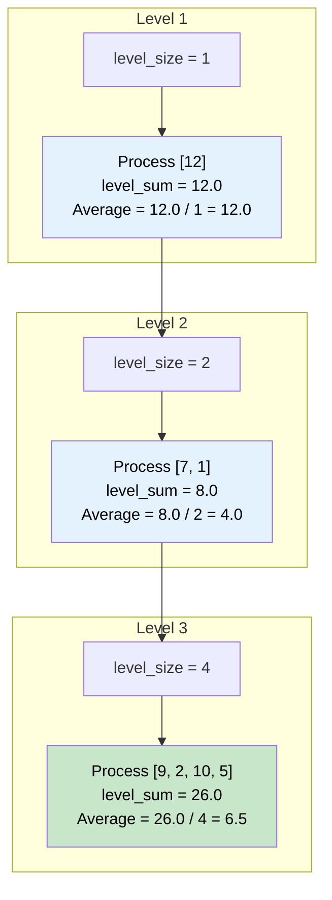

# 🚶‍♂️ Walkthrough: Level Averages in a Binary Tree

## 👶 Explain Like I'm 5
You are still looking at your family tree, but instead of taking pictures, you want to find the AVERAGE age of each generation.
- What's the average age of the Great-Grandparents?
- What's the average age of the Grandparents?
- What's the average age of the Parents?

Just like before, we use our Queue to line everyone up generation by generation.
When a generation is ready, instead of putting their names in a list, we just add up all their ages!
If the parents are 40 and 44, their total age is 84. Since there are 2 of them, the average is $84 / 2 = 42$.
We already know how many people are in the generation because we count them before we start (`level_size = len(queue)`). Easy!

## 🎯 Core Strategy
This is a straightforward aggregation task built on the standard **Tree Breadth First Search (BFS)** pattern. Instead of storing an array of node values for each level, we maintain a running sum.

1. **Initialization**: If the `root` is None, return `[]`. Initialize `queue = deque([root])`, `result = []`.
2. **Level Loop**: Loop `while queue is not empty`:
   - `level_size = len(queue)` (This acts as our denominator for the average!).
   - Initialize `level_sum = 0.0`.
   - **Node Loop**: Loop exactly `level_size` times:
     - Pop `node` from queue.
     - Add `node.value` to `level_sum`.
     - Append children to the queue (Left then Right).
   - **Calculate Average**: Append `level_sum / level_size` to `result`.
3. Return `result`.

## 🏃‍♂️ Step-by-Step Execution (Dry Run)
**Example Input Tree**:
```text
      12
     /  \
    7    1
   / \  / \
  9  2 10  5
```
Initialization: `queue = [12]`, `result = []`.

### Level 1
- `level_size` = 1. `level_sum` = 0.0.
- Pop `12`. `level_sum` += 12. `queue` = `[7, 1]`.
- Calculate: $12.0 / 1 = 12.0$.
- `result` = `[12.0]`.

### Level 2
- `level_size` = 2. `level_sum` = 0.0.
- Pop `7`. `level_sum` += 7. `queue` = `[1, 9, 2]`.
- Pop `1`. `level_sum` += 1. `queue` = `[9, 2, 10, 5]`.
- `level_sum` is now 8.0.
- Calculate: $8.0 / 2 = 4.0$.
- `result` = `[12.0, 4.0]`.

### Level 3
- `level_size` = 4. `level_sum` = 0.0.
- Pop `9`, `2`, `10`, `5`. Add them all to `level_sum`.
- `level_sum` = $9 + 2 + 10 + 5 = 26.0$.
- Calculate: $26.0 / 4 = 6.5$.
- `result` = `[12.0, 4.0, 6.5]`.

Queue is empty! Return `result`.

## 📊 Visual Diagram
Here is how the BFS logic seamlessly transforms into an aggregation logic:



## 🛑 Edge Cases & Complexity

### Complexity
- **Time Complexity:** $O(N)$. We traverse each node exactly once. Summing floats and division take $O(1)$ time.
- **Space Complexity:** $O(N)$. The queue stores at most $N/2$ nodes.

### Edge Cases Handled Safely
- **Empty Tree:** Safely handled by `if not root: return []`.
- **Tree with negative values:** E.g., a node with value `-5`. The float addition works identically.
- **Single Node:** Properly handles a single-node tree, finding `level_size = 1`, and returning the value itself.
