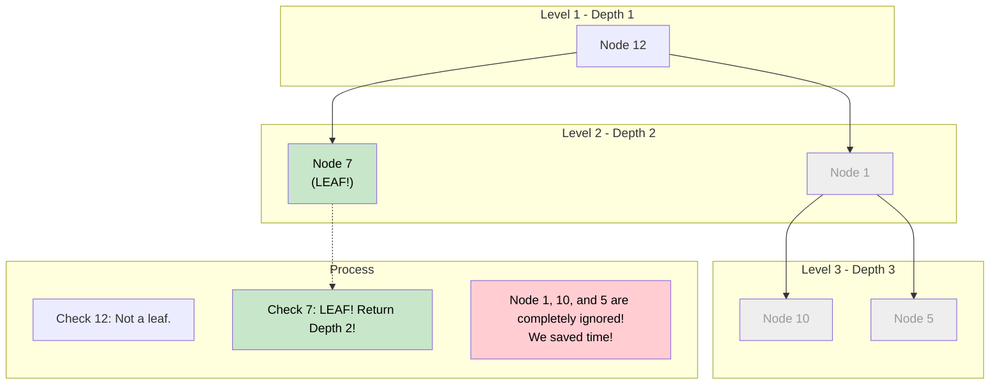

# 🚶‍♂️ Walkthrough: Minimum Depth of a Binary Tree

## 👶 Explain Like I'm 5
You are climbing down a tree, starting from the very top (the root).
You want to find the fastest way to hit the ground (a leaf).
A leaf is a node that has NO children (no left, no right).

If you use Depth First Search (DFS), you might climb all the way down the deepest, longest branch first, taking forever just to realize there was a leaf right next to the root!
But if you use Breadth First Search (BFS), you check the entire Level 1 first.
Then you check the entire Level 2.
The very FIRST time you see a leaf node, you yell "I FOUND IT!" and stop immediately!
Because you are checking level by level, the first leaf you find is mathematically guaranteed to be the closest one to the root.

## 🎯 Core Strategy
This highlights the superpower of **Tree Breadth First Search (BFS)**: finding the shortest path in an unweighted graph/tree. By traversing level by level, the first time we encounter our target condition (a leaf node), we can immediately return the current depth, short-circuiting the rest of the search.

1. **Initialization**: If the `root` is None, return `0`. Initialize `queue = deque([root])`. Initialize `depth = 1`.
2. **Level Loop**: Loop `while queue is not empty`:
   - `level_size = len(queue)`
   - **Node Loop**: Loop exactly `level_size` times:
     - Pop `node` from queue.
     - **Leaf Check**: Is it a leaf? `if not node.left and not node.right:`
       - YES! The search is over. Return `depth` immediately.
     - If not a leaf, append its children to the queue.
   - **Next Generation**: After finishing the entire level, we haven't found a leaf, so we prepare to go deeper. `depth += 1`.
3. If the queue somehow empties (which won't happen for a valid tree before hitting a leaf), return `depth`.

## 🏃‍♂️ Step-by-Step Execution (Dry Run)
**Example Input Tree**:
```text
      12
     /  \
    7    1
        / \
       10  5
```
Initialization: `queue = [12]`, `depth = 1`.

### Level 1 (depth = 1)
- `level_size = 1`.
- Pop `12`.
- Is `12` a leaf? No (it has children `7` and `1`).
- Push `7` and `1`. Queue: `[7, 1]`.
- Loop finishes. `depth` becomes 2.

### Level 2 (depth = 2)
- `level_size = 2`.
- Pop `7`.
- Is `7` a leaf? YES! (No left, no right).
- **RETURN `depth` (2)** immediately!

We never even look at node `1`, `10`, or `5`. The algorithm optimally terminates early.

## 📊 Visual Diagram
Here is how early termination saves us from exploring the whole tree:



## 🛑 Edge Cases & Complexity

### Complexity
- **Time Complexity:** $O(N)$ in the absolute worst case (e.g., a completely balanced tree where we have to check all the way to the bottom, or a linked list). However, in the *best case* (a skewed tree with a leaf near the root), it runs in $O(1)$ time! This is vastly superior to DFS for this specific problem.
- **Space Complexity:** $O(N)$. The queue can hold up to $N/2$ nodes.

### Edge Cases Handled Safely
- **Empty Tree:** `if not root: return 0` handles this immediately.
- **Single Node:** `queue = [42]`, `depth = 1`. Pops `42`. It has no children, so it's a leaf. Returns `1`. Correct!
- **Tree with a single deep branch:** E.g., `12 -> 7 -> 9` (no right children).
  - Depth 1: `12`. Pushes `7`.
  - Depth 2: `7`. Pushes `9`.
  - Depth 3: `9`. Leaf! Returns 3. Correct.
