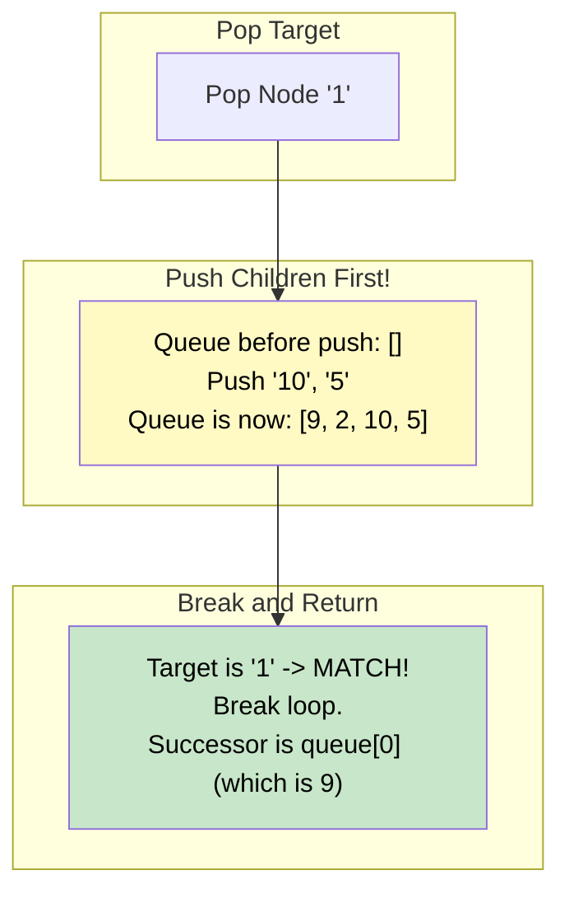

# 🚶‍♂️ Walkthrough: Level Order Successor

## 👶 Explain Like I'm 5
You are calling out the names of everyone in the family tree, level by level, left to right.
Someone asks you: "Hey, right after you call out 'Bob', who is the very next person you call?"
That next person is Bob's "Level Order Successor".

Because we are already using a Queue that perfectly lines everyone up in the exact order we call their names, this is incredibly easy!
We just pop people out of the line one by one.
The moment we pop "Bob", we stop! 
Who is the next person we were *going* to call? It's simply the person standing at the very front of the line right now!

## 🎯 Core Strategy
This is a clever variation of the **Tree Breadth First Search (BFS)** pattern. It demonstrates that the BFS queue inherently stores nodes in the exact Level Order sequence. We don't even need the inner `for _ in range(level_size)` loop because we don't care about isolating specific levels; we only care about the absolute, flattened sequence.

1. **Initialization**: If the `root` is None, return `None`. Initialize `queue = deque([root])`.
2. **Continuous Loop**: Loop `while queue is not empty`:
   - Pop `node` from queue.
   - **Crucial Order**: Append its children (Left then Right) to the queue *BEFORE* checking if we found the target. Why? Because if the target is the last node on Level 2, its successor is the first node on Level 3. We need Level 3 to be in the queue when we stop!
   - **Check Target**: `if node.value == target_value:`
     - YELL STOP! We found our target. Break out of the loop immediately.
3. **Get Successor**: After breaking out of the loop, the successor is exactly `queue[0]` (the next person in line).
4. If the queue is empty (meaning the target was the very last node in the tree, or wasn't found at all), return `None`.

## 🏃‍♂️ Step-by-Step Execution (Dry Run)
**Example Input Tree**:
```text
      12
     /  \
    7    1
   / \  / \
  9  2 10  5
```
**Target**: `1` (The last node of Level 2).
Initialization: `queue = [12]`.

### Iteration 1
- Pop `12`.
- Push children `7`, `1`. Queue: `[7, 1]`.
- Is `12` == `1`? No.

### Iteration 2
- Pop `7`.
- Push children `9`, `2`. Queue: `[1, 9, 2]`.
- Is `7` == `1`? No.

### Iteration 3
- Pop `1`.
- **Push children** `10`, `5`. Queue: `[9, 2, 10, 5]`. (Notice how Level 3 is now in the queue!).
- Is `1` == `1`? YES! Break out of the loop.

### Final Result
- Queue is currently `[9, 2, 10, 5]`.
- Return `queue[0]`, which is **Node 9**.
- Node 9 is exactly the node that follows Node 1 in a level-order sequence!

## 📊 Visual Diagram
Here is how the queue state holds the answer at the exact moment the target is popped:



## 🛑 Edge Cases & Complexity

### Complexity
- **Time Complexity:** $O(N)$. We visit nodes until we find the target. In the worst case (target is at the very end of the tree), we visit all $N$ nodes.
- **Space Complexity:** $O(N)$. The queue can hold up to $N/2$ nodes.

### Edge Cases Handled Safely
- **Target is the last node in the tree:** e.g., Target is `5`. We pop `5`, push no children (queue becomes empty). We break. Returning `queue[0]` would crash, so we use `return queue[0] if queue else None`. Returns `None`. Correct!
- **Target is not in the tree:** The loop exhausts the queue. `queue` is empty. Returns `None`. Correct!
- **Empty Tree:** Handled by initial `if not root:` check. Returns `None`.
