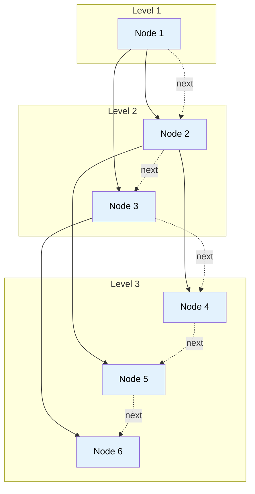

# 🚶‍♂️ Walkthrough: Connect All Level Order Siblings

## 👶 Explain Like I'm 5
Imagine kids standing in lines for a school photo. In the last problem, we connected kids standing in the SAME row.
Now, the LAST kid in every row should also point to the FIRST kid of the NEXT row. 
So everyone forms ONE long chain from top to bottom, left to right — like a single giant conga line winding through the tree!

To do this, we don't even care about which row someone is in. We just put everyone in our standard Queue.
As people pop out of the Queue one by one, we just tell the previous person who popped out to hold their hand. It's that simple!

## 🎯 Core Strategy
This is a simplification of the standard **Tree Breadth First Search (BFS)** pattern. Since we want to connect *all* nodes in the exact order they are processed by BFS, we don't need to maintain state inside a level loop (`level_size`). We can just maintain a single global `previous_node` pointer across the entire while loop!

1. **Initialization**: If the `root` is None, return `None`. Initialize `queue = deque([root])`. Initialize `prev = None`.
2. **Continuous Loop**: Loop `while queue is not empty`:
   - Pop `node` from queue.
   - **Make the Connection**: If `prev` is not None, connect it: `prev.next = node`.
   - **Advance State**: Update `prev = node`. (Notice this does NOT reset at the end of a level!).
   - Append children to the queue (Left then Right).
3. Return the modified `root`.

## 🏃‍♂️ Step-by-Step Execution (Dry Run)
**Example Input Tree**:
```text
      1
     / \
    2   3
   / \   \
  4   5   6
```
Initialization: `queue = [1]`, `prev = None`.

| Queue State Before Pop | Pop `node` | Connect | Update `prev` | Push Children | Queue State After Push |
|------------------------|------------|---------|---------------|---------------|------------------------|
| `[1]` | `1` | None | `1` | Push `2`, `3` | `[2, 3]` |
| `[2, 3]` | `2` | **`1.next = 2`** | `2` | Push `4`, `5` | `[3, 4, 5]` |
| `[3, 4, 5]` | `3` | **`2.next = 3`** | `3` | Push `6` (No left child)| `[4, 5, 6]` |
| `[4, 5, 6]` | `4` | **`3.next = 4`** | `4` | Push None | `[5, 6]` |
| `[5, 6]` | `5` | **`4.next = 5`** | `5` | Push None | `[6]` |
| `[6]` | `6` | **`5.next = 6`** | `6` | Push None | `[]` |

Loop finishes. The chain is `1 -> 2 -> 3 -> 4 -> 5 -> 6 -> None`.

## 📊 Visual Diagram
Here is how the global `prev` pointer ignores level boundaries to stitch the whole tree together:



## 🛑 Edge Cases & Complexity

### Complexity
- **Time Complexity:** $O(N)$. We visit every node exactly once. Connecting nodes takes $O(1)$ time.
- **Space Complexity:** $O(N)$. The BFS queue holds up to $N/2$ nodes at the bottom level.

### Edge Cases Handled Safely
- **Empty Tree:** `if not root: return None` handles this safely.
- **Skewed Tree:** (e.g., all left children). The queue will just contain one node at a time, and `prev` will correctly link them all into a straight line.
- **Tree with missing children:** Handled gracefully. If `node.left` doesn't exist, it isn't pushed to the queue, meaning it won't interrupt the continuous sequence of valid nodes being processed.
