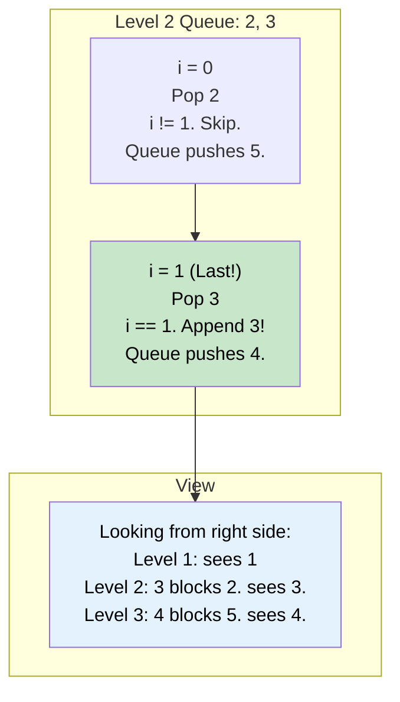

# 🚶‍♂️ Walkthrough: Right View of a Binary Tree

## 👶 Explain Like I'm 5
Imagine you're standing on the RIGHT side of a Christmas tree, looking at it from the side. You can only see the RIGHTMOST ornament on each row. 
If a row has ornaments `[4, 5, 6]`, you only see `6` because it's blocking `4` and `5` from your view.
Your goal is to return all the ornaments you can see from top to bottom.

Since we are already taking our pictures level by level (from left to right) using our Queue, the very LAST person we take a picture of on any given level is exactly the person standing on the far right!
We just need to save the very last person from every level.

## 🎯 Core Strategy
This is a standard application of **Tree Breadth First Search (BFS)** where we only care about the last element processed in the inner `level_size` loop.

1. **Initialization**: If the `root` is None, return `[]`. Initialize `queue = deque([root])`. Initialize `result = []`.
2. **Level Loop**: Loop `while queue is not empty`:
   - `level_size = len(queue)`
   - **Node Loop**: Loop exactly `level_size` times (`for i in range(level_size)`):
     - Pop `node` from queue.
     - **Check for Last Node**: If `i == level_size - 1` (this is the very last node in the current level!):
       - Append `node.val` to `result`.
     - Append children to the queue (Left then Right).
3. Return `result`.

## 🏃‍♂️ Step-by-Step Execution (Dry Run)
**Example Input Tree**:
```text
      1
     / \
    2   3
     \   \
      5   4
```
Initialization: `queue = [1]`, `result = []`.

### Level 1 (Top Level)
- `level_size` = 1.
- `i = 0`. Pop `1`.
- Is `0 == 1 - 1`? Yes! (It's the last node). Append `1` to result.
- Push children `2`, `3`. Queue: `[2, 3]`.
- `result` is `[1]`.

### Level 2 (Middle Level)
- `level_size` = 2.
- `i = 0`. Pop `2`. Push child `5` (right child). Queue: `[3, 5]`. (Not the last node).
- `i = 1`. Pop `3`. Push child `4` (right child). Queue: `[5, 4]`. 
- Is `1 == 2 - 1`? Yes! (It's the last node). Append `3` to result.
- `result` is `[1, 3]`.

### Level 3 (Bottom Level)
- `level_size` = 2.
- `i = 0`. Pop `5`. Push no children. Queue: `[4]`. (Not the last node).
- `i = 1`. Pop `4`. Push no children. Queue: `[]`.
- Is `1 == 2 - 1`? Yes! (It's the last node). Append `4` to result.
- `result` is `[1, 3, 4]`.

## 📊 Visual Diagram
Here is how the algorithm identifies the rightmost node simply by tracking the index of the inner loop:



## 🛑 Edge Cases & Complexity

### Complexity
- **Time Complexity:** $O(N)$. We visit every node exactly once. Checking the index and appending to an array are $O(1)$ operations.
- **Space Complexity:** $O(N)$. The BFS queue can hold up to $N/2$ nodes at the bottom level. The result array holds $H$ nodes (where $H$ is the height of the tree).

### Edge Cases Handled Safely
- **Empty Tree:** Safely returns `[]`.
- **Skewed Left Tree:** (e.g., `1 -> 2 -> 3` all left children). The code handles this perfectly! In this case, `level_size` is always 1, so `i` is always `0`, which equals `level_size - 1`. The algorithm correctly realizes that if a level only has one node (even a left child), it is the rightmost node visible on that level! Returns `[1, 2, 3]`.
