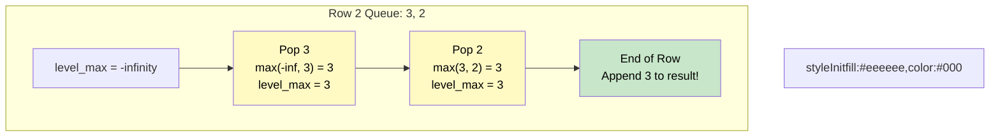

# 🚶‍♂️ Walkthrough: Find Largest Value in Each Tree Row

## 👶 Explain Like I'm 5
Look at each row of a tree. For each row, tell me the biggest number.
We just use our trusty Queue to look at the tree one row (level) at a time.
When we start looking at a new row, we grab a tiny notepad and write down "The biggest number I've seen so far is extremely small (negative infinity)."
As we look at each number in the row, we compare it to our notepad. If the number is bigger, we erase the notepad and write the new biggest number.
At the end of the row, we add whatever is on the notepad to our final list!

## 🎯 Core Strategy
This is a straightforward aggregation problem using the **Tree Breadth First Search (BFS)** pattern.

1. **Initialization**: If the `root` is None, return `[]`. Initialize `queue = deque([root])`. Initialize `result = []`.
2. **Level Loop**: Loop `while queue is not empty`:
   - Initialize `level_max = float('-inf')`. This is crucial because nodes can have negative values!
   - `level_size = len(queue)`
   - **Node Loop**: Loop exactly `level_size` times:
     - Pop `node` from queue.
     - **Update Max**: `level_max = max(level_max, node.val)`.
     - Append children to the queue (Left then Right).
   - Append `level_max` to `result`.
3. Return `result`.

## 🏃‍♂️ Step-by-Step Execution (Dry Run)
**Example Input Tree**:
```text
      1
     / \
    3   2
   / \   \
  5   3   9
```
Initialization: `queue = [1]`, `result = []`.

### Row 1
- `level_max` = `-inf`.
- Pop `1`. `level_max` becomes `max(-inf, 1) = 1`.
- Push `3`, `2`. Queue: `[3, 2]`.
- End row. `result` becomes `[1]`.

### Row 2
- `level_max` = `-inf`.
- Pop `3`. `level_max` becomes `max(-inf, 3) = 3`. Push `5`, `3`.
- Pop `2`. `level_max` becomes `max(3, 2) = 3`. Push `9`.
- Queue: `[5, 3, 9]`.
- End row. `result` becomes `[1, 3]`.

### Row 3
- `level_max` = `-inf`.
- Pop `5`. `level_max` becomes `5`.
- Pop `3`. `level_max` remains `5`.
- Pop `9`. `level_max` becomes `9`.
- Queue: `[]`.
- End row. `result` becomes `[1, 3, 9]`.

Return `[1, 3, 9]`.

## 📊 Visual Diagram
Here is how `level_max` updates across a row:



## 🛑 Edge Cases & Complexity

### Complexity
- **Time Complexity:** $O(N)$. We visit every node exactly once. Finding the max is an $O(1)$ operation per node.
- **Space Complexity:** $O(N)$. The BFS queue can hold up to $N/2$ nodes at the bottom level.

### Edge Cases Handled Safely
- **Empty Tree:** Safely returns `[]`.
- **Negative Values:** If a row is `[-5, -10, -3]`, `level_max` initialized to `0` would incorrectly return `0`. Initializing it to `float('-inf')` ensures it correctly captures `-3`.
