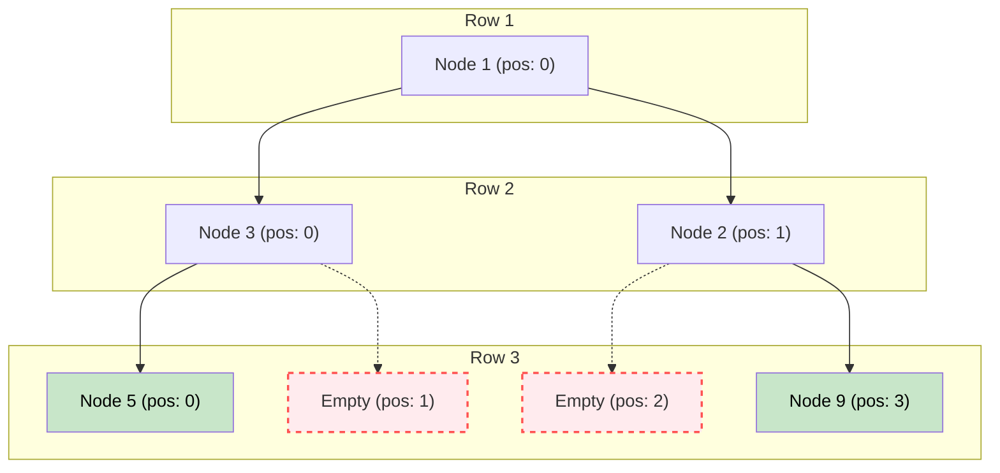

# 🚶‍♂️ Walkthrough: Maximum Width of Binary Tree

## 👶 Explain Like I'm 5
Imagine building a binary tree using LEGO blocks on a massive grid.
The root is at position 0. 
Every time you add a left child, it goes to `2 * parent_position`.
Every time you add a right child, it goes to `2 * parent_position + 1`.
Even if you skip adding some blocks (because they are `None`), the grid positions for the remaining blocks stay the same!
The "width" of a row is just the distance from the leftmost block in that row to the rightmost block, *including all the empty spaces between them*.
So, `width = Rightmost Position - Leftmost Position + 1`.

## 🎯 Core Strategy
This is an advanced application of the **Tree Breadth First Search (BFS)** pattern. Instead of just storing nodes in our queue, we store tuples: `(node, position_index)`.

1. **The Formula**: For any node at index `i`, its left child is at `2*i` and its right child is at `2*i + 1`. This is the standard array representation of a binary tree.
2. **Initialization**: Initialize `queue = deque([(root, 0)])` and `max_width = 0`.
3. **Level Loop**: Loop `while queue is not empty`:
   - `level_size = len(queue)`
   - **Prevent Overflow**: Get the `first_pos = queue[0][1]`. We subtract this `first_pos` from every node's index on this level to "normalize" the indices to start at 0. This stops the integers from exploding to massive numbers in very deep, skewed trees.
   - **Node Loop**: Loop `level_size` times:
     - Pop `(node, pos)` from queue.
     - Normalize: `pos -= first_pos`.
     - Push children with calculated indices:
       - Left child: `queue.append((node.left, 2 * pos))`
       - Right child: `queue.append((node.right, 2 * pos + 1))`
   - **Calculate Width**: By the end of the node loop, `pos` holds the normalized index of the *last* node processed. So, the width of the level is `pos + 1`.
   - Update `max_width = max(max_width, pos + 1)`.
4. Return `max_width`.

## 🏃‍♂️ Step-by-Step Execution (Dry Run)
**Example Input Tree**:
```text
      1
     / \
    3   2
   /     \
  5       9
```
Initialization: `queue = [(1, 0)]`, `max_width = 0`.

### Row 1
- `first_pos = 0`.
- Pop `(1, 0)`. Normalized `pos` = $0 - 0 = 0$.
- Push Left `(3, 2*0 = 0)`.
- Push Right `(2, 2*0+1 = 1)`.
- Queue: `[(3, 0), (2, 1)]`.
- `max_width` = $max(0, 0 + 1) = 1$.

### Row 2
- `first_pos = 0`. (First node is 3 at pos 0).
- Pop `(3, 0)`. Normalized `pos` = $0 - 0 = 0$.
  - Push Left `(5, 2*0 = 0)`.
- Pop `(2, 1)`. Normalized `pos` = $1 - 0 = 1$.
  - Push Right `(9, 2*1+1 = 3)`.
- Queue: `[(5, 0), (9, 3)]`.
- `max_width` = $max(1, 1 + 1) = 2$.

### Row 3
- `first_pos = 0`. (First node is 5 at pos 0).
- Pop `(5, 0)`. Normalized `pos` = $0 - 0 = 0$. (No children).
- Pop `(9, 3)`. Normalized `pos` = $3 - 0 = 3$. (No children).
- Queue: `[]`.
- `max_width` = $max(2, 3 + 1) = 4$.

Return `4`. (The width spans positions 0, 1, 2, 3, which is a width of 4).

## 📊 Visual Diagram
Here is how indices are mapped to nodes, mimicking an array:


*Notice how Row 3 has a width of 4, even though nodes only exist at positions 0 and 3.*

## 🛑 Edge Cases & Complexity

### Complexity
- **Time Complexity:** $O(N)$. We visit every node exactly once.
- **Space Complexity:** $O(N)$. The BFS queue holds up to $N/2$ node-index pairs.

### Edge Cases Handled Safely
- **Empty Tree:** Safely returns `0`.
- **Deep Skewed Tree:** E.g., a tree with only right children going down 100 levels. Without our `pos -= first_pos` trick, the index at level 100 would be $2^{100} - 1$, which is a ridiculously large number and might cause memory/performance issues in languages other than Python (Python handles arbitrarily large integers, but it's slow). With normalization, the first node of the level is always reset to index `0`, preventing this overflow! Width remains 1.
