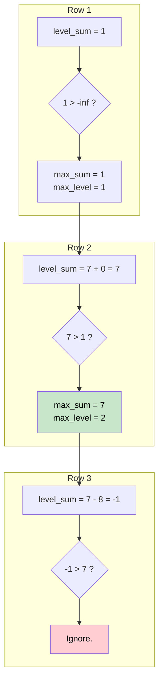

# 🚶‍♂️ Walkthrough: Maximum Level Sum of a Binary Tree

## 👶 Explain Like I'm 5
Imagine walking down the rows of an apple orchard. Some trees give you apples (positive numbers), but some are cursed and steal apples from you (negative numbers)!
As you walk through each row, you add up all the apples you gained (or lost).
At the end, you want to know: *Which row number gave me the most apples?*
If two rows gave you the exact same maximum number of apples, you prefer the row that you visited first (the smallest row number).

## 🎯 Core Strategy
This is an aggregation problem using the **Tree Breadth First Search (BFS)** pattern. We calculate the sum for each level and keep track of the maximum sum and the level at which it occurred.

1. **Initialization**: If the `root` is None, return `0`. 
   - `queue = deque([root])`
   - `max_sum = float('-inf')` (Crucial because all sums could theoretically be negative).
   - `max_level = 1` (The row we will return at the end).
   - `level = 0` (Our current row counter).
2. **Level Loop**: Loop `while queue is not empty`:
   - Increment `level += 1`.
   - Initialize `level_sum = 0`.
   - **Node Loop**: Loop exactly `level_size` times (`len(queue)`):
     - Pop `node` from queue.
     - Add `node.val` to `level_sum`.
     - Append children to the queue (Left then Right).
   - **Update Max**: If `level_sum > max_sum`: (Note the strictly greater `>` sign, which naturally breaks ties by preferring the earlier level!)
     - `max_sum = level_sum`
     - `max_level = level`
3. Return `max_level`.

## 🏃‍♂️ Step-by-Step Execution (Dry Run)
**Example Input Tree**:
```text
      1
     / \
    7   0
   / \
  7  -8
```
Initialization: `queue = [1]`, `max_sum = -inf`, `max_level = 1`, `level = 0`.

### Row 1
- `level = 1`. `level_sum = 0`.
- Pop `1`. `level_sum` becomes `1`.
- Push `7`, `0`. Queue: `[7, 0]`.
- Is `level_sum (1) > max_sum (-inf)`? Yes!
- `max_sum = 1`, `max_level = 1`.

### Row 2
- `level = 2`. `level_sum = 0`.
- Pop `7`. `level_sum` becomes `7`. Push `7`, `-8`.
- Pop `0`. `level_sum` stays `7`. Push nothing.
- Queue: `[7, -8]`.
- Is `level_sum (7) > max_sum (1)`? Yes!
- `max_sum = 7`, `max_level = 2`.

### Row 3
- `level = 3`. `level_sum = 0`.
- Pop `7`. `level_sum` becomes `7`.
- Pop `-8`. `level_sum` becomes `-1`.
- Queue: `[]`.
- Is `level_sum (-1) > max_sum (7)`? No. 

Return `max_level`, which is `2`. (Row 2 has the highest sum: 7).

## 📊 Visual Diagram
Here is how the algorithm updates its tracking variables:



## 🛑 Edge Cases & Complexity

### Complexity
- **Time Complexity:** $O(N)$. We visit every node exactly once.
- **Space Complexity:** $O(N)$. The BFS queue holds up to $N/2$ nodes.

### Edge Cases Handled Safely
- **All Negative Values:** If the tree is just `-100`, `max_sum` starts at `-inf`, gets updated to `-100`, and returns level `1`. This works perfectly because of `-inf`.
- **Tie-Breaker:** If Row 1 sums to 5, and Row 2 sums to 5. `level_sum > max_sum` becomes `5 > 5`, which is False. So `max_level` remains 1. This perfectly fulfills the requirement "return the smallest level x".
