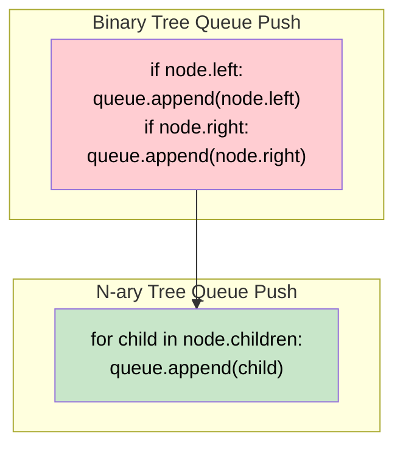

# 🚶‍♂️ Walkthrough: N-ary Tree Level Order Traversal

## 👶 Explain Like I'm 5
Imagine a family tree, but instead of everyone having exactly two children (left and right), people can have *any* number of children! Some might have 0, some might have 3, some might have 10.
We want to take a picture of this massive family, generation by generation.
We use the exact same strategy as before: line everyone up in a Queue.
The only difference is that when a parent gets out of the line, instead of just calling their `left` and `right` kids to join the back of the line, they call *all* of their children in order!

## 🎯 Core Strategy
This is the fundamental **Tree Breadth First Search (BFS)** pattern, but generalized for N-ary trees. 
Instead of explicitly checking `if node.left:` and `if node.right:`, we just iterate over the `node.children` array.

1. **Initialization**: If the `root` is None, return `[]`. Initialize `queue = deque([root])`. Initialize `result = []`.
2. **Level Loop**: Loop `while queue is not empty`:
   - `level_size = len(queue)`
   - `current_level = []`
   - **Node Loop**: Loop exactly `level_size` times:
     - Pop `node` from queue.
     - Add `node.val` to `current_level`.
     - **Push Children**: Loop over `node.children`:
       - Append each `child` to the queue.
   - Append `current_level` to `result`.
3. Return `result`.

## 🏃‍♂️ Step-by-Step Execution (Dry Run)
**Example Input Tree**:
```text
        1
      / | \
     3  2  4
    / \
   5   6
```
Initialization: `queue = [1]`, `result = []`.

### Row 1 (Generation 1)
- `level_size = 1`.
- Pop `1`. Add to `current_level`.
- Loop over `1`'s children: `[3, 2, 4]`.
  - Push `3`, `2`, `4` to queue.
- `queue` is now `[3, 2, 4]`.
- End of loop. `result` becomes `[[1]]`.

### Row 2 (Generation 2)
- `level_size = 3`.
- **Pop `3`**: Add to `current_level`.
  - Loop over `3`'s children: `[5, 6]`.
  - Push `5`, `6`. Queue: `[2, 4, 5, 6]`.
- **Pop `2`**: Add to `current_level`.
  - Loop over `2`'s children: `[]`. (None).
- **Pop `4`**: Add to `current_level`.
  - Loop over `4`'s children: `[]`. (None).
- End of loop. `current_level` is `[3, 2, 4]`.
- `result` becomes `[[1], [3, 2, 4]]`.

### Row 3 (Generation 3)
- `level_size = 2`.
- **Pop `5`**: No children.
- **Pop `6`**: No children.
- Queue is empty `[]`.
- End of loop. `current_level` is `[5, 6]`.
- `result` becomes `[[1], [3, 2, 4], [5, 6]]`.

## 📊 Visual Diagram
Notice how the transition from Binary Tree to N-ary Tree just involves a simple `for` loop over the children array instead of hardcoded left/right checks:



## 🛑 Edge Cases & Complexity

### Complexity
- **Time Complexity:** $O(N)$. We visit every node exactly once, and appending to the queue takes $O(1)$ time per child. The sum of all children across all nodes is exactly $N-1$ (every node except the root is someone's child).
- **Space Complexity:** $O(N)$. The BFS queue holds up to the maximum width of the tree, which can be $O(N)$ in a very wide tree (e.g., a root with $N-1$ children).

### Edge Cases Handled Safely
- **Empty Tree:** `if not root: return []` handles it.
- **Single Node:** `root = Node(42)`. Returns `[[42]]`. `node.children` is an empty list `[]`, so the inner loop simply skips, and the queue empties gracefully.
- **Extremely Wide Tree:** If the root has 1000 children, the algorithm easily pushes them all onto the queue in one go during the first iteration. The next iteration will have a `level_size` of 1000. It scales perfectly.
