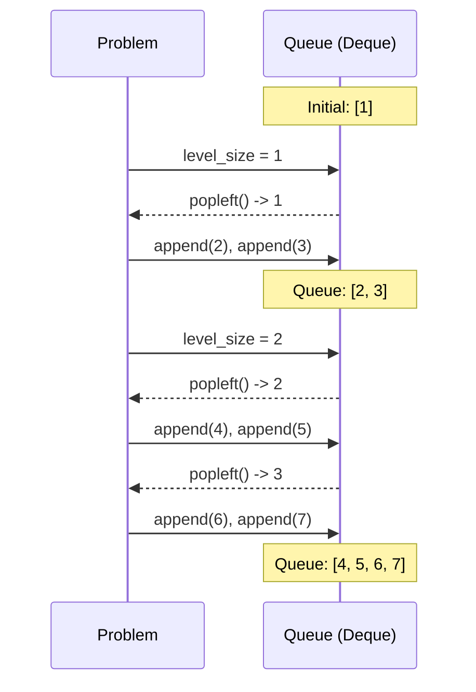

# Pattern 11: Tree Breadth First Search (BFS)

## 👶 Explain Like I'm 5
Imagine a giant family tree hanging on the wall.
At the very top is the Great-Grandparent (the Root).
Below them are the Grandparents (Level 1).
Below them are the Parents (Level 2).
Below them are the Kids (Level 3).
If you want to introduce yourself to the whole family, you could start at the top, 
and then just randomly run up and down the branches. That would be chaotic!
Instead, you use **Breadth First Search (BFS)**.
You shake hands with the Great-Grandparent first. 
Then, you shake hands with ALL the Grandparents from left to right.
Then, you shake hands with ALL the Parents from left to right.
Finally, you shake hands with ALL the Kids from left to right.
You visit the tree **Level by Level**, never going down to the next level until you 
have met everyone on the current level.
To do this, we use a special line at a theme park called a **Queue**. 
The first person who gets in line is the first person who gets on the ride 
(**FIFO** - First In, First Out).

---

## 🧩 Core Idea & Pattern Detection

The BFS pattern works by using a **Queue** to keep track of all the nodes on the current level before moving on to the next level. We process nodes level-by-level, from top to bottom, left to right.

### When to use it:
- The problem asks you to traverse a tree **level-by-level**.
- You need to find the **shortest path** or minimum depth in an unweighted tree/graph.
- You need to connect nodes that are on the same level (siblings).
- The problem mentions "Zigzag" or "Level averages".

```mermaid
flowchart TD
    ROOT((1)) --> L((2))
    ROOT --> R((3))
    L --> LL((4))
    L --> LR((5))
    R --> RL((6))
    R --> RR((7))
    
    classDef level0 fill:#ffcccc,stroke:#333,stroke-width:2px;
    classDef level1 fill:#ccffcc,stroke:#333,stroke-width:2px;
    classDef level2 fill:#ccccff,stroke:#333,stroke-width:2px;
    
    class ROOT level0;
    class L,R level1;
    class LL,LR,RL,RR level2;
    
    Note right of ROOT: Level 0: [1]
    Note right of R: Level 1: [2, 3]
    Note right of RR: Level 2: [4, 5, 6, 7]
```

---

## 🔧 Algorithmic Anatomy

### Recipe: Standard BFS Level Traversal
In Python, we use `collections.deque` (double-ended queue) for our Queue because popping from the front of a standard list takes O(N) time, but `deque.popleft()` takes O(1) time!

1. **Initialization**: `queue = deque([root])`
2. **Main Loop**: `while queue:`
3. **Level Size**: `level_size = len(queue)` (Crucial! Takes a snapshot of the current level).
4. **Level Loop**: `for _ in range(level_size):`
   - `current_node = queue.popleft()`
   - Process `current_node`.
   - `if current_node.left: queue.append(current_node.left)`
   - `if current_node.right: queue.append(current_node.right)`



---

## 🛑 Per-Variant DOs and DON'Ts

| Variant | DO | DON'T |
|---------|----|-------|
| **Standard Level Order** | **DO** take `level_size = len(queue)` at the START of the `while` loop. | **DON'T** use `for _ in range(len(queue)):` because `len(queue)` changes dynamically as you append children! |
| **Zigzag Traversal** | **DO** use a regular deque, but when adding values to the `current_level` list, insert them at the beginning (`collections.deque.appendleft()`) if the direction is reversed. | **DON'T** try to append children to the queue in reverse order. It messes up the next level completely. Just reverse the output! |
| **Minimum Depth** | **DO** return the depth immediately as soon as you find the first leaf node (a node with no left or right child). | **DON'T** traverse the entire tree to find the minimum depth. BFS guarantees the first leaf found is the shallowest! |

---

## ⏱️ Complexity Analysis

| Aspect | Complexity | Why |
|--------|-----------|-----|
| **Time** | **O(N)** | We visit every node in the tree exactly once. `popleft()` and `append()` are O(1). |
| **Space** | **O(N)** | The Queue can store at most `N/2` nodes (the maximum number of leaf nodes at the bottom level of a perfectly balanced tree). O(N/2) simplifies to O(N). |

---

## ⚠️ Common Pitfalls

1. **Using a standard List for the Queue:** `queue.pop(0)` is strictly `O(N)` because every element behind it has to shift forward. This makes the whole algorithm `O(N²)`. Always `from collections import deque` and use `.popleft()`.
2. **Forgetting to check if Root is None:** If the input tree is empty, `queue = deque([None])` will crash your code inside the loop. Always start with `if not root: return []`.
3. **Dynamic length in the `for` loop:** Do not write `for i in range(len(queue)):`. As you append children, the length grows, and the loop runs forever! Always save it to a variable first: `level_size = len(queue)`.

---

## ✅ Problems in This Pattern

| # | Problem | Difficulty | Key Twist |
|---|---------|------------|-----------|
| 1 | Binary Tree Level Order | Easy | The foundational BFS Level loop. |
| 2 | Reverse Level Order | Easy | Insert the level lists at the beginning of the result list. |
| 3 | Zigzag Traversal | Medium | Use a boolean flag `left_to_right` to reverse the current level list before appending to result. |
| 4 | Level Averages | Easy | Accumulate sum for the level, divide by `level_size`. |
| 5 | Minimum Depth | Easy | Return depth immediately upon finding the first leaf node. |
| 6 | Level Order Successor | Easy | Don't need `level_size`! Just standard BFS, return the next node popped after the target. |
| 7 | Connect Siblings | Medium | **Advanced**: Link `current_node.next = queue[0]` during the level traversal. |
