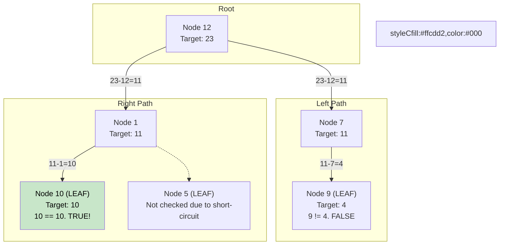

# 🚶‍♂️ Walkthrough: Binary Tree Path Sum

## 👶 Explain Like I'm 5
You are walking through a magical forest (a tree).
Every tree branch has a number on it.
You have a backpack with a target number, say `22`.
As you walk down a path, you subtract the number you see from your backpack.
If the first branch says `5`, your backpack now holds `17`.
If you reach the very end of the path (a leaf node) and your backpack is exactly empty (`0`), you win!
But if you reach a leaf and your backpack isn't `0`, that path was a loser, so you magically teleport backward (Backtracking) and try a different path!

## 🎯 Core Strategy
This is the foundational **Tree Depth First Search (DFS)** pattern. We explore all the way down to a leaf before looking at other paths. We do this by recursively calling the function on the left and right children while passing down the updated state (the remaining sum needed).

1. **Base Case (Empty)**: If the `root` is None, return `False`. (A non-existent path can't equal the sum).
2. **Base Case (Leaf)**: If the current node is a leaf (no left, no right children):
   - Check if `root.value == target_sum`. If it is, return `True`! 
   - Note: We check if it equals the *current* `target_sum`, which has been reduced by the parent nodes.
3. **Recursive Step**: If it's not a leaf, recursively check the left and right subtrees.
   - We subtract the current node's value from the `target_sum` before passing it down.
   - `return has_path_sum(root.left, target_sum - root.value) or has_path_sum(root.right, target_sum - root.value)`

## 🏃‍♂️ Step-by-Step Execution (Dry Run)
**Example Input Tree**:
```text
      12
     /  \
    7    1
   /    / \
  9    10  5
```
**Target Sum**: `23`

### The Descent
1. **At Node 12**:
   - Is it a leaf? No.
   - Recursively call left and right with `target_sum = 23 - 12 = 11`.
2. **At Node 7 (Left of 12)**:
   - Target is `11`.
   - Is it a leaf? No.
   - Recursively call left and right with `target_sum = 11 - 7 = 4`.
3. **At Node 9 (Left of 7)**:
   - Target is `4`.
   - Is it a leaf? Yes!
   - Does `9 == 4`? No. Return `False`.

### The Backtrack
- We return `False` back up to Node 7. Node 7 checks its right child, which is None (returns False). Node 7 returns `False` back up to Node 12.
- Now Node 12 explores its right child.

4. **At Node 1 (Right of 12)**:
   - Target is `11`. (Remember, this branch stems from Node 12!).
   - Is it a leaf? No.
   - Recursively call left and right with `target_sum = 11 - 1 = 10`.
5. **At Node 10 (Left of 1)**:
   - Target is `10`.
   - Is it a leaf? Yes!
   - Does `10 == 10`? **YES!** Return `True`!

- Node 10 returns `True` to Node 1. Node 1 returns `True` to Node 12. The final answer is `True`. (The recursion short-circuits via the `or` operator, so Node 5 is never checked).

## 📊 Visual Diagram
Here is how the recursion stack tracks the state of the remaining sum down different paths:



## 🛑 Edge Cases & Complexity

### Complexity
- **Time Complexity:** $O(N)$ in the worst case (where we have to visit every node).
- **Space Complexity:** $O(H)$ where $H$ is the height of the tree. This is the space used by the recursion stack. In a balanced tree, it's $O(\log N)$. In the worst-case skewed tree, it's $O(N)$.

### Edge Cases Handled Safely
- **Empty Tree:** `if not root:` immediately returns `False`.
- **Target met early but not at a leaf:** If the path is `12 -> 1`, and the target is `13`, it doesn't accidentally return True at Node 1 unless Node 1 has no children. The problem explicitly asks for a *root-to-leaf* path sum. Our `if not root.left and not root.right` check enforces this.
