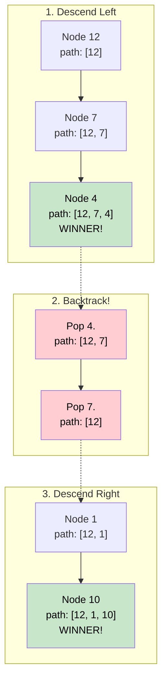

# 🚶‍♂️ Walkthrough: All Paths for a Sum

## 👶 Explain Like I'm 5
This is just like the previous game where we walked through the magical forest trying to empty our backpack to exactly `0`.
BUT this time, instead of just shouting "I won!" when you reach a leaf and hit `0`, you have to write down the EXACT path you took to win. 
And you have to find ALL the winning paths, not just one!

Because you are walking up and down branches, you keep a "current path" list on a clipboard.
When you step onto a branch, you write that number down on your clipboard.
When you hit a dead end and need to turn around (Backtracking), you ERASE that number from your clipboard before you step back up. This way, your clipboard always perfectly matches the path you are currently standing on!

## 🎯 Core Strategy
This introduces the concept of **Backtracking** alongside **Tree Depth First Search (DFS)**. As we recursively traverse down the tree, we maintain the current path in an array. When we return from a recursive call, we must remove the node we just visited to keep the array clean for the next branch.

1. **Initialization**: Initialize an empty list `all_paths = []` to store the winning paths.
2. **Recursive Helper**: Define `find_paths_recursive(node, current_sum, current_path)`.
   - **Base Case**: If `node` is None, return.
   - **Add to Path**: Append the current node's value to `current_path`.
   - **Check for Winner**: If it's a leaf node AND `current_sum == node.value`:
     - We found a winner! 
     - **CRITICAL STEP**: Append a COPY of `current_path` to `all_paths` (e.g., `list(current_path)`). If we just append the reference, our future backtracking steps will erase the winning path we just saved!
   - **Explore**: If it's not a winner, recursively call the left and right subtrees with `current_sum - node.value`.
   - **BACKTRACK**: After exploring both subtrees, we are about to return to the parent node. We MUST remove the current node from `current_path` by calling `current_path.pop()`.
3. Call the helper with the root and return `all_paths`.

## 🏃‍♂️ Step-by-Step Execution (Dry Run)
**Example Input Tree**:
```text
      12
     /  \
    7    1
   /    / \
  4    10  5
```
**Target**: `23`

### The Descent
1. **Node 12**: `path = [12]`. Call Left(7) with target `11`.
2. **Node 7**: `path = [12, 7]`. Call Left(4) with target `4`.
3. **Node 4**: `path = [12, 7, 4]`. 
   - Is Leaf? Yes. Does `4 == 4`? Yes! 
   - Append **COPY** of `[12, 7, 4]` to `all_paths`.

### The Backtrack
- We finished Node 4. **Backtrack**: `path.pop()`. `path` is now `[12, 7]`.
- Return to Node 7. Node 7 has no right child.
- We finished Node 7. **Backtrack**: `path.pop()`. `path` is now `[12]`.
- Return to Node 12. Call Right(1) with target `11`.

### Exploring the Right Side
4. **Node 1**: `path = [12, 1]`. Call Left(10) with target `10`.
5. **Node 10**: `path = [12, 1, 10]`. 
   - Is Leaf? Yes. Does `10 == 10`? Yes!
   - Append **COPY** of `[12, 1, 10]` to `all_paths`.
- Finished Node 10. **Backtrack**: `path.pop()`. `path` is `[12, 1]`.
- Return to Node 1. Call Right(5) with target `10`.
6. **Node 5**: `path = [12, 1, 5]`. 
   - Is Leaf? Yes. Does `5 == 10`? No.
- Finished Node 5. **Backtrack**: `path.pop()`. `path` is `[12, 1]`.
- Finished Node 1. **Backtrack**: `path.pop()`. `path` is `[12]`.

Traversal complete! `all_paths` contains `[[12, 7, 4], [12, 1, 10]]`.

## 📊 Visual Diagram
Here is how `current_path` correctly shrinks during the backtrack phase so it can grow down the right side correctly:



## 🛑 Edge Cases & Complexity

### Complexity
- **Time Complexity:** $O(N^2)$. In the worst-case scenario (e.g., every single root-to-leaf path equals the target sum), we have to copy the `current_path` for every single leaf node. Creating a copy of an array of length $H$ takes $O(H)$ time. With $N/2$ leaves, this approaches $O(N \log N)$ for balanced trees, and $O(N^2)$ for skewed trees.
- **Space Complexity:** $O(N \log N)$. The recursion stack takes $O(H)$ space. The `all_paths` array will store the copies of the paths. If there are many valid paths, storing them all can take significant space.

### Edge Cases Handled Safely
- **Forgetting to copy the array:** If you just use `all_paths.append(current_path)`, then as your recursion progresses, it modifies that *exact same list object in memory*. By the time the algorithm finishes, `current_path` will be empty `[]`, and `all_paths` will look like `[[], [], []]`. Using `list(current_path)` or `current_path.copy()` prevents this.
- **Empty Tree:** Safely handled by the initial `if not node:` check. Returns `[]`.
