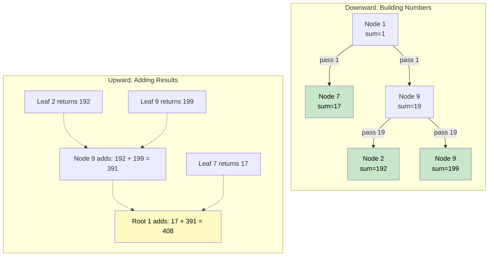

# 🚶‍♂️ Walkthrough: Sum of Path Numbers

## 👶 Explain Like I'm 5
Imagine every node in the tree is a single digit (0-9).
As you walk down a path from the top of the tree to a leaf, you write down the numbers you see.
If you see a `1`, then a `7`, then a `3`, you just formed the number `173`.
Your job is to find ALL the numbers formed by every possible path to the bottom, and add them all together!

How do we build the number as we walk down?
Math! If you currently have the number `17`, and you step on a `3`, you don't add 3 to 17 (that would be 20). You multiply 17 by 10 (which makes it 170), and THEN add 3 (which makes it 173).
Formula: `current_number = (current_number * 10) + node.value`
When you hit a leaf, you return that fully built number.
When branches split, you just add the total from the left branch and the total from the right branch!

## 🎯 Core Strategy
This is an elegant **Tree Depth First Search (DFS)** application where state is passed *down* the tree, and the aggregated results are passed *up*.

1. **Helper Function**: We define a recursive helper `find_sum(node, path_sum)` that takes the current node and the number built so far.
2. **Base Case (Empty)**: If the `node` is None, return `0`.
3. **State Update**: Calculate the new number: `path_sum = 10 * path_sum + node.value`.
4. **Base Case (Leaf)**: Is this a leaf node? (`if not node.left and not node.right:`)
   - If yes, we have finished building this specific number. Return `path_sum`!
5. **Recursive Step**: If it's not a leaf, we need to collect the numbers from both branches. Return the sum of the left subtree PLUS the sum of the right subtree.
   - `return find_sum(node.left, path_sum) + find_sum(node.right, path_sum)`
6. **Initialization**: Start the recursion from the root with a starting sum of `0`: `return find_sum(root, 0)`.

## 🏃‍♂️ Step-by-Step Execution (Dry Run)
**Example Input Tree**:
```text
      1
     / \
    7   9
       / \
      2   9
```

### The DFS Process
1. **At Node 1**:
   - Incoming `path_sum` = 0.
   - New `path_sum` = $10 * 0 + 1 = 1$.
   - Not a leaf. Recurse Left and Right with `path_sum = 1`.
2. **At Node 7 (Left of 1)**:
   - Incoming `path_sum` = 1.
   - New `path_sum` = $10 * 1 + 7 = 17$.
   - Is a leaf! **Return `17`**.
3. **At Node 9 (Right of 1)**:
   - Incoming `path_sum` = 1.
   - New `path_sum` = $10 * 1 + 9 = 19$.
   - Not a leaf. Recurse Left and Right with `path_sum = 19`.
4. **At Node 2 (Left of 9)**:
   - Incoming `path_sum` = 19.
   - New `path_sum` = $10 * 19 + 2 = 192$.
   - Is a leaf! **Return `192`**.
5. **At Node 9 (Right of 9)**:
   - Incoming `path_sum` = 19.
   - New `path_sum` = $10 * 19 + 9 = 199$.
   - Is a leaf! **Return `199`**.

### Aggregating Back Up
- Node 9 (right of 1) receives `192` from left and `199` from right. Returns `192 + 199 = 391`.
- Node 1 receives `17` from left and `391` from right. Returns `17 + 391 = 408`.

Final Answer: `408`.

## 📊 Visual Diagram
Here is how the numbers are built on the way down, and summed on the way up:



## 🛑 Edge Cases & Complexity

### Complexity
- **Time Complexity:** $O(N)$. We visit every node exactly once. The math operations (`* 10 + value`) take $O(1)$ time.
- **Space Complexity:** $O(H)$ where $H$ is the tree height, representing the recursion stack. $O(\log N)$ for balanced, $O(N)$ for skewed.

### Edge Cases Handled Safely
- **Empty Tree:** Safely handled by `if not node: return 0`.
- **Node value is 0:** e.g., a path is `1 -> 0 -> 2`.
  - Node 1: `path_sum` = 1.
  - Node 0: `path_sum` = $10 * 1 + 0 = 10$.
  - Node 2: `path_sum` = $10 * 10 + 2 = 102$.
  - Handled perfectly via the math formula!
- **Single Node:** `root = [5]`. `path_sum` becomes `5`. It's a leaf, so it returns `5`. Correct.
