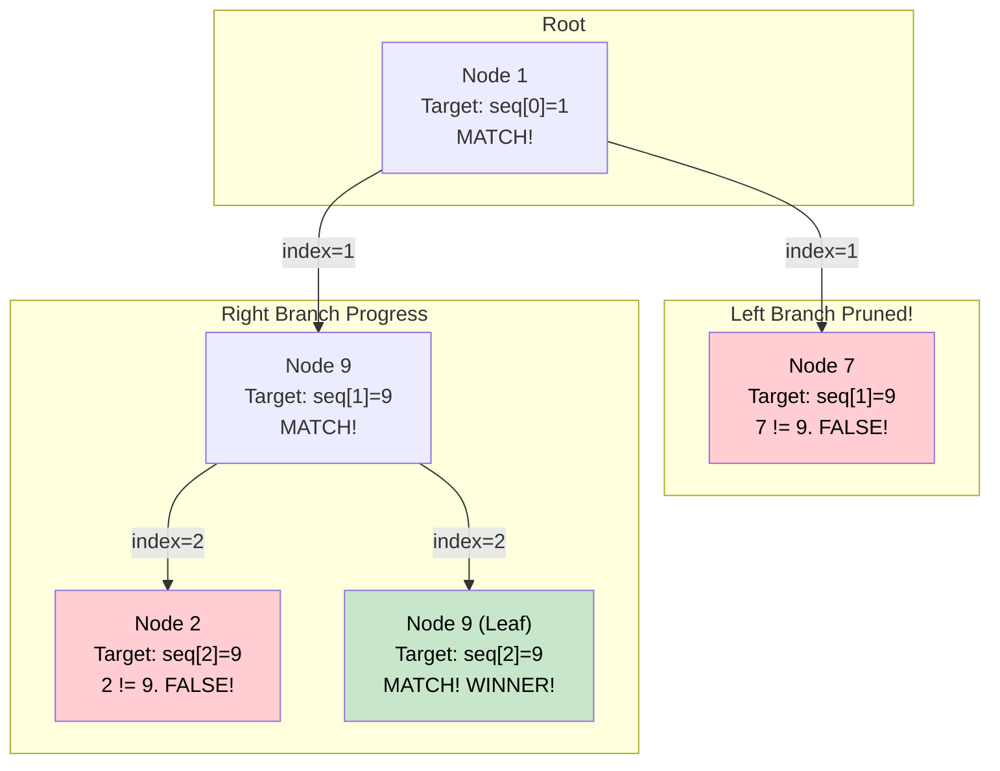

# 🚶‍♂️ Walkthrough: Path With Given Sequence

## 👶 Explain Like I'm 5
You are walking down a path in the forest, and you have a treasure map.
The map says: "Walk exactly on the numbers: 1, then 9, then 9".
If you step on a `1`, great! You check the map, and the next number should be `9`.
If the next branch says `5`, you know immediately this is the wrong path! You don't even need to walk to the end of it; you can turn around right away.
If you step on `1`, then `9`, then `9`, AND you are at a leaf (the end of a path), you found the treasure!

To keep track of where you are on the map, you carry a pointer called `sequence_index`. Every time you step on a correct number, `sequence_index` goes up by 1.

## 🎯 Core Strategy
This is an efficient **Tree Depth First Search (DFS)** implementation with **early exit**. We don't need to blindly explore the whole tree. If a path deviates from the sequence at any point, we prune that branch immediately.

1. **Base Case (Empty/Invalid)**: If `root` is None or `sequence` is empty, return `False`.
2. **Recursive Helper**: Define `find_path_recursive(node, sequence, sequence_index)`.
3. **Early Exits (Pruning)**:
   - If `node` is None, return `False`.
   - If `sequence_index` is too large (out of bounds), return `False`.
   - If `node.value != sequence[sequence_index]`, the number doesn't match! Return `False` immediately.
4. **Win Condition**: If the number matches, we ask: Is this the very end of the map AND the end of the tree?
   - `if sequence_index == len(sequence) - 1 and not node.left and not node.right:`
     - Return `True`!
5. **Recursive Step**: If it's not the end yet, keep walking down both the left and right branches, passing `sequence_index + 1` so they look for the next number.
   - `return find_path_recursive(node.left, ...) or find_path_recursive(node.right, ...)`

## 🏃‍♂️ Step-by-Step Execution (Dry Run)
**Example Input Tree**:
```text
      1
     / \
    7   9
       / \
      2   9
```
**Target Sequence**: `[1, 9, 9]`

### The Search
1. **Node 1 (Index 0)**:
   - Does `1` match `seq[0]` (which is 1)? Yes!
   - Is it the last index and a leaf? No.
   - Recurse Left and Right with `index = 1`.
2. **Node 7 (Left of 1) (Index 1)**:
   - Does `7` match `seq[1]` (which is 9)? **NO!**
   - **Early Exit!** Return `False` immediately. We don't explore under 7.
3. **Node 9 (Right of 1) (Index 1)**:
   - Does `9` match `seq[1]` (which is 9)? Yes!
   - Is it the last index and a leaf? No.
   - Recurse Left and Right with `index = 2`.
4. **Node 2 (Left of 9) (Index 2)**:
   - Does `2` match `seq[2]` (which is 9)? **NO!**
   - **Early Exit!** Return `False`.
5. **Node 9 (Right of 9) (Index 2)**:
   - Does `9` match `seq[2]` (which is 9)? Yes!
   - Is it the last index (2 == 3-1)? Yes.
   - Is it a leaf? Yes.
   - **Return `True`!**

Node 9 returns `True` to its parent, which propagates up to the root. Final answer: `True`.

## 📊 Visual Diagram
Here is how the algorithm aggressively prunes bad paths (like Node 7 and Node 2):



## 🛑 Edge Cases & Complexity

### Complexity
- **Time Complexity:** $O(N)$ in the worst case (e.g., all paths perfectly match the sequence up to the leaves, but fail at the very end). However, due to early exit pruning, average time complexity is much better.
- **Space Complexity:** $O(H)$ for the recursion stack, where $H$ is the height of the tree.

### Edge Cases Handled Safely
- **Sequence is longer than any path:** Safely handles this because when it reaches a leaf, `index` won't equal `len(sequence) - 1`, so it won't return `True`. It will recurse into `None` children and return `False`.
- **Sequence is shorter than the path:** E.g., Tree is `1 -> 9 -> 2`, Sequence is `[1, 9]`. 
  - At node 9, index matches, but node is not a leaf. It recurses to node 2 with index 2.
  - At node 2, `index >= seq_len` triggers our out-of-bounds check `if sequence_index >= seq_len: return False`. It correctly rejects the path!
- **Empty Sequence or Tree:** `if not root or not sequence: return False` catches these immediately.
