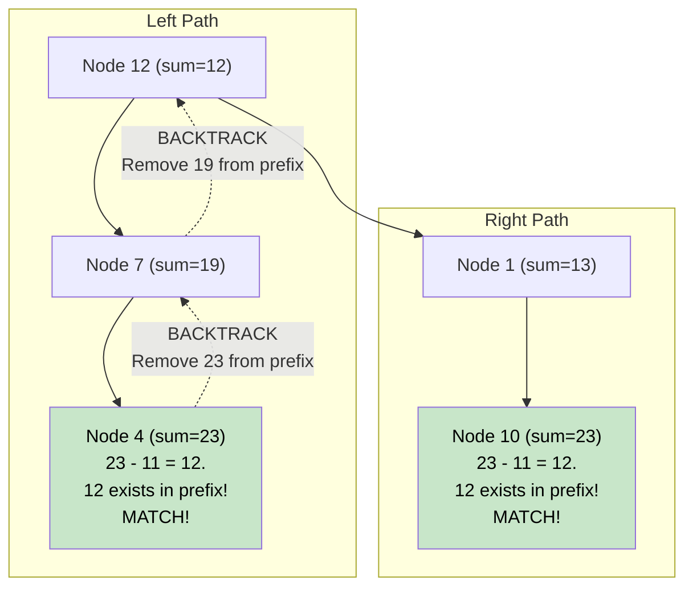

# 🚶‍♂️ Walkthrough: Count Paths for a Sum

## 👶 Explain Like I'm 5
Remember the trick where we used a magical notebook (Hash Map) to store our Running Totals in an array? 
This is the EXACT same trick, but instead of an array, it's a tree!
The paths don't have to start at the root, and they don't have to end at a leaf. They just have to go straight down.

As we walk down a branch, we keep a Running Total.
If the Target is `8`, and our Running Total is `10`, we check our magical notebook:
"Did I ever have a Running Total of `2` higher up on this EXACT same path?"
If yes, that means the numbers between that old spot and our current spot add up exactly to `8`!

BUT, there is a catch. When we hit a dead end and backtrack to try a different branch, we MUST erase our Running Total from the notebook! We can't let the left branch's totals accidentally get used by the right branch!

## 🎯 Core Strategy
This marries the **Subarray Sum Equals K (Prefix Sum)** technique with **Tree Depth First Search (DFS)** and **Backtracking**.

1. **Global/Shared State**: Initialize a Hash Map `prefix_sums = {0: 1}`. (Base case: a path perfectly matches the target from the very beginning).
2. **Recursive DFS**: Define `dfs(node, current_sum)`.
3. **Update Sum**: `current_sum += node.value`.
4. **Check Notebook**: Check if `current_sum - target_sum` exists in `prefix_sums`. If it does, add that frequency to our `path_count`.
5. **Add to Notebook**: Add the current `current_sum` to `prefix_sums` (increment by 1).
6. **Recurse**: Recursively calculate the path counts for the left and right subtrees and add them to `path_count`.
7. **BACKTRACK (CRITICAL)**: Before returning from this node, DECREMENT the `current_sum` in `prefix_sums` by 1. We are stepping back up the tree, so this sum is no longer available to other parallel branches!

## 🏃‍♂️ Step-by-Step Execution (Dry Run)
**Example Input Tree**:
```text
      12
     /  \
    7    1
   /    / \
  4    10  5
```
**Target**: `11`
Initialization: `prefix = {0: 1}`.

### Down the Left Side
1. **Node 12**: `current_sum = 12`. 
   - `needed = 12 - 11 = 1`. Not in `prefix`.
   - `prefix` becomes `{0: 1, 12: 1}`. 
   - Recurse Left.
2. **Node 7**: `current_sum = 19`.
   - `needed = 19 - 11 = 8`. Not in `prefix`.
   - `prefix` becomes `{0: 1, 12: 1, 19: 1}`.
   - Recurse Left.
3. **Node 4**: `current_sum = 23`.
   - `needed = 23 - 11 = 12`. **Wait, 12 IS in `prefix`!** (Frequency is 1).
   - This means the path from *after* the node that gave 12 (Node 12 itself) down to this node (Node 7 -> Node 4) equals 11! `7 + 4 = 11`.
   - `path_count += 1`.
   - `prefix` becomes `{0: 1, 12: 1, 19: 1, 23: 1}`.

### Backtracking
- Finished Node 4. **Backtrack**: `prefix[23] -= 1`. `prefix` is `{0: 1, 12: 1, 19: 1}`.
- Finished Node 7. **Backtrack**: `prefix[19] -= 1`. `prefix` is `{0: 1, 12: 1}`.
- Back at Node 12. Recurse Right.

### Down the Right Side
4. **Node 1**: `current_sum = 13`.
   - `needed = 13 - 11 = 2`. Not in `prefix`.
   - `prefix` becomes `{0: 1, 12: 1, 13: 1}`.
   - Recurse Left.
5. **Node 10**: `current_sum = 23`.
   - `needed = 23 - 11 = 12`. **Wait, 12 IS in `prefix`!** (Frequency is 1).
   - The path `1 -> 10 = 11`.
   - `path_count += 1`.
   - `prefix` becomes `{0: 1, 12: 1, 13: 1, 23: 1}`.

Total `path_count` is `2`.

## 📊 Visual Diagram
Notice how the backtracking prevents Node 10 from falsely seeing the `23` that was generated by Node 4 on the other side of the tree:



## 🛑 Edge Cases & Complexity

### Complexity
- **Time Complexity:** $O(N)$. We visit every node exactly once. Looking up the `needed` sum in the hash map is $O(1)$. This is vastly superior to the brute-force $O(N^2)$ approach where we start a new DFS from every node.
- **Space Complexity:** $O(N)$. The hash map can store up to $N$ distinct prefix sums if all values in a skewed tree are positive. The recursion stack also takes $O(H)$ space.

### Edge Cases Handled Safely
- **Negative Values:** The hash map handles negative values flawlessly. The `current_sum` might dip up and down, but the math `current - needed = target` always holds true regardless of signs.
- **Path starts at Root:** The initialization `prefix_sums = {0: 1}` ensures that if `current_sum` perfectly equals `target_sum`, then `current_sum - target_sum = 0`. The map looks up `0`, finds `1`, and correctly registers the path!
