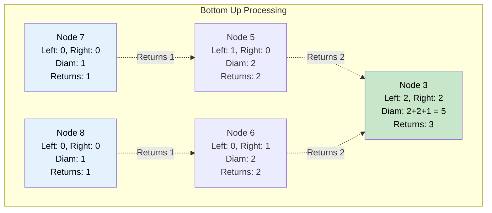

# 🚶‍♂️ Walkthrough: Tree Diameter

## 👶 Explain Like I'm 5
Imagine stretching a string from one leaf of the tree as far across the tree as possible to another leaf. 
The length of this string is the "Diameter" of the tree.

You might think: "Oh, it's just the distance from the furthest leaf on the left to the furthest leaf on the right of the ROOT!"
But wait! What if the left branch is extremely short, but the right branch is MASSIVE and branches out into its own two giant sub-branches? 
The longest string might be completely inside the right branch, never even touching the root!

To solve this, we can't just check from the top down. We have to work **BOTTOM-UP**.
Every node asks its left child: "How tall are you?"
And asks its right child: "How tall are you?"
The node then says: "If I stretch my string from the bottom of my left child, through me, down to the bottom of my right child, the string would be exactly `left_tall + right_tall + 1` nodes long!"
Every single node calculates this, and we just remember the biggest number we see.
To answer its own parent, the node passes up its OWN height: `max(left_tall, right_tall) + 1`.

## 🎯 Core Strategy
This is a classic **Post-order Traversal** using **Tree Depth First Search (DFS)**. "Post-order" means we process the children *before* we process the parent node.

1. **Global Variable**: Initialize a variable `max_diameter = 0`.
2. **Recursive Helper**: Define `calculate_height(node)`.
3. **Base Case**: If `node` is None, its height is `0`.
4. **Post-order Step (Ask Children)**:
   - `left_height = calculate_height(node.left)`
   - `right_height = calculate_height(node.right)`
5. **Process Parent (Calculate Diameter)**: 
   - The diameter of the tree passing *through* the current node is: `left_height + right_height + 1`. (Note: Some variations, like LeetCode, ask for the number of EDGES instead of nodes, which is just `left_height + right_height`).
   - Update our record: `max_diameter = max(max_diameter, current_diameter)`.
6. **Return to Parent (Calculate Height)**:
   - The height of the current node to give to its parent is the tallest of its two branches plus itself: `return max(left_height, right_height) + 1`.
7. Call the helper on the root and return `max_diameter`.

## 🏃‍♂️ Step-by-Step Execution (Dry Run)
**Example Input Tree**:
```text
      1
     / \
    2   3
       / \
      5   6
     /     \
    7       8
```
Initialization: `max_diameter = 0`.

1. **Leaf Nodes (7, 8)**:
   - Node 7: left=0, right=0. Diameter: `0+0+1=1`. `max_diameter`=1. Returns `max(0,0)+1 = 1`.
   - Node 8: left=0, right=0. Diameter: `0+0+1=1`. `max_diameter`=1. Returns `max(0,0)+1 = 1`.
2. **Node 5**:
   - Left (7) returned 1. Right (None) returned 0.
   - Diameter passing through 5: `1 + 0 + 1 = 2`. `max_diameter`=2. 
   - Returns height: `max(1, 0) + 1 = 2`.
3. **Node 6**:
   - Left (None) returned 0. Right (8) returned 1.
   - Diameter passing through 6: `0 + 1 + 1 = 2`. `max_diameter`=2.
   - Returns height: `max(0, 1) + 1 = 2`.
4. **Node 3**:
   - Left (5) returned 2. Right (6) returned 2.
   - **Diameter passing through 3**: `2 + 2 + 1 = 5`. `max_diameter`=5.
   - Returns height: `max(2, 2) + 1 = 3`.
5. **Node 2 (Leaf)**:
   - Returns height 1.
6. **Node 1 (Root)**:
   - Left (2) returned 1. Right (3) returned 3.
   - Diameter passing through 1: `1 + 3 + 1 = 5`. `max_diameter`=5.

The max diameter was found passing through node 3 and node 1. Answer: 5 (nodes 7->5->3->6->8).

## 📊 Visual Diagram
Here is how heights are passed up, but the diameter is calculated and tracked internally:



## 🛑 Edge Cases & Complexity

### Complexity
- **Time Complexity:** $O(N)$. We visit every node exactly once during the post-order traversal.
- **Space Complexity:** $O(H)$ where $H$ is the tree height. This is the memory used by the recursion stack.

### Edge Cases Handled Safely
- **Empty Tree:** Safely handled by `if not node: return 0`. The helper is called, returns 0, and the initial `max_diameter = 0` is returned.
- **Single Node:** `calculate_height` returns 1, `current_diameter` becomes `0 + 0 + 1 = 1`. `max_diameter` becomes 1. Returns correctly.
- **Longest Path completely in one subtree:** This is exactly why we use a global `max_diameter` variable instead of just combining the root's left and right heights. Node 3 will correctly calculate a diameter of 5, which will be safely saved in `max_diameter` even if the root's diameter was smaller.
