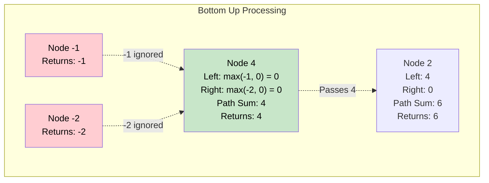

# 🚶‍♂️ Walkthrough: Maximum Path Sum

## 👶 Explain Like I'm 5
This is just like finding the longest string across the tree (Tree Diameter), but instead of counting the number of nodes, we want the path with the **HIGHEST SCORE**.
Every node has a score (some are positive, some are negative).
A node asks its left child: "What is the highest score I can get if I walk down your branch?"
And it asks its right child the same thing.

If a child returns a NEGATIVE score (like `-10`), the parent says: "Ew, no thanks! I'm just not going to walk down your branch at all!" 
So we replace any negative scores with a `0` (meaning we just ignore that branch entirely and stop our path there).
The score of the path going THROUGH the current node is: `left_score + right_score + node's own score`.
We keep track of the absolute highest score we ever see.

Then, to answer its OWN parent, the node can only pick ONE path to pass up (you can't walk down both branches and then go back up to the parent without retracing your steps).
So it passes up: `max(left_score, right_score) + node's own score`.

## 🎯 Core Strategy
This is an advanced application of **Post-order Traversal** using **Tree Depth First Search (DFS)**, where we filter out negative contributions.

1. **Global Variable**: Initialize `max_sum = -infinity` (to handle trees with all negative numbers).
2. **Recursive Helper**: Define `calculate_max_path_sum(node)`.
3. **Base Case**: If `node` is None, return `0`.
4. **Post-order Step (Ask Children, Filter Negatives)**:
   - Ask left child: `left_sum = max(calculate_max_path_sum(node.left), 0)`
   - Ask right child: `right_sum = max(calculate_max_path_sum(node.right), 0)`
5. **Process Parent (Calculate Global Max)**: 
   - The maximum path sum passing *through* the current node is: `current_max_sum = left_sum + right_sum + node.value`.
   - Update our record: `max_sum = max(max_sum, current_max_sum)`.
6. **Return to Parent (Return Branch Max)**:
   - The node returns the best single continuous line down its subtree: `return max(left_sum, right_sum) + node.value`.
7. Call the helper on the root and return `max_sum`.

## 🏃‍♂️ Step-by-Step Execution (Dry Run)
**Example Input Tree**:
```text
       1
      / \
     2   3
    /     \
   4       5
  / \     / \
 -1 -2   -3 -4
```
Initialization: `max_sum = -infinity`.

1. **Leaf Node -1**:
   - Left=0, Right=0. `current = -1`. `max_sum = -1`. Returns `max(0,0)-1 = -1`.
2. **Leaf Node -2**:
   - Left=0, Right=0. `current = -2`. `max_sum = -1`. Returns `max(0,0)-2 = -2`.
3. **Node 4**:
   - Left returned -1. We take `max(-1, 0) = 0`.
   - Right returned -2. We take `max(-2, 0) = 0`.
   - `current = 0 + 0 + 4 = 4`. `max_sum = 4`.
   - Returns `max(0, 0) + 4 = 4`.
4. **Leaves -3 and -4**:
   - Similar to above, they return `-3` and `-4`.
5. **Node 5**:
   - Left returned -3 -> becomes `0`.
   - Right returned -4 -> becomes `0`.
   - `current = 0 + 0 + 5 = 5`. `max_sum = 5`.
   - Returns `max(0, 0) + 5 = 5`.
6. **Node 2**:
   - Left (4) returned `4` -> `4`. Right is None -> `0`.
   - `current = 4 + 0 + 2 = 6`. `max_sum = 6`.
   - Returns `max(4, 0) + 2 = 6`.
7. **Node 3**:
   - Left is None -> `0`. Right (5) returned `5` -> `5`.
   - `current = 0 + 5 + 3 = 8`. `max_sum = 8`.
   - Returns `max(0, 5) + 3 = 8`.
8. **Root Node 1**:
   - Left (2) returned `6`. Right (3) returned `8`.
   - `current = 6 + 8 + 1 = 15`. `max_sum = 15`.
   - Returns `max(6, 8) + 1 = 9`.

Final Answer: `15`.

## 📊 Visual Diagram
Here is how negative returns from the bottom are ignored (`max(child, 0)`), preventing them from dragging down the scores higher up:



## 🛑 Edge Cases & Complexity

### Complexity
- **Time Complexity:** $O(N)$. We visit every node exactly once during the post-order traversal.
- **Space Complexity:** $O(H)$ where $H$ is the tree height. This is the memory used by the recursion stack.

### Edge Cases Handled Safely
- **Tree with ONLY negative numbers:** E.g., `[-10, -20, -30]`.
  - Node -20 returns -20. Node -30 returns -30.
  - Root -10 filters these to 0. `current = 0 + 0 - 10 = -10`.
  - Because `max_sum` was initialized to `-infinity`, it correctly updates to `-10` instead of falsely returning `0`.
- **Empty Tree:** Handled by `if not root: return 0`.
