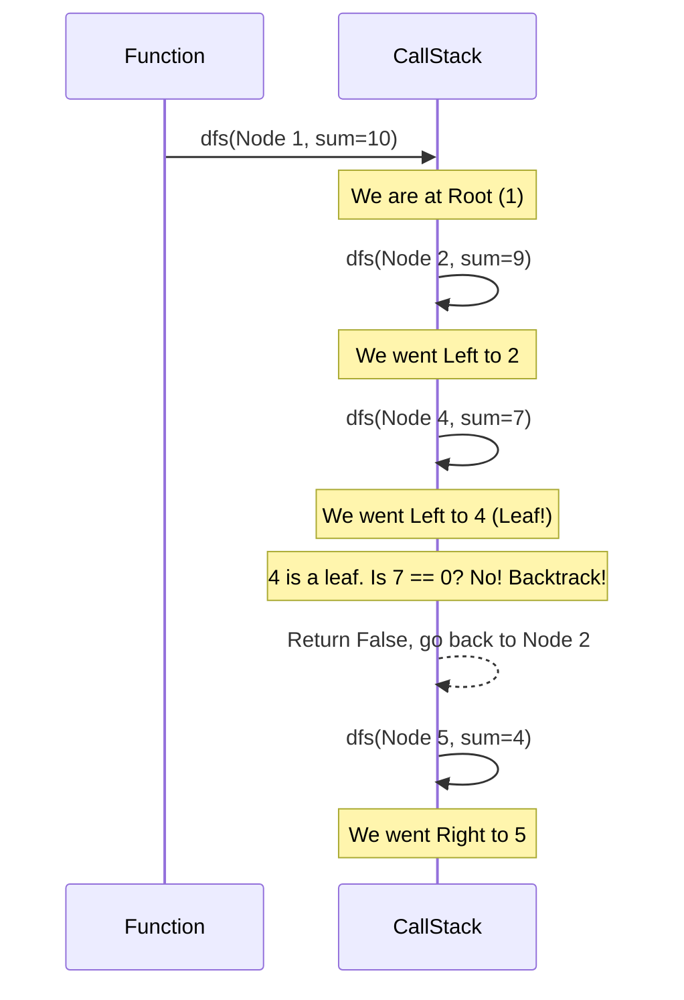

# Pattern 12: Tree Depth First Search (DFS)

## 👶 Explain Like I'm 5
Imagine you are exploring a giant maze.
Breadth First Search (BFS) is like sending a million clones of yourself to walk 
down every possible path one step at a time.
**Depth First Search (DFS)** is like just being you. You pick a path, and you run 
down it as fast and as far as you possibly can! 
You keep going until you hit a dead end (a Leaf).
When you hit a dead end, you take one step backward, see if there is another path, 
and run down that one instead.
To remember how to get back, you leave a trail of breadcrumbs.
In code, this trail of breadcrumbs is called **Recursion** (a function calling itself).
The computer's "Call Stack" remembers exactly where you left off at every fork 
in the road, so you can easily backtrack!

---

## 🧩 Core Idea & Pattern Detection

The DFS pattern works by diving deep into the tree until it hits a leaf node, and then backtracking. It is almost always implemented using **Recursion** because the Call Stack naturally handles the backtracking logic for us.

### When to use it:
- The problem asks you to search from the **Root to a Leaf**.
- You need to find all possible paths from top to bottom.
- You need to aggregate values along a vertical path.
- The problem involves finding the "Diameter" or "Maximum Path Sum" (which requires computing bottom-up from the leaves).

```mermaid
flowchart TD
    ROOT((1)) --> L((2))
    ROOT --> R((3))
    L --> LL((4))
    L --> LR((5))
    R --> RL((6))
    R --> RR((7))
    
    classDef path fill:#ff9999,stroke:#333,stroke-width:4px;
    
    class ROOT,L,LL path;
    
    Note right of LL: DFS dives all the way down: 1 -> 2 -> 4
    Note right of LR: Then backtracks to 2, and dives to 5
```

---

## 🔧 Algorithmic Anatomy

### Recipe: Standard DFS (Pre-order Traversal)
When you process the node BEFORE you visit its children, it's called Pre-order traversal. This is standard for "Root-to-Leaf" path problems.

1. **Base Case 1**: `if not root: return False`
2. **Base Case 2 (Leaf)**: `if not root.left and not root.right:`
   - Check if this path meets the condition (e.g. `current_sum == target`).
3. **Recursive Step**: 
   - `return dfs(root.left, updated_state) or dfs(root.right, updated_state)`



---

## 🛑 Per-Variant DOs and DON'Ts

| Variant | DO | DON'T |
|---------|----|-------|
| **Path Sum** | **DO** subtract the current node's value from the `target_sum` as you go down. When you hit a leaf, check if `target_sum == 0`. | **DON'T** keep a running total and pass it down unless you have to, subtracting is usually cleaner. |
| **All Paths** | **DO** append the current node to a `current_path` list, and `pop()` it AFTER the recursive calls finish (Backtracking!). | **DON'T** pass `current_path.append()` directly into the recursion. It mutates the single list for all branches. Pass a copy, or strictly `append/pop`. |
| **Bottom-Up (Diameter)** | **DO** use Post-order traversal (process left child, process right child, THEN do logic on current node). | **DON'T** try to compute the diameter from the top down. You need the heights of the subtrees first! |

---

## ⏱️ Complexity Analysis

| Aspect | Complexity | Why |
|--------|-----------|-----|
| **Time** | **O(N)** | We visit every node in the tree exactly once. |
| **Space** | **O(H)** | The Recursion Call Stack takes up memory equal to the Height (H) of the tree. In a balanced tree, this is O(log N). In a skewed tree (a linked list), this is O(N). |

---

## ⚠️ Common Pitfalls

1. **Forgetting to Backtrack:** If you are storing the current path in a list, and you modify that list in-place, that modification will bleed into other branches! You MUST remove the node from the list when the function returns (e.g., `current_path.pop()`).
2. **Missing the Leaf Check:** For root-to-leaf problems, you must explicitly check `not node.left and not node.right`. If you just check `not node`, you'll process a path ending in a node that only has one child (which is NOT a leaf).
3. **Global Variables:** In Python, avoid global variables for counts or maximums. Instead, pass them as a mutable list `[0]` or use a class attribute `self.max_val`.

---

## ✅ Problems in This Pattern

| # | Problem | Difficulty | Key Twist |
|---|---------|------------|-----------|
| 1 | Binary Tree Path Sum | Easy | Standard DFS, subtracting `target_sum`. |
| 2 | All Paths for a Sum | Medium | Storing `current_path` and Backtracking (`pop()`). |
| 3 | Sum of Path Numbers | Medium | Pass `current_number = current_number * 10 + node.value`. |
| 4 | Path With Given Sequence | Medium | Pass the current index of the sequence to check matches. |
| 5 | Count Paths for a Sum | Medium | **Advanced**: Any node to any node (going downwards). |
| 6 | Tree Diameter | Hard | **Advanced**: Post-order. Calculate height, update global max diameter. |
| 7 | Maximum Path Sum | Hard | **Advanced**: Post-order. Handle negative path sums by ignoring them (max with 0). |
