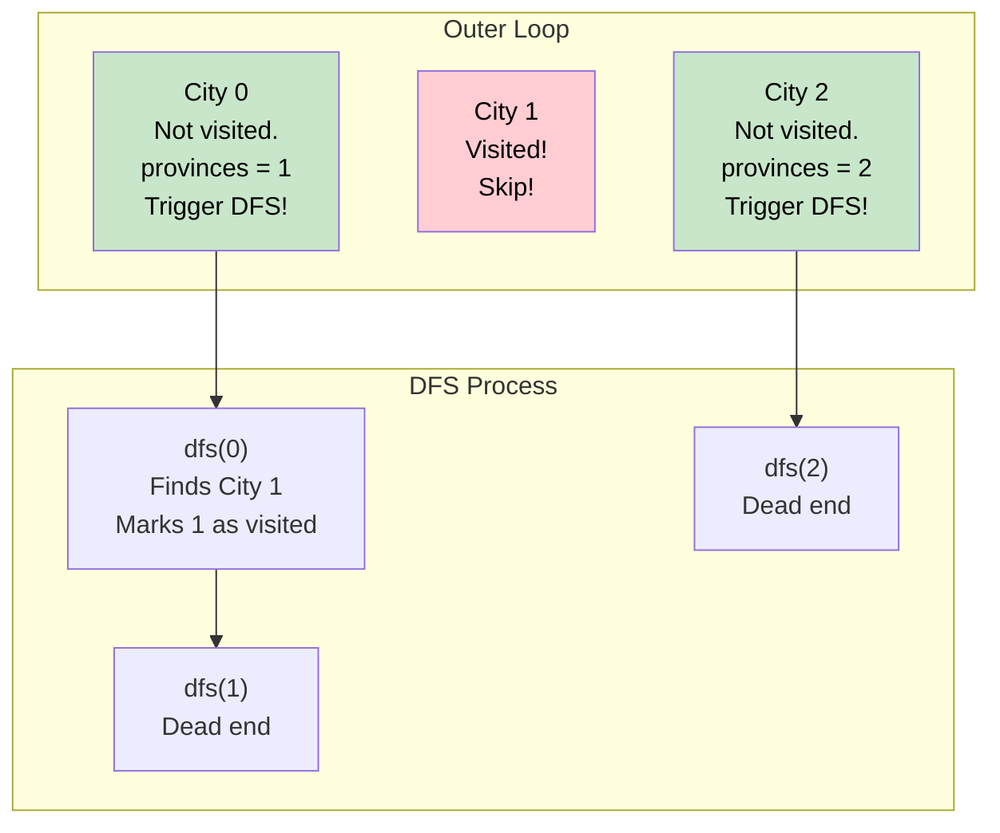

# 🚶‍♂️ Walkthrough: Number of Provinces

## 👶 Explain Like I'm 5
Imagine you have a map of cities. 
Some cities have roads connecting them. If City A is connected to City B, and City B is connected to City C, they all belong to the same "Province".
But what if City D and City E are connected to each other, but have NO roads leading to A, B, or C? Then D and E form a SECOND Province.

Your job is to count how many completely separate Provinces there are.
How do we do this? We just pick a city, say City A, and start exploring!
We put a red "X" (visited) on City A, then we walk down the road to City B and put an "X" on it, then to City C and put an "X" on it.
Once we hit a dead end, we know we have fully explored Province 1!
Then we look at our list of all cities. 
"Is City B visited?" Yes. "City C?" Yes. 
"What about City D?" No! City D doesn't have an "X". 
That means City D is in a brand new Province!
So we increment our Province count, start exploring from City D, and repeat until every single city has an "X".

## 🎯 Core Strategy
This is the foundational **Connected Components** algorithm using **Graph Depth First Search (DFS)**. 

1. **State Tracking**: `n` is the number of cities. We use a `visited` set to keep track of which cities we've already explored. `provinces = 0`.
2. **Recursive DFS Helper**: `dfs(city)` explores all cities connected to a starting city.
   - Loop through all possible `neighbor` indices from `0` to `n-1`.
   - If `is_connected[city][neighbor] == 1` AND `neighbor` is NOT in `visited`:
     - Mark it visited: `visited.add(neighbor)`.
     - Recursively call `dfs(neighbor)` to continue exploring from there.
3. **Outer Loop**: We loop through *every* `city` from `0` to `n-1`. This is the crucial step that prevents us from stopping after the first component.
   - If the `city` is NOT in `visited`:
     - We found an unexplored node! This means we found a new province. Increment `provinces += 1`.
     - Add `city` to `visited`.
     - Call `dfs(city)` to explore its entire component.
4. Return `provinces`.

## 🏃‍♂️ Step-by-Step Execution (Dry Run)
**Example Input Matrix**:
```text
      0  1  2  (Cities)
   0 [1, 1, 0]  (City 0 connected to 0 and 1)
   1 [1, 1, 0]  (City 1 connected to 0 and 1)
   2 [0, 0, 1]  (City 2 only connected to itself)
```
Initialization: `visited = set()`, `provinces = 0`.

### Outer Loop - Iteration 0
- `city = 0`. Is it in `visited`? No.
- `provinces += 1` (Now `provinces = 1`).
- `visited.add(0)`. (Now `visited = {0}`).
- **Call `dfs(0)`**:
  - Check neighbors of City 0:
    - Neighbor 0: Connected? Yes. Visited? Yes. Skip.
    - Neighbor 1: Connected? Yes! Visited? No.
      - `visited.add(1)`. (Now `{0, 1}`).
      - **Call `dfs(1)`**:
        - Check neighbors of City 1:
          - Neighbor 0: Connected? Yes. Visited? Yes. Skip.
          - Neighbor 1: Connected? Yes. Visited? Yes. Skip.
          - Neighbor 2: Connected? No. Skip.
        - `dfs(1)` finishes.
    - Neighbor 2: Connected? No. Skip.
  - `dfs(0)` finishes.

### Outer Loop - Iteration 1
- `city = 1`. Is it in `visited`? Yes! (It was found during `dfs(0)`).
- Skip!

### Outer Loop - Iteration 2
- `city = 2`. Is it in `visited`? No!
- `provinces += 1` (Now `provinces = 2`).
- `visited.add(2)`. (Now `visited = {0, 1, 2}`).
- **Call `dfs(2)`**:
  - Check neighbors of City 2:
    - Neighbor 0: Connected? No. Skip.
    - Neighbor 1: Connected? No. Skip.
    - Neighbor 2: Connected? Yes. Visited? Yes. Skip.
  - `dfs(2)` finishes.

Loop finishes. Return `provinces` (which is `2`).

## 📊 Visual Diagram
Here is how the outer loop triggers the DFS only when necessary:



## 🛑 Edge Cases & Complexity

### Complexity
- **Time Complexity:** $O(N^2)$. The outer loop runs $N$ times, and the inner DFS explores neighbors. However, because we only explore unvisited nodes, we check every cell in the $N \times N$ adjacency matrix exactly once across all DFS calls. Therefore, the time complexity is strictly proportional to the number of cells in the matrix: $O(N^2)$.
- **Space Complexity:** $O(N)$. The `visited` set stores up to $N$ elements. The recursion stack for DFS can go up to $N$ layers deep in the worst case (a single long path of connected cities).

### Edge Cases Handled Safely
- **Completely Disconnected Graph:** The matrix is an Identity Matrix (1s on the diagonal, 0s everywhere else). The outer loop will run $N$ times, triggering DFS $N$ times, correctly returning $N$ provinces.
- **Fully Connected Graph:** The outer loop triggers DFS on city 0, which visits *every other city*. The remaining iterations of the outer loop will instantly skip. Returns `1` province.
