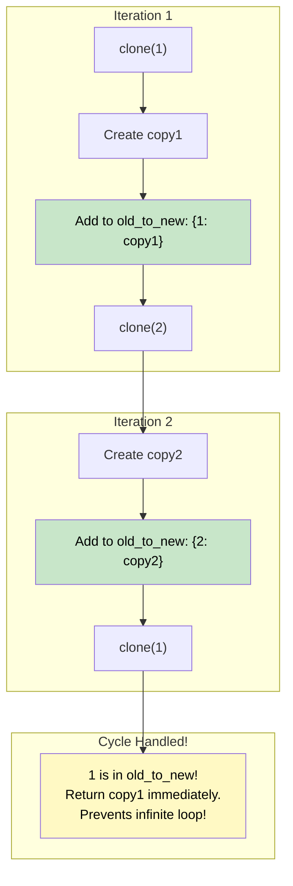

# 🚶‍♂️ Walkthrough: Clone Graph

## 👶 Explain Like I'm 5
You are holding a blueprint of a city, and you want to build an EXACT duplicate of the entire city on a new island.
If you build "New City A", you also have to build the road connecting it to "New City B".
But what if "New City B" connects back to "New City A"? 
If you aren't careful, you might accidentally build a SECOND "New City A"! You would end up building infinite cities forever.

To prevent this, you carry a magical notebook (a Hash Map).
Whenever you build a new city, you write down: *"Old City A translates to New City A"*.
If you ever need to build a road to a city, you first check the notebook:
"Did I already build the new version of this city?"
- **If yes:** Just connect the road to the one you already built!
- **If no:** Build the new city, write it in the notebook, and then connect the road.

## 🎯 Core Strategy
This uses **Graph Depth First Search (DFS)** paired with a **Hash Map** to handle cycles (loops in the graph). In a graph, unlike a tree, you can visit the same node multiple times. The Hash Map prevents infinite recursion and ensures we only clone each node once.

1. **State Tracking**: Initialize a Hash Map `old_to_new = {}`. This maps original nodes to their new cloned counterparts. This map *also* acts as our `visited` set!
2. **Recursive Clone Helper**: `clone(current_node)`
   - **Base Case 1**: If `current_node` is None, return `None`.
   - **Base Case 2 (Cycle Detection)**: If `current_node` is already in `old_to_new`, we have already cloned it. Return the clone: `return old_to_new[current_node]`.
   - **Action**: Create the new cloned node: `copy = Node(current_node.val)`.
   - **CRITICAL STEP**: Add `copy` to `old_to_new` *IMMEDIATELY*, **before** iterating over its neighbors. If a neighbor has a path back to this node, we need this entry in the map to prevent infinite recursion!
   - **Explore**: Iterate over `current_node.neighbors`. Recursively call `clone(neighbor)` and append the result to `copy.neighbors`.
   - **Return**: Return the fully constructed `copy`.

## 🏃‍♂️ Step-by-Step Execution (Dry Run)
**Example Input Graph**:
```text
  1 --- 2
  |     |
  4 --- 3
```
Initialization: `old_to_new = {}`. Call `clone(1)`.

1. **Node 1**:
   - In `old_to_new`? No.
   - Create `copy1`. `old_to_new = {1: copy1}`.
   - Iterate neighbors: `[2, 4]`.
   - Call `clone(2)`.
2. **Node 2**:
   - In `old_to_new`? No.
   - Create `copy2`. `old_to_new = {1: copy1, 2: copy2}`.
   - Iterate neighbors: `[1, 3]`.
   - Call `clone(1)`.
     - **CYCLE DETECTED**: `1` is in `old_to_new`. Returns `copy1`.
     - `copy2.neighbors` becomes `[copy1]`.
   - Call `clone(3)`.
3. **Node 3**:
   - In `old_to_new`? No.
   - Create `copy3`. `old_to_new = {1: copy1, 2: copy2, 3: copy3}`.
   - Iterate neighbors: `[2, 4]`.
   - Call `clone(2)`.
     - **CYCLE DETECTED**: Returns `copy2`.
     - `copy3.neighbors` becomes `[copy2]`.
   - Call `clone(4)`.
4. **Node 4**:
   - In `old_to_new`? No.
   - Create `copy4`. `old_to_new = {1: copy1, 2: copy2, 3: copy3, 4: copy4}`.
   - Iterate neighbors: `[1, 3]`.
   - Call `clone(1)`. (CYCLE, returns `copy1`).
   - Call `clone(3)`. (CYCLE, returns `copy3`).
   - `copy4.neighbors` becomes `[copy1, copy3]`.
   - `clone(4)` returns `copy4` to Node 3.
5. Node 3 adds `copy4` to neighbors. Returns `copy3` to Node 2.
6. Node 2 adds `copy3` to neighbors. Returns `copy2` to Node 1.
7. Node 1 adds `copy2` to neighbors. Now Node 1 processes its second neighbor, `clone(4)`.
   - **CYCLE DETECTED**: Returns `copy4`.
   - Node 1 adds `copy4` to neighbors.
8. `clone(1)` completes and returns `copy1`. The entire graph is cloned!

## 📊 Visual Diagram
Here is a visualization of why adding the node to the Hash Map *before* exploring neighbors is so critical:



## 🛑 Edge Cases & Complexity

### Complexity
- **Time Complexity:** $O(V + E)$ where $V$ is the number of vertices (nodes) and $E$ is the number of edges. We visit every node exactly once (because of the Hash Map), and we iterate through every edge exactly once when looping through neighbors.
- **Space Complexity:** $O(V)$. The Hash Map stores exactly $V$ entries, and the recursion stack can go up to $V$ levels deep in a graph that resembles a linked list.

### Edge Cases Handled Safely
- **Empty Graph:** Handled safely by `if not node: return None`.
- **Graph with one node:** `current_node.neighbors` is empty. The `for` loop skips, and it returns the single cloned node.
- **Disconnected Components:** The problem states the graph is connected (we are given a reference to one node, and we clone everything reachable from it). If there were disconnected components, we wouldn't be able to reach them from a single node anyway.
