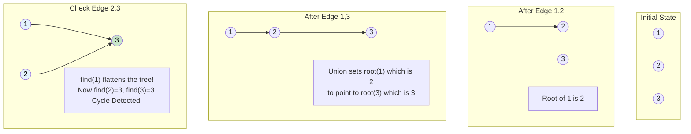

# 🚶‍♂️ Walkthrough: Redundant Connection

## 👶 Explain Like I'm 5
Imagine a group of friends forming a club. 
At first, everyone is in their own 1-person club.
When Alice and Bob become friends, they merge their clubs into one bigger club (this is called a "Union"). They pick one person (say, Alice) to be the "President".
When Bob becomes friends with Charlie, Charlie joins Alice's club, because Bob is already in it.

Before two people merge their clubs, they first check: 
*"Wait, do we have the same President?"* (this is called a "Find").
If Alice and Charlie want to become friends, they check their Presidents. They realize they BOTH already have Alice as their President! They are already in the same club!
If they draw a friendship line between each other anyway, they create a CYCLE (a loop of friends).

The problem gives us a list of friendships, and exactly ONE friendship creates a cycle. Our job is to find it!

## 🎯 Core Strategy
This is the textbook application of the **Disjoint Set (Union Find)** data structure. It is the most efficient way to detect cycles in an *undirected* graph.

1. **Initialization**: Initialize a `parent` dictionary where every node is its own parent (e.g., `parent[1] = 1`).
2. **`find(node)`**: A function to find the "President" (root) of a node's set.
   - If `parent[node] == node`, it is the root.
   - Otherwise, recursively call `find(parent[node])`.
   - **Path Compression**: When returning, set `parent[node] = root`. This flattens the tree, making future lookups $O(1)$.
3. **`union(node1, node2)`**: A function to merge two sets.
   - Find `root1` and `root2`.
   - If `root1 == root2`, the nodes are already connected! Adding this edge creates a cycle. **Return `False`**.
   - If they are different, merge them by setting `parent[root1] = root2`. **Return `True`**.
4. **Execution**: Iterate through all `edges`. Call `union(u, v)`. The first edge that returns `False` is our redundant connection!

## 🏃‍♂️ Step-by-Step Execution (Dry Run)
**Example Input**: `[[1, 2], [1, 3], [2, 3]]`
Initialization: `parent = {1: 1, 2: 2, 3: 3}`

### Processing Edge [1, 2]
- `find(1)` returns `1`.
- `find(2)` returns `2`.
- Roots are different. `union` succeeds.
- Set `parent[1] = 2`.
- `parent` is now: `{1: 2, 2: 2, 3: 3}`.

### Processing Edge [1, 3]
- `find(1)`: `parent[1]` is 2. `parent[2]` is 2. Path compression sets `parent[1] = 2`. Returns `2`.
- `find(3)` returns `3`.
- Roots are different (2 and 3). `union` succeeds.
- Set `parent[2] = 3`.
- `parent` is now: `{1: 2, 2: 3, 3: 3}`. (Note: 1 points to 2, 2 points to 3. The true root is 3).

### Processing Edge [2, 3]
- `find(2)`: `parent[2]` is 3. `parent[3]` is 3. Returns `3`.
- `find(3)` returns `3`.
- **Roots are the SAME (3 == 3)!** 
- They are already in the same set. Adding this edge creates a cycle.
- **Return `[2, 3]`**.

## 📊 Visual Diagram
Here is how the clubs (sets) merge, and how Path Compression keeps the tree flat:

## 🛑 Edge Cases & Complexity

### Complexity
- **Time Complexity:** $O(N \cdot \alpha(N))$. The Inverse Ackermann function $\alpha(N)$ grows so slowly that for all practical values of $N$, it is $\le 4$. Therefore, Union-Find operations take amortized $O(1)$ time. Processing $N$ edges takes $O(N)$ time.
- **Space Complexity:** $O(N)$ to store the `parent` array/dictionary.

### Edge Cases Handled Safely
- **Multiple possible edges:** The problem guarantees the graph started as a tree and exactly one edge was added. It asks us to return the edge that occurs *last* in the input array. Because we build the graph edge-by-edge in order, the edge that finally triggers the `root1 == root2` condition is guaranteed to be the correct one!
- **Path Compression benefits:** Even in a worst-case scenario where edges form a long line `[1,2], [2,3], [3,4], [4,5]`, Path Compression ensures that looking up the root of `1` immediately updates its pointer to the very end of the line, keeping lookups lightning fast.
