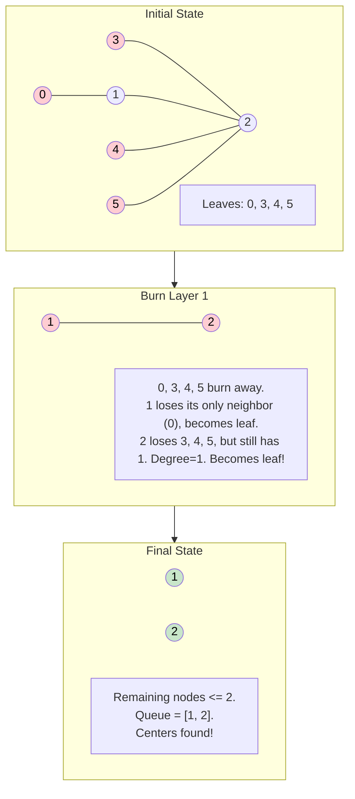

# 🚶‍♂️ Walkthrough: Minimum Height Trees

## 👶 Explain Like I'm 5
Imagine a spider web made of nodes and strings, but it doesn't have any loops (it's technically a Tree).
If you pick it up by one node and let the rest dangle down, the tree will have a certain "height" (how far down it dangles).
If you pick it up by a node at the very edge (a Leaf), it will dangle VERY far down! (Maximum Height).
But if you pick it up exactly in the middle (the "Centroid"), the dangling parts are balanced, giving you the **MINIMUM Height!**

So the problem is really asking: *"Find the exact center of this graph."*

How do we find the center? We eat the graph from the outside in!
Imagine setting the outer edge of all leaves on fire. The fire burns the leaves, exposing the next layer of nodes (which become the new leaves).
If you keep burning the outermost leaves layer by layer, eventually the fire will meet exactly in the middle!
The last 1 or 2 surviving nodes before the whole thing burns up are your Minimum Height Tree roots.
*(Fun fact: A tree can only ever have 1 or 2 centers. Never 3, or it would have a cycle!).*

## 🎯 Core Strategy
This uses a **Topological Sort** pattern, specifically peeling the graph layer-by-layer (BFS). Instead of sorting by directed arrows, we sort by **Degree** (number of connections).

1. **Base Cases**: If $N \le 2$, every node is a valid root. Return all of them.
2. **Build Graph**: Build an adjacency list `graph`. We use `set()` instead of lists for the neighbors because we need to quickly remove edges ($O(1)$ deletion).
3. **Find Initial Leaves**: A leaf in an undirected graph has exactly `1` connection. Add all nodes with `len(graph[i]) == 1` to a `queue`.
4. **Peel the Onion**: 
   - Initialize `remaining_nodes = n`.
   - Loop `while remaining_nodes > 2:` (We stop when 1 or 2 nodes are left).
   - Get the number of leaves in the current layer: `leaves_count = len(queue)`.
   - Subtract them from the total: `remaining_nodes -= leaves_count`.
   - Pop every leaf in this layer from the queue.
   - For each `leaf`:
     - It only has ONE neighbor. Get it: `neighbor = graph[leaf].pop()`.
     - Remove the leaf from the neighbor's connections: `graph[neighbor].remove(leaf)`.
     - If the neighbor now ONLY has 1 connection left, it just became a leaf! Add it to the `queue` for the next layer of burning.
5. **Return**: When the while loop finishes, whatever is left in the `queue` are the centers! Return them as a list.

## 🏃‍♂️ Step-by-Step Execution (Dry Run)
**Example Input Graph**:
```text
  0 - 1 - 2 - 3
```
- `N = 4`
- `edges = [[0, 1], [1, 2], [2, 3]]`

### Initialization
- Graph: `{0: {1}, 1: {0, 2}, 2: {1, 3}, 3: {2}}`
- Initial Leaves (degree 1): Node 0 and Node 3.
- `queue = [0, 3]`. `remaining_nodes = 4`.

### Iteration 1 (Burn outer layer)
- `remaining_nodes > 2` (4 > 2). True!
- `leaves_count = 2`. `remaining_nodes` becomes `2`.
- **Process Leaf 0**:
  - Neighbor is `1`.
  - Remove `0` from `graph[1]`. `graph[1]` becomes `{2}`.
  - `len(graph[1])` is now 1! Add `1` to `queue`.
- **Process Leaf 3**:
  - Neighbor is `2`.
  - Remove `3` from `graph[2]`. `graph[2]` becomes `{1}`.
  - `len(graph[2])` is now 1! Add `2` to `queue`.
- Queue is now `[1, 2]`.

### Iteration 2
- `remaining_nodes > 2` (2 > 2). **FALSE!**
- The loop terminates.
- The remaining nodes in the queue are `[1, 2]`. 
- Return `[1, 2]`. (Both node 1 and node 2 are valid centers).

## 📊 Visual Diagram
Here is a visualization of the layer-by-layer topological sort (burning from the outside in):



## 🛑 Edge Cases & Complexity

### Complexity
- **Time Complexity:** $O(V + E)$ where $V$ is nodes and $E$ is edges. Building the graph takes $O(E)$. Every node is added and removed from the queue exactly once. Because we use a `set` for the adjacency list, removing an edge `graph[neighbor].remove(leaf)` takes $O(1)$ time. Overall Time is Linear.
- **Space Complexity:** $O(V + E)$. The adjacency list takes $O(V + E)$ space. The queue can store up to $V$ nodes.

### Edge Cases Handled Safely
- **Tree with 1 Node:** Handled immediately by `if n <= 2: return [i for i in range(n)]`. Returns `[0]`.
- **Tree with 2 Nodes:** Also handled by the base case. Returns `[0, 1]`.
- **Star Graph (Many leaves, one center):** E.g., Node 1 is connected to 0, 2, 3, 4. The initial leaves are 0, 2, 3, 4. In the first pass, they are all burned away. Node 1 is left untouched. Loop terminates. Returns `[1]`.
