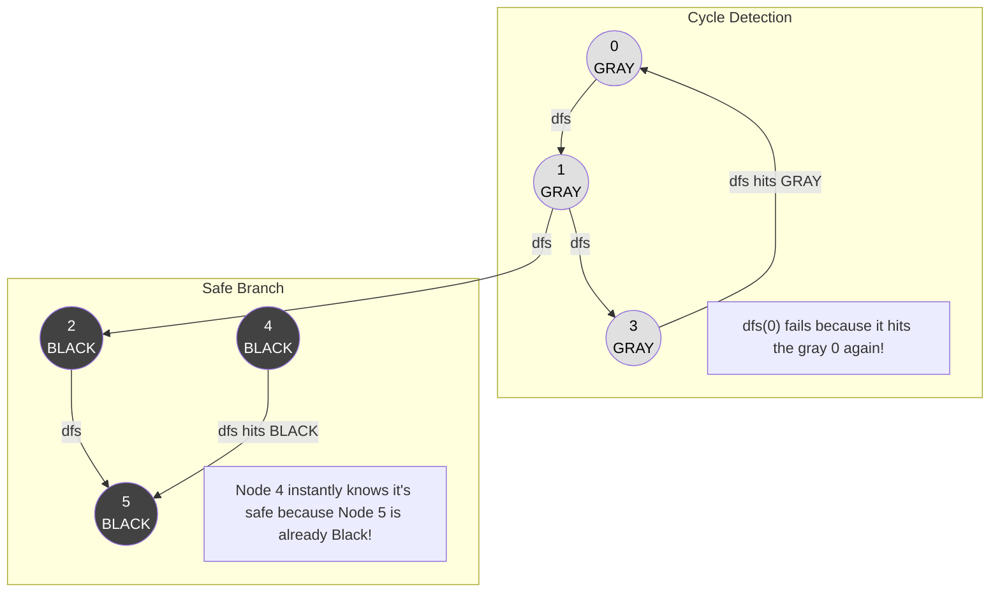

# 🚶‍♂️ Walkthrough: Find Eventual Safe States

## 👶 Explain Like I'm 5
Imagine a game board where each square has arrows pointing to other squares.
A "safe" square is one where **NO MATTER** which arrows you follow, you ALWAYS eventually reach a square with no outgoing arrows (a "terminal" node).
A square is "unsafe" if there's ANY path from it that leads to a cycle (an infinite loop where you go around in circles forever).

Think of it like testing a maze. You mark the floor with different colors:
- **White**: Haven't stepped here yet.
- **Gray**: I'm currently standing on this path. If I ever walk into a gray square again, I've walked in a circle! (UNSAFE).
- **Black**: I've fully explored all paths from here, and they all lead to the exit. (SAFE).

Your job is to find all the squares that eventually get painted Black!

## 🎯 Core Strategy
This is a classic **Cycle Detection** problem in a Directed Graph using **Depth-First Search (DFS)** and a **3-color marking system**.

1. **Colors**: We use an array `color` of size $N$ initialized to `0` (White).
   - `0` (White): Unvisited.
   - `1` (Gray): Currently in the DFS recursion stack.
   - `2` (Black): Fully explored and proven to be safe.
2. **DFS Function `dfs(node)`**:
   - If the node is not White (`color[node] != 0`), it means we've seen it before. If it's Black (`2`), it's safe (return `True`). If it's Gray (`1`), we found a cycle! (return `False`).
   - Mark the node as Gray (`color[node] = 1`).
   - Loop through all its `neighbors`. If `dfs(neighbor)` returns `False`, then this node leads to a cycle. It's unsafe. Return `False` immediately.
   - If all neighbors return `True` (or if it has no neighbors), mark the node as Black (`color[node] = 2`) and return `True`.
3. **Execution**: Run `dfs(i)` for every node from `0` to $N-1$. Return a list of all nodes where `dfs(i)` is `True`.

## 🏃‍♂️ Step-by-Step Execution (Dry Run)
**Example Input**: `graph = [[1,2], [2,3], [5], [0], [5], [], []]`
- Node 0 -> 1, 2
- Node 1 -> 2, 3
- Node 2 -> 5
- Node 3 -> 0
- Node 4 -> 5
- Nodes 5, 6 -> [] (Terminal nodes)

### DFS from Node 0
- `dfs(0)`: Paint `0` Gray.
  - Neighbor `1`: `dfs(1)`. Paint `1` Gray.
    - Neighbor `2`: `dfs(2)`. Paint `2` Gray.
      - Neighbor `5`: `dfs(5)`. Paint `5` Gray.
        - `5` has no neighbors. Paint `5` **Black**. Returns `True`.
      - `2`'s neighbors are all safe. Paint `2` **Black**. Returns `True`.
    - Neighbor `3`: `dfs(3)`. Paint `3` Gray.
      - Neighbor `0`: `0` is already **Gray**! **CYCLE DETECTED!** Returns `False`.
    - `1` received `False` from `3`. So `1` returns `False`. (Leaves `1` as Gray).
  - `0` received `False` from `1`. So `0` returns `False`. (Leaves `0` as Gray).

### DFS from other nodes
- `dfs(1)`: Already Gray. Returns `False`.
- `dfs(2)`: Already Black. Returns `True`.
- `dfs(3)`: Already Gray. Returns `False`.
- `dfs(4)`: Paint `4` Gray.
  - Neighbor `5`: Already Black. Returns `True`.
  - `4`'s neighbors are all safe. Paint `4` **Black**. Returns `True`.
- `dfs(5)`: Already Black. Returns `True`.
- `dfs(6)`: Paint `6` Gray. No neighbors. Paint `6` **Black**. Returns `True`.

Safe nodes (returned `True` / painted Black): `[2, 4, 5, 6]`.

## 📊 Visual Diagram
Here's how the 3-color marking immediately identifies safe nodes without recomputing:

## 🛑 Edge Cases & Complexity

### Complexity
- **Time Complexity:** $O(V + E)$. We visit every vertex and follow every edge exactly once. Once a node is painted Gray or Black, we never recurse into it again.
- **Space Complexity:** $O(V)$. The `color` array takes $V$ space, and the recursion stack can go up to $V$ deep.

### Edge Cases Handled Safely
- **Terminal Nodes (no outgoing edges):** The `for neighbor in graph[node]:` loop instantly skips, the node is painted Black, and it returns `True`. Handled perfectly.
- **Self-loops:** E.g., `graph = [[0]]`. `dfs(0)` marks `0` Gray. Then it checks neighbor `0`. It sees `0` is Gray. It immediately returns `False`. The cycle is caught perfectly!
- **Disconnected Graphs:** The outer list comprehension `[i for i in range(n) if dfs(i)]` ensures every single node is checked, even if they aren't reachable from Node 0.
