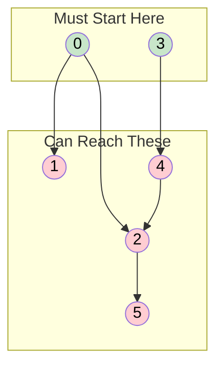

# 🚶‍♂️ Walkthrough: Minimum Vertices to Reach All Nodes

## 👶 Explain Like I'm 5
Imagine a bunch of rooms connected by one-way doors. You want to find the SMALLEST set of rooms to start from so that you can eventually reach EVERY room in the building. 
If a room has a door leading *into* it, you don't need to start there; you can just start at the room before it and walk through the door!
But what if a room has NO doors leading into it? Then nobody can ever walk into that room from anywhere else! 
If you want to visit every room, you **MUST** start in those isolated rooms.

The magical secret of this problem is: if you just find every single room that has NO incoming doors, that list of rooms is your complete and final answer!

## 🎯 Core Strategy
This problem is solved using **In-Degree Analysis**. In a Directed Acyclic Graph (DAG), the "in-degree" of a node is the number of edges pointing *towards* it.

1. **The Logic**: 
   - A node with an in-degree of `0` CANNOT be reached from any other node. Therefore, it MUST be included in our starting set.
   - A node with an in-degree `> 0` CAN be reached from some other node. Therefore, we don't *need* to include it in our starting set (we can just start from the node pointing to it).
   - Because the graph is acyclic (no cycles), every node with an in-degree `> 0` can ultimately be traced backwards to a node with an in-degree of `0`.
2. **Implementation**:
   - Create a set `has_incoming` to track nodes that have at least one incoming edge.
   - Loop through all `edges` (where an edge is `[from_node, to_node]`). Add `to_node` to the `has_incoming` set.
   - Finally, check every node from `0` to `n-1`. If it is NOT in the `has_incoming` set, add it to our result list!

## 🏃‍♂️ Step-by-Step Execution (Dry Run)
**Example Input**: `n = 6`, `edges = [[0,1], [0,2], [2,5], [3,4], [4,2]]`

### Processing Edges (Finding In-Degrees)
- Edge `[0, 1]`: Node 1 has an incoming edge. `has_incoming = {1}`
- Edge `[0, 2]`: Node 2 has an incoming edge. `has_incoming = {1, 2}`
- Edge `[2, 5]`: Node 5 has an incoming edge. `has_incoming = {1, 2, 5}`
- Edge `[3, 4]`: Node 4 has an incoming edge. `has_incoming = {1, 2, 4, 5}`
- Edge `[4, 2]`: Node 2 has an incoming edge. (Already in set). `has_incoming = {1, 2, 4, 5}`

### Finding the Answer
Check every node `0` through `5`:
- **Node 0**: Not in set! (In-degree 0). Add to answer.
- **Node 1**: In set.
- **Node 2**: In set.
- **Node 3**: Not in set! (In-degree 0). Add to answer.
- **Node 4**: In set.
- **Node 5**: In set.

Final Answer: `[0, 3]`.

## 📊 Visual Diagram
Notice how nodes 0 and 3 are the "sources" of the rivers. All other nodes are downstream.

## 🛑 Edge Cases & Complexity

### Complexity
- **Time Complexity:** $O(V + E)$ where $V$ is vertices and $E$ is edges. We iterate through the $E$ edges once, and then iterate through the $V$ vertices once. Hash set lookups are $O(1)$.
- **Space Complexity:** $O(V)$. In the worst case (e.g. a straight line graph), the `has_incoming` set stores $V-1$ nodes.

### Edge Cases Handled Safely
- **Disconnected Components:** E.g., `0 -> 1` and `2 -> 3`. Both 0 and 2 will correctly be identified as having 0 in-degree, returning `[0, 2]`.
- **Single Node:** `n = 1`, `edges = []`. Loop over edges does nothing. Node 0 is checked against empty set, returns `[0]`. Correct!
- **Why no DFS/BFS?** This is a rare graph problem where we *don't* actually need to traverse the graph! The mathematical property of Directed Acyclic Graphs guarantees that identifying the 0 in-degree nodes is sufficient. We save a massive amount of complexity by just using a hash set.
