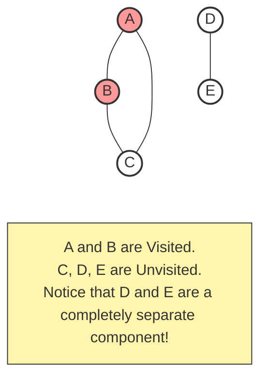
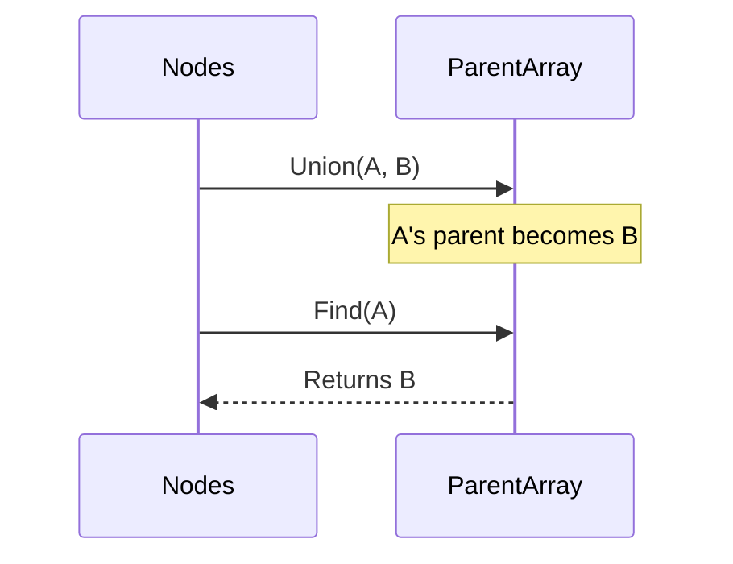

# Pattern 13: Graphs

## 👶 Explain Like I'm 5
Imagine you are exploring a giant city using a map.
The city has buildings (Nodes), and roads connecting those buildings (Edges).
Unlike a family tree, which always flows from top to bottom without crossing over, 
a city is chaotic!
A road can go from Building A to Building B, but another road can go from Building B 
right back to Building A! This is called a **Cycle**.
If you try to explore the city without a plan, you might just walk back and forth 
between A and B forever.
To prevent this, you carry a magical red marker.
Every time you enter a building, you put a big red "X" on the door.
If you ever walk down a road and see a building that already has a red "X" on it, 
you say "I've already been here!" and turn around.
This red "X" is called a **Visited Set**.

---

## 🧩 Core Idea & Pattern Detection

Graphs are just Trees with Cycles and multiple interconnected components. 
You can traverse them using **DFS** (Recursion) or **BFS** (Queue), but you MUST maintain a `visited` set to avoid infinite loops.

### When to use it:
- The problem asks about "Connected Components" (e.g. Number of Islands/Provinces).
- The problem involves scheduling or dependencies (e.g. "Course B requires Course A"). This usually requires **Topological Sort**.
- The problem asks about connecting nodes or finding redundant edges (e.g. **Union Find**).



---

## 🔧 Algorithmic Anatomy

### Concept 1: The Adjacency List
Before traversing a graph, you often need to build it. We use a Hash Map where the Key is a node, and the Value is a list of its neighbors.
```python
graph = {i: [] for i in range(num_nodes)}
for u, v in edges:
    graph[u].append(v)
    graph[v].append(u) # Only if undirected!
```

### Concept 2: Traversal with a Visited Set (DFS)
```python
def dfs(node):
    if node in visited:
        return
    visited.add(node)
    for neighbor in graph[node]:
        dfs(neighbor)
```

### Concept 3: Union Find (Disjoint Set)
Used to instantly check if two nodes are already connected, or to detect cycles in an undirected graph.


---

## 🛑 Per-Variant DOs and DON'Ts

| Variant | DO | DON'T |
|---------|----|-------|
| **DFS/BFS Traversal** | **DO** add nodes to the `visited` set immediately when you push them to the Queue or enter the DFS function. | **DON'T** forget that a Graph might be disconnected! You often need an outer `for` loop over all nodes to ensure you visit every component. |
| **Topological Sort** | **DO** count the "in-degree" (number of incoming edges) for every node. Start with nodes that have an `in-degree` of 0. | **DON'T** use a standard `visited` set for Cycle Detection in directed graphs; you need a `path_visited` set to track the CURRENT path! |
| **Union Find** | **DO** use Path Compression in your `find` function (`parent[x] = find(parent[x])`) to keep the tree flat. | **DON'T** forget to initialize the parent array such that every node is its own parent at the start (`parent = {i: i}`). |

---

## ⏱️ Complexity Analysis

| Aspect | Complexity | Why |
|--------|-----------|-----|
| **Time** | **O(V + E)** | We visit every Vertex (Node) and traverse every Edge exactly once. |
| **Space** | **O(V + E)** | Storing the Adjacency List takes V + E space. The `visited` set takes O(V). |

---

## ⚠️ Common Pitfalls

1. **Infinite Loops:** If you forget your `visited` set, or forget to add nodes to it, a cycle like `A -> B -> A` will run until the computer crashes with a Stack Overflow.
2. **Disconnected Graphs:** In Trees, starting from the Root guarantees you can reach every node. In Graphs, nodes might be isolated islands! Always wrap your traversal in an outer loop: `for node in range(n): if node not in visited: dfs(node)`.
3. **Directed vs Undirected:** When building your Adjacency List, pay close attention to the problem description. If the road is one-way, only `graph[u].append(v)`. If it's two-way, you MUST also `graph[v].append(u)`.

---

## ✅ Problems in This Pattern

| # | Problem | Difficulty | Key Twist |
|---|---------|------------|-----------|
| 1 | Number of Provinces | Medium | Finding the number of disconnected components. |
| 2 | Clone Graph | Medium | Deep copy using a Hash Map `old_to_new`. |
| 3 | Course Schedule | Medium | Topological Sort / Cycle Detection in a directed graph. |
| 4 | Redundant Connection | Medium | Union Find to detect the exact edge that forms a cycle. |
| 5 | Minimum Height Trees | Hard | **Advanced**: Topological Sort from the LEAVES inward. |
