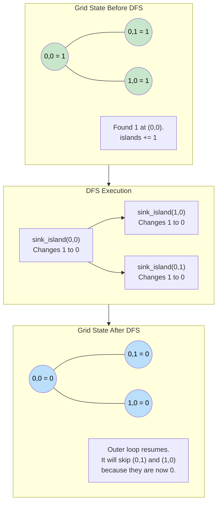

# 🚶‍♂️ Walkthrough: Number of Islands

## 👶 Explain Like I'm 5
You are flying a helicopter over an ocean looking at a giant grid.
Some squares are Water (`'0'`), some are Land (`'1'`).
If you see Land touching other Land (Up, Down, Left, or Right), they form a single Island.
Your job is to count exactly how many Islands there are.

How do you make sure you don't count the same big island 5 times?
When you spot a piece of Land, you say *"I found an Island! +1"*. 
Then, you drop a massive Paint Bucket of Water on that square. The water magically spreads to all the connected Land squares, turning the ENTIRE island into Water (`'0'`).
Now you can keep flying and scanning the grid. If you see a `'1'` again, you know for a fact it's a BRAND NEW island!

## 🎯 Core Strategy
This is the foundational **Matrix Traversal** pattern using **Depth First Search (DFS)**. 

1. **State Tracking**: Keep track of `islands = 0`.
2. **Recursive DFS Helper**: `sink_island(r, c)`
   - **Base Cases**: If the row `r` or column `c` is out of bounds (off the grid), OR if the current square is water (`'0'`), just `return` and do nothing.
   - **Sink it**: Change the current land square to water (`grid[r][c] = '0'`). This acts as our "visited" set! By mutating the grid, we save memory.
   - **Explore**: Recursively call `sink_island` in all 4 directions (Up, Down, Left, Right).
3. **Outer Loop**: Loop through every single row and column in the grid.
   - If `grid[r][c] == '1'`:
     - We found a new, unexplored island! `islands += 1`.
     - Call `sink_island(r, c)` to sink the entire island so we don't count it again.
4. Return `islands`.

## 🏃‍♂️ Step-by-Step Execution (Dry Run)
**Example Input**:
```text
  0 1 2 3
0 1 1 0 0
1 1 0 0 1
2 0 0 1 1
```

### 1. Outer Loop Scans
- `(0, 0)`: It's a `'1'`! 
  - `islands += 1` (Now `1`).
  - Call `sink_island(0, 0)`.

### 2. DFS Sinks the Island
- **`sink_island(0, 0)`**: 
  - Change to `'0'`.
  - Recurse UP: Out of bounds. Returns.
  - Recurse DOWN `(1, 0)`: It's a `'1'`. Change to `'0'`.
    - Recursion continues from `(1, 0)`, checking all 4 sides. It hits water or out-of-bounds everywhere, and returns.
  - Recurse LEFT: Out of bounds. Returns.
  - Recurse RIGHT `(0, 1)`: It's a `'1'`. Change to `'0'`.
    - Recursion continues from `(0, 1)`. All sides are water or bounds. Returns.
- DFS finishes. The top-left island is completely gone!

**Grid is now**:
```text
  0 1 2 3
0 0 0 0 0
1 0 0 0 1
2 0 0 1 1
```

### 3. Outer Loop Continues
- `(0, 1)`, `(0, 2)`, `(0, 3)`, `(1, 0)`, `(1, 1)`, `(1, 2)`: All are `'0'`. Skip.
- `(1, 3)`: It's a `'1'`!
  - `islands += 1` (Now `2`).
  - Call `sink_island(1, 3)`.
  - DFS sinks `(1, 3)`, then recurse DOWN to `(2, 3)` and sinks it, then LEFT to `(2, 2)` and sinks it.
- DFS finishes.

**Grid is now**:
```text
  0 1 2 3
0 0 0 0 0
1 0 0 0 0
2 0 0 0 0
```

### 4. Finish
- Outer loop finishes checking the remaining squares (all `'0'`).
- Return `islands` (which is `2`).

## 📊 Visual Diagram
Here is how the DFS spreads out to sink the island, preventing double counting:



## 🛑 Edge Cases & Complexity

### Complexity
- **Time Complexity:** $O(M \times N)$ where $M$ is the number of rows and $N$ is the number of columns. The outer loop visits every cell once. The DFS visits cells, but since it immediately changes them to `'0'`, no cell is processed by the DFS logic more than once.
- **Space Complexity:** $O(M \times N)$. In the worst-case scenario (the entire grid is filled with `'1'`s), the DFS will go in a continuous snake-like pattern, and the recursion stack will grow to $M \times N$ deep before it starts returning.

### Edge Cases Handled Safely
- **Empty Grid:** Handled at the top: `if not grid: return 0`.
- **All Water:** Outer loop runs, never triggers the `if grid[r][c] == '1':` block. Returns `0`.
- **Single Cell Grid (`[["1"]]`):** Outer loop finds it, calls DFS. DFS sinks it, recursion base cases catch all 4 directions as out of bounds, DFS ends. Returns `1`.
