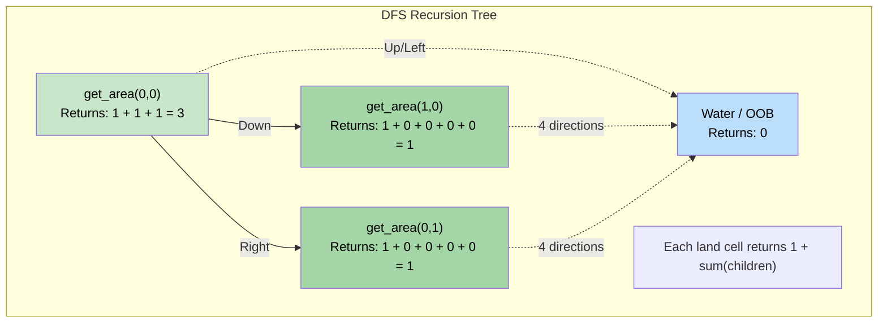

# 🚶‍♂️ Walkthrough: Max Area of Island

## 👶 Explain Like I'm 5
We are back in our helicopter looking at our grid of Water (`0`) and Land (`1`), but this time we don't just care about HOW MANY islands there are, we want to find the **BIGGEST** island.

When we drop our Paint Bucket of Water on an island, we want to measure exactly how much Land we painted over before it sank.
To do this, every time the paint touches a square of Land, that square shouts "1!"
Then, it asks its neighbors (Up, Down, Left, Right) to shout their numbers, and it adds them all together.
So if I touch a piece of Land, and its left neighbor is size 2, and its right neighbor is size 1, my total size is `1 (me) + 2 (left) + 1 (right) = 4`.

We keep track of the biggest size we've seen so far as we scan the grid.

## 🎯 Core Strategy
This builds on the exact same **Matrix DFS** pattern used to count islands, with one key change: the DFS function now *returns* a value (the area) instead of just sinking the island silently.

1. **State Tracking**: Initialize `max_area = 0`.
2. **Recursive DFS Helper**: `get_island_area(r, c)`
   - **Base Cases**: If out of bounds, OR if the cell is Water (`0`), return `0`. (This contributes 0 to the total area).
   - **Sink it**: Mark `grid[r][c] = 0` so we don't count it twice!
   - **Calculate Area**: Recursively ask all 4 directions for their area.
   - **Return**: `1 (for the current cell) + Up + Down + Left + Right`.
3. **Outer Loop**: Loop through every single row and column.
   - If `grid[r][c] == 1`:
     - We found a new island! Calculate its area: `current_area = get_island_area(r, c)`.
     - Update our record: `max_area = max(max_area, current_area)`.
4. Return `max_area`.

## 🏃‍♂️ Step-by-Step Execution (Dry Run)
**Example Input**:
```text
  0 1 2 3
0 1 1 0 0
1 1 0 0 1
2 0 0 1 1
```

### 1. Outer Loop Scans
- `(0, 0)` is a `1`! Call `get_island_area(0, 0)`.

### 2. DFS Calculates Area
- **`get_island_area(0, 0)`**:
  - Sink `(0, 0)` -> `0`.
  - Up: `0` (Out of bounds)
  - Down `(1, 0)`: It's a `1`! Call `get_island_area(1, 0)`.
    - Sink `(1, 0)` -> `0`.
    - Up `(0, 0)`: It's now `0` (Water)! Returns `0`.
    - Down: Returns `0`. Left: Returns `0`. Right: Returns `0`.
    - `(1, 0)` returns `1 + 0 + 0 + 0 + 0 = 1`.
  - Left: Returns `0`.
  - Right `(0, 1)`: It's a `1`! Call `get_island_area(0, 1)`.
    - Sink `(0, 1)` -> `0`.
    - All valid directions return `0`. 
    - `(0, 1)` returns `1`.
  - Total for `(0, 0)`: `1 (self) + 0 (Up) + 1 (Down) + 0 (Left) + 1 (Right) = 3`.
- Returns `3`. 
- `max_area` becomes `max(0, 3) = 3`.

### 3. Outer Loop Continues
- Grid is now:
```text
  0 1 2 3
0 0 0 0 0
1 0 0 0 1
2 0 0 1 1
```
- Scans until `(1, 3)`, which is a `1`.
- `get_island_area(1, 3)` sinks `(1, 3)`, `(2, 3)`, and `(2, 2)`.
- It returns `1 + 1 + 1 = 3`.
- `max_area = max(3, 3) = 3`.

Returns `max_area` of `3`.

## 📊 Visual Diagram
Here is how the recursion unrolls and adds up the area from the leaves of the DFS back to the root:



## 🛑 Edge Cases & Complexity

### Complexity
- **Time Complexity:** $O(M \times N)$. Same as Number of Islands. We visit every cell in the grid, and we sink islands immediately, ensuring no cell is processed by the heavy DFS logic more than once.
- **Space Complexity:** $O(M \times N)$ for the recursion stack in the worst-case scenario (e.g., a massive snake-shaped island covering the entire grid).

### Edge Cases Handled Safely
- **All Water Grid:** Outer loop never finds a `1`. `max_area` remains `0`. Returns `0`. Correct.
- **Single Cell Island (`[[1]]`):** Outer loop finds it. DFS triggers. Base cases return `0` for all 4 directions. Returns `1 + 0 + 0 + 0 + 0 = 1`. `max_area` becomes `1`. Correct.
- **Mutating the Grid:** Note that we destroy the original grid by mutating it. In an interview, it's worth mentioning: *"I am modifying the input array to save $O(M \times N)$ space. If we need to preserve the original grid, I would use a `visited` set."*
