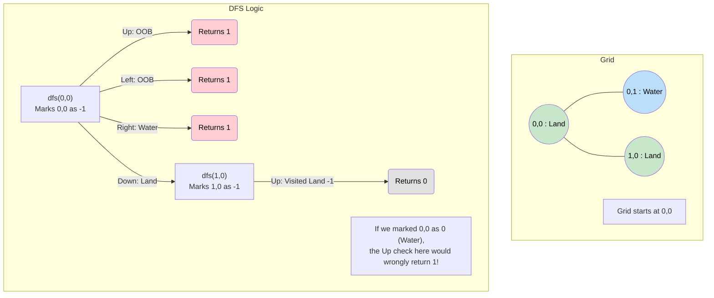

# 🚶‍♂️ Walkthrough: Island Perimeter

## 👶 Explain Like I'm 5
You are building a fence around an island.
If a piece of land touches another piece of land, you don't need a fence there.
You ONLY need a fence if the land touches the Water, OR if it touches the edge of the map!

So, you walk around the island. Every time you are standing on Land, you look in all 4 directions.
- If you look Left and see Water: *"+1 to the fence!"*
- If you look Right and see the edge of the map: *"+1 to the fence!"*
- If you look Up and see Land, you say: *"Oh, no fence needed here,"* but you still step onto that new land to keep exploring.

## 🎯 Core Strategy
This uses a **Matrix DFS** where the base cases return the value we want to sum up (the perimeter segments). 

1. **State Tracking**: We need a way to mark visited land so we don't count it infinitely. In previous problems, we changed Land (`1`) to Water (`0`). We CANNOT do that here! If we change visited Land to Water, the next piece of Land will see that Water and think it needs a fence there! Instead, we change visited Land to a special marker like `-1`.
2. **Recursive DFS Helper `dfs(r, c)`**:
   - **Base Case 1 (Boundary/Water)**: If we go out of bounds, or hit Water (`0`), we have found a border! **Return `1`** (one segment of fence).
   - **Base Case 2 (Visited Land)**: If we hit `-1`, it's just land we've already explored. We don't need a fence between two pieces of land. **Return `0`**.
   - **Action**: Mark the current cell as visited: `grid[r][c] = -1`.
   - **Recurse & Sum**: Return the sum of calling DFS in all 4 directions.
3. **Trigger**: Because the problem guarantees there is exactly ONE island, we just loop through the grid. The very first time we see a `1`, we call `return dfs(r, c)` and we are completely done.

## 🏃‍♂️ Step-by-Step Execution (Dry Run)
**Example Input**:
```text
  0 1
0 1 0
1 1 1
```

### 1. Find the Island
- Outer loop finds `1` at `(0, 0)`.
- Call `dfs(0, 0)`.

### 2. DFS Execution
- **`dfs(0, 0)`**:
  - Mark `grid[0][0] = -1`.
  - **Up**: Out of bounds. Returns `1`.
  - **Left**: Out of bounds. Returns `1`.
  - **Right `(0, 1)`**: It's Water (`0`). Returns `1`.
  - **Down `(1, 0)`**: It's Land (`1`)! Recurse to `dfs(1, 0)`.
    - **`dfs(1, 0)`**:
      - Mark `grid[1][0] = -1`.
      - **Up `(0, 0)`**: It's `-1` (Visited Land). Returns `0`.
      - **Left**: Out of bounds. Returns `1`.
      - **Down**: Out of bounds. Returns `1`.
      - **Right `(1, 1)`**: It's Land (`1`)! Recurse to `dfs(1, 1)`.
        - **`dfs(1, 1)`**:
          - Mark `grid[1][1] = -1`.
          - **Up `(0, 1)`**: Water (`0`). Returns `1`.
          - **Right**: Out of bounds. Returns `1`.
          - **Down**: Out of bounds. Returns `1`.
          - **Left `(1, 0)`**: `-1` (Visited Land). Returns `0`.
          - `dfs(1, 1)` returns $1 + 1 + 1 + 0 = 3$.
      - `dfs(1, 0)` returns $0 + 1 + 1 + 3 = 5$.
  - `dfs(0, 0)` returns $1 + 1 + 1 + 5 = 8$.

Return `8`. 
*(Verify visually: A 3-block L-shape has 8 outer edges!)*

## 📊 Visual Diagram
Here is how the recursion correctly counts fences only when hitting water or boundaries, while returning 0 when hitting previously explored land:



## 🛑 Edge Cases & Complexity

### Complexity
- **Time Complexity:** $O(M \times N)$ where $M$ is rows and $N$ is columns. We scan the grid to find the island. Once found, the DFS visits each land cell exactly once, and checks its 4 neighbors. Total time is proportional to the size of the grid.
- **Space Complexity:** $O(M \times N)$ for the DFS recursion stack. The maximum depth of the recursion is the total number of land cells on the island.

### Edge Cases Handled Safely
- **Single Cell Island:** Grid is `[[1]]`. `dfs(0, 0)` runs. All 4 directions go out of bounds and return `1`. Returns `4`. Correct!
- **Grid Full of Land:** The outer boundaries return `1`, but all internal neighbor checks return `0` (because they hit `-1`). The total perimeter matches the rectangular boundary perfectly.
- **Iterative Approach Alternative:** While DFS is elegant, this problem can also be solved iteratively without DFS in $O(M \times N)$ time and $O(1)$ space. You just loop over every cell. If it's a `1`, add 4 to the perimeter, then check if it has a land neighbor to the Left (subtract 2) or Up (subtract 2). We stick with DFS here to reinforce the Matrix Traversal pattern!
