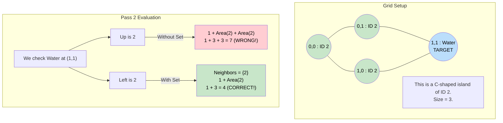

# 🚶‍♂️ Walkthrough: Making A Large Island

## 👶 Explain Like I'm 5
You are a powerful wizard. You have the ability to turn exactly ONE square of Water (`0`) into Land (`1`). Your goal is to use this power to create the **BIGGEST** possible island.

If you just randomly try turning every single `0` into a `1` and recounting all the islands from scratch, it will take way too long (it's way too slow!). Instead, we do this intelligently in two steps.

**Step 1 (The Surveyor):**
You explore every island. But instead of just sinking them, you paint them a unique color (give them an ID: 2, 3, 4...) and you write down their sizes in a Magical Notebook (Hash Map).
*"Island ID 2 has size 10."*
*"Island ID 3 has size 5."*

**Step 2 (The Wizard):**
Now you look at every single square of Water (`0`).
You ask: *"If I turn this into Land, which islands will I connect?"*
You look Up, Down, Left, and Right. 
Maybe Up is Island 2, and Left is Island 3. You just check your Notebook! 
`New Size = 1 (my new square) + Size of Island 2 + Size of Island 3`.
`New Size = 1 + 10 + 5 = 16!`
You do this math for every Water square, and you just remember the biggest number.

## 🎯 Core Strategy
This is a Two-Pass pattern that combines **Matrix DFS** with a **Hash Map** to store metadata about the grid.

1. **State Tracking**: 
   - `current_island_id = 2` (Start at 2 because 0 is Water and 1 is Unvisited Land).
   - `island_areas = {0: 0}` (Hash Map to store `ID -> Area`. We define Area of water as 0).
2. **DFS Helper `dfs(r, c, island_id)`**:
   - Standard Area DFS. Base cases out of bounds or `!= 1`.
   - **Action**: Mark the cell with its new ID: `grid[r][c] = island_id`.
   - Returns $1 + \text{sum of 4 directions}$.
3. **Pass 1 (Surveyor)**:
   - Scan grid. If `grid[r][c] == 1`, we found an unvisited island!
   - `area = dfs(r, c, current_island_id)`
   - `island_areas[current_island_id] = area`
   - `current_island_id += 1`
4. **Pass 2 (Wizard)**:
   - Set `max_possible_area` to the largest existing island (just in case the grid is entirely `1`s and we can't flip anything).
   - Scan grid. If `grid[r][c] == 0`:
     - Look at 4 neighbors. Put their `island_id`s into a `set()`. **CRITICAL**: A set ensures we don't double count if an island wraps around and touches the 0 from two different sides!
     - Calculate potential area: $1 + \sum(\text{island\_areas}[id] \text{ for id in unique\_neighbor\_ids})$.
     - Update `max_possible_area = max(max_possible_area, potential_area)`.
5. Return `max_possible_area`.

## 🏃‍♂️ Step-by-Step Execution (Dry Run)
**Example Input**:
```text
  0 1
0 1 0
1 0 1
```

### Pass 1: Surveyor
- `(0, 0)` is `1`. 
  - Call `dfs(0, 0, id=2)`. Area is `1`.
  - Grid becomes `2`.
  - `island_areas = {0: 0, 2: 1}`
- `(1, 1)` is `1`.
  - Call `dfs(1, 1, id=3)`. Area is `1`.
  - Grid becomes `3`.
  - `island_areas = {0: 0, 2: 1, 3: 1}`

**Grid is now:**
```text
  0 1
0 2 0
1 0 3
```

### Pass 2: Wizard
- `max_possible_area = max(0, 1, 1) = 1`.
- Check Water at `(0, 1)`:
  - Up: Out. Down: `3`. Left: `2`. Right: Out.
  - Neighbor IDs set: `{2, 3}`.
  - Area = $1 \text{ (self)} + \text{Area}(2) + \text{Area}(3) = 1 + 1 + 1 = 3$.
  - `max_possible_area = 3`.
- Check Water at `(1, 0)`:
  - Up: `2`. Down: Out. Left: Out. Right: `3`.
  - Neighbor IDs set: `{2, 3}`.
  - Area = $1 + 1 + 1 = 3$.

Return `3`.

## 📊 Visual Diagram
Here is why using a `set()` to find unique neighbors is absolutely critical in Pass 2:



## 🛑 Edge Cases & Complexity

### Complexity
- **Time Complexity:** $O(M \times N)$ where $M$ is rows and $N$ is cols. Pass 1 visits every cell and edge exactly once. Pass 2 visits every Water cell and does $O(1)$ Hash Map lookups for its 4 neighbors.
- **Space Complexity:** $O(M \times N)$ for the DFS recursion stack in Pass 1, and for the `island_areas` Hash Map (which could contain up to $(M \times N) / 2$ entries if the grid is a checkerboard of tiny islands).

### Edge Cases Handled Safely
- **All Land Grid:** Pass 1 surveys it all as ID 2, Area $M \times N$. Pass 2 never triggers because there are no `0`s. At the end, it returns `max_possible_area` which we initialized to the biggest island size!
- **All Water Grid:** Pass 1 does nothing. `island_areas = {0: 0}`. `max_possible_area = 0`. Pass 2 checks every Water cell, neighbors are all `0` (or out of bounds). Area = $1 + 0 = 1$. Returns `1`. Correct (we can flip one `0` to a `1`).
