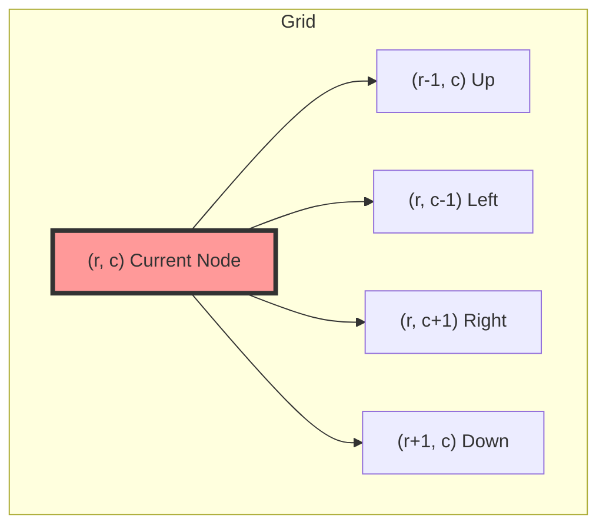

# Pattern 14: Island (Matrix Traversal)

## 👶 Explain Like I'm 5
Imagine you have a giant piece of graph paper. 
Some squares are colored Blue (Water / 0), and some are colored Green (Land / 1).
If Green squares are touching each other (up, down, left, right), they form an Island!
How do you count the islands?
You scan the paper starting from the top-left corner.
When you see a Green square, you just found a new island!
But to make sure you don't count the SAME island twice, you have to "sink" it.
You take a bucket of Blue paint (DFS or BFS), and you pour it on the Green square. 
The paint spreads to all touching Green squares, turning the ENTIRE island Blue.
Then, you keep scanning the paper for the next piece of Green land!

---

## 🧩 Core Idea & Pattern Detection

Matrix Traversal is just a Graph Traversal where every cell is a Node, and it has up to 4 neighbors (Up, Down, Left, Right). 
We use **DFS** (or BFS) to explore connected components (islands).

### When to use it:
- The problem provides a 2D matrix (Grid).
- The problem asks you to find, count, or modify "connected components" (Islands, Regions, Shapes).
- The elements are binary (e.g., `0` and `1`, or `Water` and `Land`).



---

## 🔧 Algorithmic Anatomy

### Recipe: Standard Matrix DFS (The "Paint Bucket")
1. **Iterate**: Loop through every row `r` and column `c` in the matrix.
2. **Find Land**: If `matrix[r][c] == '1'`, you found an island! Increment your count, and call `dfs(r, c)`.
3. **The DFS Function**:
   - **Base Cases (Bounds Check)**: If `r` or `c` are out of bounds (less than 0, or greater than length), RETURN.
   - **Base Case (Water Check)**: If `matrix[r][c] == '0'`, RETURN.
   - **Sink it**: Mark the current cell as visited (usually by mutating it to `'0'`).
   - **Explore**: Recursively call DFS on the 4 neighbors:
     - `dfs(r - 1, c)` (Up)
     - `dfs(r + 1, c)` (Down)
     - `dfs(r, c - 1)` (Left)
     - `dfs(r, c + 1)` (Right)

```python
def dfs(r, c):
    if r < 0 or r >= ROWS or c < 0 or c >= COLS or grid[r][c] == '0':
        return
    
    # Sink the island
    grid[r][c] = '0'
    
    dfs(r - 1, c) # Up
    dfs(r + 1, c) # Down
    dfs(r, c - 1) # Left
    dfs(r, c + 1) # Right
```

---

## 🛑 Per-Variant DOs and DON'Ts

| Variant | DO | DON'T |
|---------|----|-------|
| **Counting Islands** | **DO** mutate the input grid (`grid[r][c] = '0'`) if allowed, to save O(N*M) space on a `visited` set. | **DON'T** forget to check boundary conditions (`r < 0` or `r >= ROWS`) BEFORE accessing the grid, otherwise you'll get an `IndexError`! |
| **Closed Islands** | **DO** run a preliminary loop around the **borders** (top, bottom, left, right edges) of the matrix to sink any islands touching the edge first! | **DON'T** try to check edge-touching during the main DFS loop; it makes the logic incredibly messy. Sink the borders first, then just count what's left. |
| **Max Area / Perimeter** | **DO** have your DFS function `return` a number (e.g. `1 + dfs(up) + dfs(down)...`) so you can sum up the size. | **DON'T** use global variables for counting if you can avoid it. Returning the aggregated sum is cleaner and less error-prone. |

---

## ⏱️ Complexity Analysis

| Aspect | Complexity | Why |
|--------|-----------|-----|
| **Time** | **O(M * N)** | `M` is rows, `N` is columns. We visit every cell in the matrix a constant number of times. |
| **Space** | **O(M * N)** | In the absolute worst case (the entire matrix is one giant island), the DFS recursion Call Stack will grow to M*N deep. (If using BFS, the queue takes O(min(M, N))). |

---

## ⚠️ Common Pitfalls

1. **IndexOutofBounds / IndexError:** Python allows negative indexing (`grid[-1][-1]`), which means if your `r` or `c` goes to `-1`, Python will silently wrap around to the other side of the matrix instead of throwing an error! You MUST explicitly check `r < 0` and `c < 0`.
2. **Infinite Loops (Stack Overflow):** If you forget to mark a cell as visited (or "sink" it to water) BEFORE calling DFS on its neighbors, the cells will bounce back and forth recursively forever.
3. **Diagonals:** Read the problem carefully. Most problems only allow 4 directions (Up, Down, Left, Right). A few rare ones allow 8 directions (including diagonals).

---

## ✅ Problems in This Pattern

| # | Problem | Difficulty | Key Twist |
|---|---------|------------|-----------|
| 1 | Number of Islands | Medium | Classic Matrix DFS. Mutate `1` to `0` to avoid a visited set. |
| 2 | Max Area of Island | Medium | DFS returns the size of the island: `1 + left + right + up + down`. |
| 3 | Flood Fill | Easy | Like the Paint Bucket tool. Only fill matching starting colors. |
| 4 | Number of Closed Islands | Medium | A 2-pass approach. Pass 1: Sink edges. Pass 2: Count the rest. |
| 5 | Island Perimeter | Easy | Count +1 for every out-of-bounds or water edge you touch. |
| 6 | Making A Large Island | Hard | **Advanced**: Paint each island with a unique ID, store their areas in a Hash Map, then test flipping each `0`. |
