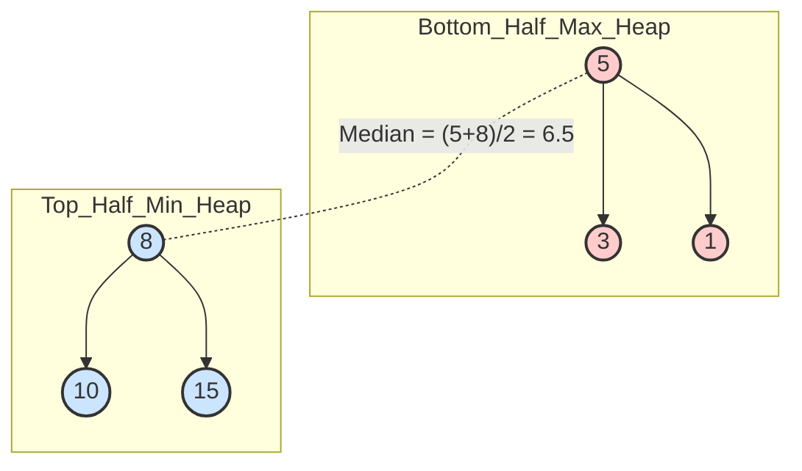

# Pattern 15: Two Heaps

## 👶 Explain Like I'm 5
Imagine you have a giant bag of test scores, and you want to instantly know 
what the exact middle score is (the Median).
If you sort the whole bag every time a new score comes in, it takes forever!
Instead, you buy two magical sorting hats (Heaps).
One hat is for the "Bottom Half" of the scores. It always hands you the BIGGEST 
number in that half (Max Heap).
The other hat is for the "Top Half" of the scores. It always hands you the 
SMALLEST number in that half (Min Heap).
If both hats have the same number of scores in them, the true Median is just 
the two numbers they hand you, added together and divided by 2!
To keep the magic working, you just have to make sure the hats always have 
almost the exact same number of scores in them (balance them).

---

## 🧩 Core Idea & Pattern Detection

The Two Heaps pattern uses two Priority Queues to constantly divide a dataset into two halves. 
This allows us to find the Median (or maximize capital/profit combinations) in **O(1)** time while inserting new elements in **O(log N)** time.

### When to use it:
- The problem asks you to find the **Median** of a stream of numbers.
- The problem requires tracking the middle of a sliding window.
- The problem involves scheduling or optimizing based on two distinct properties (e.g., Cost vs. Profit in "Maximize Capital").



---

## 🔧 Algorithmic Anatomy

### Concept 1: The Max Heap in Python
Python's `heapq` module only provides a Min Heap out of the box. 
To create a Max Heap, we simply multiply all numbers by `-1` before pushing them in, and multiply by `-1` again when popping them out!

### Concept 2: The Balancing Act (For Median Finding)
1. **Insert**: Always push to the Max Heap (Bottom Half) first.
2. **Transfer**: Immediately pop the largest element from the Max Heap and push it to the Min Heap (Top Half). This ensures the Top Half only gets the biggest numbers.
3. **Rebalance**: If the Min Heap becomes larger than the Max Heap, pop the smallest element from the Min Heap and give it back to the Max Heap. (We usually want the Max Heap to hold the middle element if the total count is odd).

```python
import heapq

def add_num(num):
    # Python uses Min Heaps, so we push -num for a Max Heap
    heapq.heappush(max_heap, -num)
    
    # Transfer the largest of the bottom half to the top half
    largest_bottom = -heapq.heappop(max_heap)
    heapq.heappush(min_heap, largest_bottom)
    
    # Rebalance: We want max_heap to be equal size or 1 larger
    if len(min_heap) > len(max_heap):
        smallest_top = heapq.heappop(min_heap)
        heapq.heappush(max_heap, -smallest_top)
```

---

## 🛑 Per-Variant DOs and DON'Ts

| Variant | DO | DON'T |
|---------|----|-------|
| **Median Finding** | **DO** explicitly manage the Python `-1` multiplication. Wrap it in helper functions if it gets confusing. | **DON'T** try to manually sort an array for every new number. `O(N log N)` insertion is too slow. Heaps give `O(log N)`. |
| **Sliding Window** | **DO** keep a Hash Map (or a simple list deletion mechanism) to track numbers that fall out of the window, because `heapq` cannot easily delete specific elements in O(1) time. | **DON'T** call `.remove()` on the underlying heap list. It takes O(N) time and ruins the heap property! |
| **Maximize Capital** | **DO** use a Min Heap for sorting Projects by Cost, and a Max Heap for sorting available Projects by Profit. | **DON'T** try to solve it with greedy arrays. You need to dynamically shift projects from the "Unattainable" list to the "Attainable" list as your capital grows. |

---

## ⏱️ Complexity Analysis

| Aspect | Complexity | Why |
|--------|-----------|-----|
| **Time (Insert)** | **O(log N)** | Pushing and popping from a heap takes logarithmic time. |
| **Time (Find Median)** | **O(1)** | We just look at the top element of the heaps (`max_heap[0]` and `min_heap[0]`). |
| **Space** | **O(N)** | The heaps store all N numbers. |

---

## ⚠️ Common Pitfalls

1. **Python Max Heaps:** Forgetting to multiply by `-1` when reading `max_heap[0]`. If you just read `max_heap[0]`, you will get a negative number! Read `-max_heap[0]`.
2. **Improper Balancing:** If you just push to the Max Heap, and only transfer to the Min Heap when the Max Heap is too big, you might accidentally put a massive number (like 1,000,000) into the Bottom Half! You MUST always transfer the element over to verify it belongs there, and then rebalance.

---

## ✅ Problems in This Pattern

| # | Problem | Difficulty | Key Twist |
|---|---------|------------|-----------|
| 1 | Find the Median | Medium | The classic Two Heaps pattern. |
| 2 | Sliding Window Median | Hard | Removing numbers from the heap lazily. |
| 3 | Maximize Capital | Hard | **Advanced**: Min Heap for Costs, Max Heap for Profits. |
| 4 | Next Interval | Hard | **Advanced**: Max Heap for Start Times, Max Heap for End Times. |
