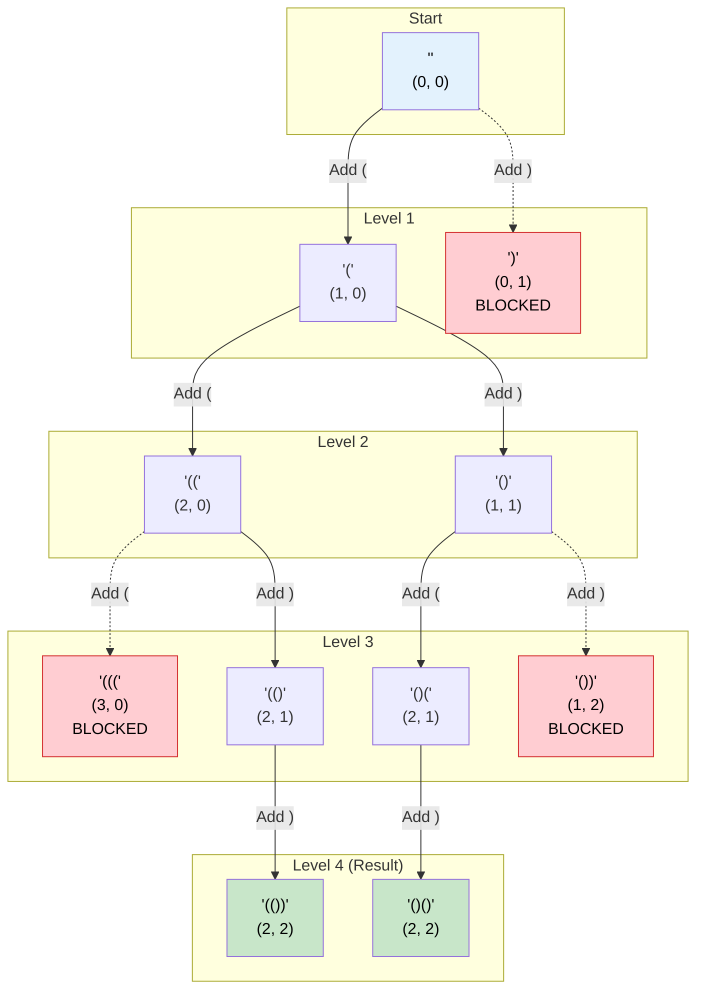

# 🚶‍♂️ Walkthrough: Balanced Parentheses

## 👶 Explain Like I'm 5
You are given a number `n`. You need to create all possible strings that use exactly `n` open parentheses `(` and `n` close parentheses `)`.
BUT, they must be "balanced"! 
Balanced means you can never have more close parentheses than open parentheses at any point while reading from left to right.
For example, `)(` is illegal because you closed it before you opened it!

We start with an empty string: `""`.
- We can only add a `(` if we haven't used all `n` of them yet.
- We can only add a `)` if we currently have MORE open ones than close ones!

Let's use a Queue (BFS).
We start the queue with a bundle: `(current_string, open_count, close_count)`.
Start: `("", 0, 0)`
Pop it. Can we add `(`? Yes ($0 < 3$). Push `("(", 1, 0)`.
Pop `("(", 1, 0)`. 
- Can we add `(`? Yes ($1 < 3$). Push `("((", 2, 0)`.
- Can we add `)`? Yes ($0 < 1$). Push `("()", 1, 1)`.

Keep doing this until `open_count == n` AND `close_count == n`. Then we have a finished, balanced string!

## 🎯 Core Strategy
This uses the **Subsets (BFS)** pattern with a Queue, but we selectively branch instead of blindly copying.

1. **Initialization**: Initialize `result = []`. Initialize `queue = deque([("", 0, 0)])`. The tuple stores the current string, the number of open parentheses used, and the number of closed parentheses used.
2. **BFS Loop**: Loop while `queue` is not empty.
   - Pop the state: `s, open_count, close_count = queue.popleft()`.
   - **Base Case (Success)**: If `open_count == n` and `close_count == n`, we finished a valid string! Append `s` to `result`.
   - **Branch 1 (Add Open)**: If `open_count < n`, we are allowed to add an open parenthesis. 
     - Append `(s + "(", open_count + 1, close_count)` to the queue.
   - **Branch 2 (Add Close)**: If `close_count < open_count`, we have unmatched open parentheses, meaning we are allowed to close one.
     - Append `(s + ")", open_count, close_count + 1)` to the queue.
3. Return `result`.

## 🏃‍♂️ Step-by-Step Execution (Dry Run)
**Input**: `n = 2`

### Initialization
`queue = [("", 0, 0)]`, `result = []`

### Step 1
- Pop `("", 0, 0)`.
- Open allowed? ($0 < 2$) YES. Push `("(", 1, 0)`.
- Close allowed? ($0 < 0$) NO.
- `queue = [("(", 1, 0)]`

### Step 2
- Pop `("(", 1, 0)`.
- Open allowed? ($1 < 2$) YES. Push `("((", 2, 0)`.
- Close allowed? ($0 < 1$) YES. Push `("()", 1, 1)`.
- `queue = [("((", 2, 0), ("()", 1, 1)]`

### Step 3
- Pop `("((", 2, 0)`.
- Open allowed? ($2 < 2$) NO. (We used all opens!)
- Close allowed? ($0 < 2$) YES. Push `("(()", 2, 1)`.
- `queue = [("()", 1, 1), ("(()", 2, 1)]`

### Step 4
- Pop `("()", 1, 1)`.
- Open allowed? ($1 < 2$) YES. Push `("()(", 2, 1)`.
- Close allowed? ($1 < 1$) NO.
- `queue = [("(()", 2, 1), ("()(", 2, 1)]`

### Step 5
- Pop `("(()", 2, 1)`.
- Open allowed? NO. Close allowed? ($1 < 2$) YES. Push `("(())", 2, 2)`.

### Step 6
- Pop `("()(", 2, 1)`.
- Open allowed? NO. Close allowed? YES. Push `("()()", 2, 2)`.
- `queue = [("(())", 2, 2), ("()()", 2, 2)]`

### Final Steps
- Pop `("(())", 2, 2)`. Both are `2`. Append to `result`.
- Pop `("()()", 2, 2)`. Both are `2`. Append to `result`.

Return `["(())", "()()"]`.

## 📊 Visual Diagram
Here is the BFS tree showing the selective branching based on validity rules:

## 🛑 Edge Cases & Complexity

### Complexity
- **Time Complexity:** $O(4^N / \sqrt{N})$. This evaluates to the $N$th Catalan number, which represents the exact mathematical number of valid parenthesization combinations. We don't waste any time generating invalid strings, so the time perfectly bounds to the answer size.
- **Space Complexity:** $O(4^N / \sqrt{N})$. The space required to store all the resulting strings and the queue.

### Edge Cases Handled Safely
- **Smallest Constraints ($n=1$):** `queue` pops `""`, pushes `"("`, pops `"("`, pushes `"()"`, pops `"()"` and returns `["()"]`. Perfect.
- **Why no Backtracking recursion?** This problem is actually more commonly solved with recursive DFS Backtracking. But this BFS iterative Queue approach is highly intuitive and conceptually groups it perfectly within the "Subsets" pattern family where we build strings state by state.
