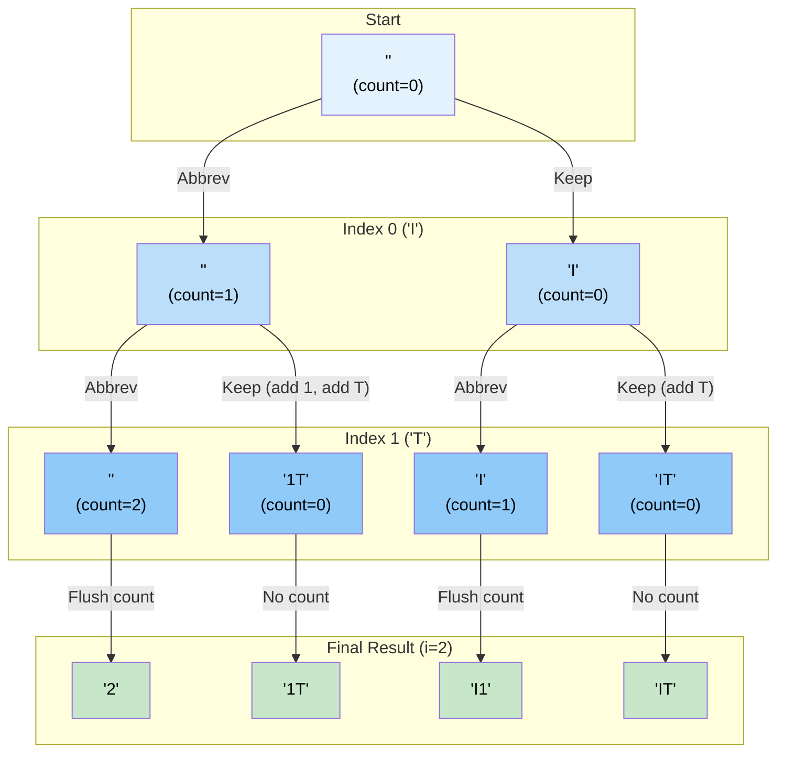

# 🚶‍♂️ Walkthrough: Unique Generalized Abbreviations

## 👶 Explain Like I'm 5
You are given a word, like `"BAT"`.
An abbreviation replaces letters with numbers representing how many letters were skipped.
For example, `"B1T"` skips the `'A'`. `"3"` skips all three letters.
You want to generate EVERY possible abbreviation!

For every single letter in the word, you have exactly two choices:
- **Choice 1**: Keep the letter!
- **Choice 2**: Abbreviate the letter! (Instead of writing the letter, we start counting how many letters we've abbreviated in a row).

We can use a Queue to explore all branches.
We put a bundle in our queue: `(current_string, current_index, abbreviation_count)`.
Start: `("", 0, 0)`

Pop it. The first letter is `'B'`.
- **Branch 1 (Keep 'B')**: We must first write down any existing abbreviations we counted up! Since `abbreviation_count` is 0, we just write `'B'`. Push `("B", index 1, count 0)`.
- **Branch 2 (Abbreviate 'B')**: We don't write anything, we just increment our count! Push `("", index 1, count 1)`.

Pop `("", 1, 1)`. The next letter is `'A'`.
- **Branch 1 (Keep 'A')**: We MUST write down our abbreviation count `1` before writing `'A'`. So the string becomes `"1A"`. Push `("1A", index 2, count 0)`.
- **Branch 2 (Abbreviate 'A')**: We just increment the count! Push `("", index 2, count 2)`.

When we reach the end of the word, if we still have a `count > 0`, we just slap it onto the end of the string!

## 🎯 Core Strategy
This uses the **Subsets (BFS)** pattern with a `Queue` to systematically branch out into all $2^N$ possibilities.

1. **Initialization**: Initialize `result = []` and a queue holding the initial state: `deque([("", 0, 0)])`. 
   - State tuple: `(current_abbreviation, index_in_word, running_abbreviation_count)`
2. **BFS Loop**: Loop while `queue` is not empty.
   - Pop `(s, i, count)`.
   - **Base Case (End of Word)**: If `i == len(word)`:
     - If `count > 0`, we have trailing abbreviated letters. Append `count` to `s`: `s += str(count)`.
     - Append the completed string `s` to `result`.
   - **Branch 1 (Abbreviate)**: We choose to abbreviate `word[i]`.
     - We do NOT add anything to `s`. We just increment `count`.
     - Push `(s, i + 1, count + 1)` to the queue.
   - **Branch 2 (Keep Letter)**: We choose to keep `word[i]`.
     - If `count > 0`, we must write that number into our string FIRST. `new_s = s + str(count)`.
     - Then, append the actual letter: `new_s += word[i]`.
     - Since we kept a letter, the consecutive abbreviation chain is broken. Push `(new_s, i + 1, 0)` to the queue.
3. Return `result`.

## 🏃‍♂️ Step-by-Step Execution (Dry Run)
**Input**: `word = "IT"` (Length 2)

### Initialization
`queue = [("", 0, 0)]`, `result = []`

### Step 1 (Index 0: 'I')
- Pop `("", 0, 0)`.
- **Branch 1 (Abbreviate)**: Count becomes 1. Push `("", 1, 1)`.
- **Branch 2 (Keep)**: Count is 0, so just add 'I'. Push `("I", 1, 0)`.
- `queue = [("", 1, 1), ("I", 1, 0)]`

### Step 2 (Index 1: 'T')
- **Pop `("", 1, 1)`**:
  - **Branch 1 (Abbreviate)**: Count becomes 2. Push `("", 2, 2)`.
  - **Branch 2 (Keep)**: Count is 1, so add '1', then 'T'. String is `"1T"`. Push `("1T", 2, 0)`.
- **Pop `("I", 1, 0)`**:
  - **Branch 1 (Abbreviate)**: Count becomes 1. Push `("I", 2, 1)`.
  - **Branch 2 (Keep)**: Count is 0, add 'T'. String is `"IT"`. Push `("IT", 2, 0)`.
- `queue = [("", 2, 2), ("1T", 2, 0), ("I", 2, 1), ("IT", 2, 0)]`

### Step 3 (Base Cases, i=2)
- Pop `("", 2, 2)`. `i == 2`. `count > 0`, so string becomes `"2"`. Append to result.
- Pop `("1T", 2, 0)`. `i == 2`. `count == 0`. Append `"1T"`.
- Pop `("I", 2, 1)`. `i == 2`. `count > 0`, so string becomes `"I1"`. Append to result.
- Pop `("IT", 2, 0)`. `i == 2`. `count == 0`. Append `"IT"`.

Return `["2", "1T", "I1", "IT"]`.

## 📊 Visual Diagram
Here is how the BFS branches at every single character, creating a perfect binary tree of size $2^N$:

## 🛑 Edge Cases & Complexity

### Complexity
- **Time Complexity:** $O(N \times 2^N)$. A string of length $N$ has $2^N$ possible generalized abbreviations. For each combination, string concatenations take $O(N)$ time.
- **Space Complexity:** $O(N \times 2^N)$. All combinations are stored in the queue and then transferred to the result array.

### Edge Cases Handled Safely
- **Trailing Abbreviations:** The logic `if i == word_len: if count > 0: s += str(count)` is crucial. Without it, the branch that abbreviates every single letter would just output an empty string `""` instead of `"3"` (for a 3-letter word).
- **Empty String:** Returns `[""]`. Handled perfectly because the loop pops `("", 0, 0)`, sees `i == 0 == word_len`, `count=0`, appends `""` to result and finishes.
